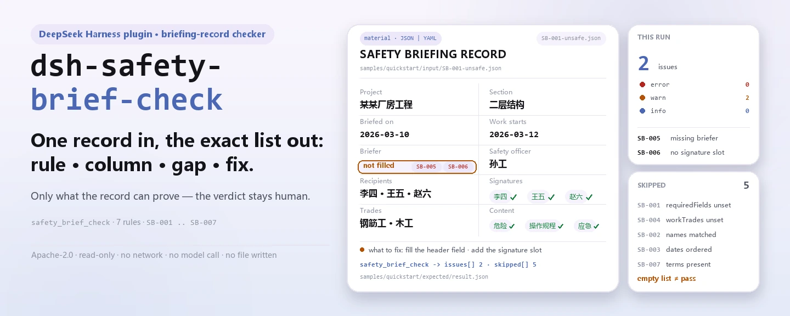

<div align="center">

<picture>
  <source media="(prefers-color-scheme: dark)" srcset="docs/assets/dsh-safety-brief-check-hero-en-dark.webp">
  
</picture>

# dsh-safety-brief-check

**Check one safety technical briefing record and get back the exact "which rule, which column, what differs, how to fix it" list — the verdict stays with the reviewer.**

A briefing-record checker plugin for DeepSeek Harness: it reads one record (header, recipient and signer lists, trade list), applies the versioned rule pack it ships (`SB-001`..`SB-007`), and lists only the differences it can point to inside the material — no compliance verdict, no liability finding, no substitute for the reviewer.

[Install](#three-step-setup) · [Configuration](#configuration) · [FAQ](#faq) · [简体中文](README.md) · [English](README.en.md) · [Español](README.es.md) · [Português](README.pt.md) · [हिन्दी](README.hi.md)

[](LICENSE)
[](#compatibility)
[](https://www.npmjs.com/package/dsh-safety-brief-check)
[](https://github.com/PerryLink/dsh-safety-brief-check/actions/workflows/ci.yml)
[](#compatibility)

[](https://github.com/PerryLink/dsh-safety-brief-check/stargazers)
[](https://www.npmjs.com/package/dsh-safety-brief-check)
[](https://dshfind.com/plugins/PerryLink/dsh-safety-brief-check?ref=badge)
[](https://securityscorecards.dev/viewer/?uri=github.com/PerryLink/dsh-safety-brief-check)
[](https://dsh.market/)
[](https://gitee.com/perrylink/dsh-safety-brief-check)

```sh
dsh plugin --profile <name> add dsh-safety-brief-check
```

</div>

<sub>Community plugin, not affiliated with DeepSeek. Canonical repository: <https://github.com/PerryLink/dsh-safety-brief-check> (Gitee is a mirror).</sub>

## What it is

`dsh-safety-brief-check` reads one **safety technical briefing record** — its header fields, its `recipients` and `signers` lists, and its `trades` list — and checks that record's own completeness and closure: that the columns your form requires are filled, that every recipient appears among the signers and that nobody signs twice, that the briefing date is not later than the work date, that the trades at work appear in the briefed trade list, that the record identifies its work section and its briefer, that it carries a place for the briefer, recipient and full-time safety officer signatures, and that the briefing text touches hazards, operating procedures and emergency measures.

It does not judge whether the briefing content was adequate, whether it targeted the right hazards, whether a signature is genuine, or whether a penalty applies.

- **Who it is for**: safety officers, site foremen, and document controllers; no command line required — hand the material over in chat.
- **What you give it**: the source material the check works on (a table, register or document); the original is never modified. Excel can be converted to JSON/YAML first, in chat if the platform supports it.
- **What it returns**: a "which rule, which column, what differs, how to fix it" list; every check that could not run is listed in `skipped` with its reason.

<picture>
  <source media="(prefers-color-scheme: dark)" srcset="docs/assets/dsh-safety-brief-check-flow-v5-dark.svg">
  
</picture>

## Three-step setup

1. **Install** (pick one channel):

   ```sh
   # git channel (latest main; equivalent to git+https://github.com/PerryLink/dsh-safety-brief-check.git)
   dsh plugin --profile <name> add github:PerryLink/dsh-safety-brief-check
   # npm channel (published releases)
   dsh plugin --profile <name> add dsh-safety-brief-check
   # tarball channel: pnpm pack in this repo, then
   dsh plugin --profile <name> add ./dsh-safety-brief-check-<version>.tgz
   ```

   The git channel runs `prepare` (tsdown) and builds `lib/` on the spot; the npm channel already carries the built artifacts — for the tarball channel, check that `pnpm run build` has produced `lib/` first.

2. **Minimal config** (the defaults work; without a `config` block on the bundle row every key keeps its default, and the rule-pack path points at the `rules/safety-brief-check.yaml` shipped in the package):

   ```yaml
   - insert:
       - id: dsh-safety-brief-check
         name: dsh-safety-brief-check
   ```

3. **Verify it mounts**:

   ```sh
   dsh --profile <name> --dump-config | grep 'dsh-safety-brief-check'
   ```

   Then hand it a record, for example the sample shipped in the repo (matching `samples/quickstart/expected/result.json`):

   ```text
   > Run this check on the bundled sample and tell me how many issues it found and at what severity.
   safety_brief_check: 2 issue(s) — error 0, warn 2, info 0
   skipped: 5
   ```

**Uninstall**: `dsh plugin --profile <name> remove dsh-safety-brief-check` (or remove the row from the profile patch).

<details>
<summary>Use it from WorkBuddy / Coze</summary>

Search "Safety Compliance Suite" in WorkBuddy / Coze (the suite this check is one part of; availability as listed in the store) to reach the same checking capability without a command line.

</details>

<details>
<summary>Install from the DSH Desktop market</summary>

Every PerryLink plugin is listed in the built-in DSH Desktop market: **Market → Sources → Add source → paste** `https://perrylink-dsh-catalog.perrylink.workers.dev/catalog-source.json` **→ select**. Installation still requires the market's npm identity check and your confirmation.

</details>

## Core capabilities

`dsh-safety-brief-check` registers the `safety_brief_check` tool: it reads one briefing record, applies the versioned rule pack, and returns a report.

- **Seven rules in one pack** — the rule pack is data, not code (`rules/safety-brief-check.yaml`); replacing it replaces the whole rule set without touching a line of TypeScript. Rule ids are `SB-001`..`SB-007`.
- **Read-only on the material** — accepts JSON or YAML and never modifies the original; pure ESM, no network requests, no model calls.
- **No fabricated citations** — every rule carries `document` / `number` / `clause` / `excerpt` / `kind` / `source`, and `excerpt` must be a verbatim quotation; when the verbatim text was not obtained the pack says so instead of presenting a paraphrase as a quotation.
- **Severity follows the evidence** — `derived-from-principle` is capped at `warn`, institutional configuration (`institutional-configuration`) at `info`, and a test asserts it.
- **An empty list is not a pass** — every check that could not run is listed in `skipped` with its reason; a rule whose required list is unset reports itself in `skipped` rather than passing silently.
- **No adjudicating wording** — the report lists differences only and never pronounces on compliance, liability or correctness; a wording guard (`src/shared/wording.ts`) enforces it and every report carries the disclaimer.

| Rule | What it checks | Severity | Basis |
|---|---|---|---|
| `SB-001` | the record fills the columns your form requires (unconfigured out of the box) | info | GB 50870-2013 clause 8.2.3 |
| `SB-002` | every recipient appears among the signers, and nobody signs twice | **error** | State Council Decree No. 393, Article 27 |
| `SB-003` | the briefing date is not later than the work date | warn | Article 27 (derived) |
| `SB-004` | the briefed trades cover the trades doing the work | warn | JGJ 59-2011 clause 3.1.3-3-2) |
| `SB-005` | the record names its work section and its briefer | warn | GB 50870-2013 clause 8.2.1 |
| `SB-006` | the record carries a place for all three signatures | warn | JGJ 59-2011 clause 3.1.3-3-4) |
| `SB-007` | the briefing text touches hazards, operating procedures and emergency measures | warn | GB 50870-2013 clause 8.2.3 |

### Examples

These are the plugin's real entry points; install once, then call one. The first row is the detailed walkthrough, the rest are short cases.

The output below is the plugin's real run against its own `SB-002` test fixture, not a mock-up; the rule pack fabricates no citation either — every finding names the clause it rests on, and whether that clause's `excerpt` is a verbatim quotation or a derived principle.

**Detailed example** — tool `safety_brief_check`, input:

```json
{"被交底人":"李四、王五、赵六","签字":"李四、王五"}
```

Output:

```json
{
  "id": "dsh-safety-brief-check.SB-002.029bddbd",
  "ruleId": "SB-002",
  "severity": "error",
  "locator": {
    "row": 0,
    "column": "被交底人"
  },
  "found": "被交底人「赵六」在签字列表中未出现",
  "expected": "被交底人应当在交底记录上签字确认",
  "fix": "核对是否漏签；本条只比对名单，不判断签字是否为本人所签"
}
```

*Observed from `dsh-safety-brief-check/tests/fixtures/SB-002/SB-002-unsafe.json`*

| You ask | What it answers |
|---|---|
| One of the people briefed never signed. What does the report say? | `SB-002` — the pack's only `error`-level rule — compares the recipient list with the signer list and reports every person who does not appear in it; a name that appears twice in the signature list is reported separately, because the two gaps need different fixes. It only compares the two lists: it cannot tell whether a signature is the person's own, and it does not require per-person signing — if your institution allows one signature for a group, say so in the material or list the rule under `disabledRules`. |
| The briefing date is later than the work date. Is that an error? | `SB-003` reports it, and the same day counts as not later. The rule is capped at `warn`: Article 27 gives "before construction" as a time premise but does not spell out that comparison, so the finding is a lead for review — a briefing added mid-job for a hazard found later is legitimately later, and the record should say so. A date that cannot be parsed is reported on its own rather than dropped in silence. |
| Which columns must the record fill before the check passes? | `SB-001` reads `requiredFields`, which the pack ships empty, so it reports `skipped` (not configured) instead of passing. Once you list your form's columns it reports each one that is absent or empty — an empty string counts as unfilled — and it does not judge whether what was written in them is correct. |
| The record has a recipient column but no place for the full-time safety officer. | `SB-006` checks the header for a place for each of the three parties — briefer, recipient, full-time safety officer — and reports the ones with no column; the column names may be replaced to match your form. It stays at `warn` because clause 3.1.3 of JGJ 59-2011 is a recommendatory assessment clause (the standard's mandatory clauses 4.0.1 and 5.0.3 were annulled by MOHURD Announcement No. 164 of 2022). It asks whether the place exists, not whether anyone signed there — that is `SB-002`'s question. |
| The trades that worked on the section are missing from the briefing's trade list. | `SB-004` compares the trades at work with the record's trade list and reports those that do not appear. It is capped at `warn` because JGJ 59-2011 asks for briefings per part and sub-item but sets no mandatory trade mapping, and it reports `skipped` when neither the material nor the `workTrades` parameter names the trades at work — it hard-codes no trade list. It compares names only, so a steel fixer and a steel-fixing crew count as different, and it does not judge whether the briefing content addresses that trade. |

### Tool parameters

| Parameter | Type | Meaning |
|---|---|---|
| `file` | string | absolute path to the material file (JSON or YAML); use either `file` or `material` |
| `material` | string | inline material text; use either `file` or `material` |
| `rulesFile` | string | overrides the configured rule-pack path (relative to the package root, or absolute) |
| `only` | string[] | run only these rule ids; empty runs every rule |

## Standards it follows

| Document | Number | Cited by rules |
|---|---|---|
| Unified Code for Safety Technology in Building Construction | GB 50870-2013 | SB-001, SB-002, SB-005, SB-007 |
| Standard for Safety Inspection of Building Construction | JGJ 59-2011 | SB-001, SB-002, SB-004, SB-006, SB-007 |
| Regulation on the Safety Management of Construction Projects | State Council Decree No. 393 | SB-002, SB-003 |

The canonical Chinese titles and the verbatim clause text are recorded in `rules/evidence/clause-verification.md`.

> ### ⚠️ One `error`, and two annulled mandatory provisions the pack refuses to misuse
>
> **`SB-002` is the only `error`-level rule**, and it rests on an administrative regulation: Article 27 of the Regulation on the Safety Management of Construction Projects requires the briefing to be given and "confirmed by signature of both parties", with Article 64(1) as its penalty. Everything else is capped at `warn` or `info`.
>
> The pack records two corrections that a reader would otherwise get wrong:
>
> **1. Clause 3.1.3 of JGJ 59-2011 — this plugin's closest fit — is a *recommendatory* assessment clause.** The standard's only mandatory provisions were 4.0.1 and 5.0.3, and **both were annulled** by MOHURD Announcement No. 164 of 2022 (effective 2023-06-01). So `SB-006` (three-party signatures) is `warn`, and its note says why.
>
> **2. Clause 10.0.6 of GB 50656-2011 lost its mandatory status by the same announcement, and its pre-shift briefing wording sits in the explanatory notes, not in a clause.** So this pack **does not cite that standard at all** — a test asserts the number never appears.
>
> **National law has no provision on pre-shift meetings.** The Work Safety Law's 119 articles contain no mention of them; neither the law, an administrative regulation, a departmental rule nor a national standard addresses it. Provincial documents (a provincial pre-shift "morning meeting" guide, for instance) exist but are **local, not national** — so any pre-shift check ships unconfigured and the pack says so.
>
> Stated limits: the signature check **compares name lists only** and cannot tell whether a signature is the person's own; the content check is a **literal word-occurrence test** and cannot tell whether a briefing was any good — JGJ 59-2011's own scoring table deducts points when the content is not targeted, a judgement no string operation can make.

## Configuration

All tunables are Schemastery `Config` fields in `src/config.ts` (changeable from cordis.yml); the per-rule thresholds live in the rule pack under `rules/`. An id-targeted override replaces the whole row — restate every key you need.

| Key | Type | Default | Meaning |
|---|---|---|---|
| `rulesFile` | string | `rules/safety-brief-check.yaml` | rule-pack path, relative to the package root; a relative path is resolved up the module's ancestor directories first and only then against the process working directory, and a miss throws and lists every location tried |
| `disabledRules` | string[] | `[]` | rule ids to stop running; each appears in `skipped` |
| `onlyRules` | string[] | `[]` | run only these rule ids; empty runs every rule |
| `skipNotes` | string | `""` | note appended to every `skipped` reason, e.g. to cite your institution's implementation rules |
| `timeoutMs` | number | `120000` | cooperative tool timeout budget in milliseconds |

Rule-level parameters worth knowing (they live in the rule-pack file under `rules/`, not in the Config above):

- `SB-001` `requiredFields` — the columns the record must carry, e.g. your form's header fields. Empty means the rule does not run.
- `SB-004` `requireTradeMatch` — set to `false` to stop comparing the briefed trades with the work trades.
- `SB-005` `requireHeader` — set to `false` if your record legitimately carries no header.
- `SB-006` `parties` — the signature parties the standard names, the briefer, the recipient and the full-time safety officer.
- `SB-007` `terms` / `contentColumns` — the words the briefing text should touch, and the columns to read them from. Empty `terms` means the rule does not run.

<details>
<summary>Key details and a profile patch override example</summary>

- `rulesFile` resolution order: absolute path, then every ancestor directory of the module, then the process working directory; when nothing is found the tool throws and the message lists the locations tried. It **never falls back silently to a different rule pack** — that would produce a report resting on the wrong basis.
- Every rule id in `disabledRules` lands in `skipped` with the reason "disabled in the current configuration", and `skipNotes` is appended after it.
- When both `onlyRules` and the tool's `only` argument are given, the argument wins; rules excluded from that call also land in `skipped` with their reason.
- `skipNotes` only changes the wording of `skipped`; it changes no verdict.

```yaml
- insert:
    - id: dsh-safety-brief-check
      name: dsh-safety-brief-check
      config:
        disabledRules: [SB-007]
        skipNotes: institution implementation rules, clause 4
        timeoutMs: 180000
```

</details>

## Material format

The tool accepts JSON or YAML. One record is one flat mapping; name and trade lists may be an array or a delimited string:

```yaml
工程名称: 某某厂房工程
交底部位: 二层结构
交底日期: 2026-03-10
施工日期: 2026-03-12
交底人: 张工
被交底人: 李四、王五、赵六
签字: 李四、王五、赵六
工种: 钢筋工、木工
```

```yaml
被交底人: [李四, 王五]      # the array form also works
签字: 李四，王五；          # and Chinese punctuation splits the same way
```

Column names are matched through the field alias table (`COLUMNS` in `src/model.ts`), so both English and Chinese column names are accepted. Names are compared with whitespace removed, so a name written with a space is the same person as the same name without one. A missing signature and a repeated signature produce **different** findings, because they need different fixes. An unreadable date is reported as unreadable rather than skipped, so a badly formatted cell can never hide the chronology check. Fields are optional at the reading layer and validated by the check engine, so a partial export produces "missing item" findings instead of a crash.

## Rule sources

Rule data lives in `rules/safety-brief-check.yaml`, separate from the code: every rule carries a document, a document number, a clause in the source's own numbering, a verbatim excerpt and the URL the excerpt was read from. The loader enforces that an excerpt is a real quotation of at least eight characters, and that a check resting on a general principle or a local policy can never be declared `error`. A rule pack that overstates its basis fails at load rather than producing a confident-looking report.

The clauses quoted come from:

- **Regulation on the Safety Management of Construction Projects** (State Council Decree No. 393, in force 2004-02-01, unamended) — Article 27, Article 64(1)
- **Standard for Safety Inspection of Building Construction** (JGJ 59-2011) — clause 3.1.3, paragraph 3, items 2), 3) and 4), plus appendix B's scoring entry
- **Unified Code for Safety Technology in Building Construction** (GB 50870-2013) — clauses 8.2.1, 8.2.3 and 8.2.4

Two corrections shaped this pack and are recorded in its header:

1. **The industry standard's clause is recommendatory.** JGJ 59-2011's mandatory provisions were 4.0.1 and 5.0.3, and both were annulled by MOHURD Announcement No. 164 of 2022; so rules citing 3.1.3 are `warn`.
2. **Clause 10.0.6 of GB 50656-2011 lost its mandatory status by the same announcement**, and its pre-shift wording is in the explanatory notes rather than a clause — so the pack does not cite that standard at all.

The full clause-verification report, including the sources that were checked and rejected, ships in `rules/evidence/clause-verification.md`; `pnpm run check:citations` matches every excerpt in the pack against that record segment by segment, and `rules/citations-baseline.json` may only ever shrink.

## FAQ

<details>
<summary>Is the material uploaded? Where do the report and the data live?</summary>

No. This is a purely local check: it reads the material you hand the tool, makes no network requests, ships no telemetry, analytics or background reporting, and writes nothing outside the tool result and the DSH host's own session/log storage. That storage is controlled by the host and kept per the host's retention policy; this package adds no second copy. Removing the package removes its code; it does not delete host session logs or documents you already created.

</details>

<details>
<summary>Can an empty `issues` list be read as "this record is fine"?</summary>

No. Every check that could not run is listed in `skipped` with its reason (an empty required-field list, no work trades in the material, a missing briefing-content column). Read the findings and `skipped` together; `skipped` means "not checked", not "passed".

</details>

<details>
<summary>Will it hand us a compliance verdict?</summary>

No. It lists only the differences it can point to inside the material (which rule, which column, what differs, how to fix it); it decides no facts and evaluates no compliance — the conclusion is always the reviewer's. The report's wording is constrained by the wording guard (`src/shared/wording.ts`), and every report carries the `DISCLAIMER`.

</details>

<details>
<summary>Does it fight other plugins over tool names, service keys or UI slots?</summary>

No. It only `inject: ['tools']`, registers a single namespaced tool `safety_brief_check`, provides no service key, registers no client slot and no `webServer` prefix, listens to no host event, and mutates no global; the bundle patch only `insert`s its own row. The point-by-point argument is in "Interoperability with other DSH plugins".

</details>

<details>
<summary>Can it handle a whole batch of briefing records?</summary>

Yes. The check itself is local column matching and date arithmetic — no network requests, no model calls — and the rule pack is parsed once per process and cached, so repeated calls do not re-read the disk. The tool runs in both `native` and `ptc`; for a batch of records use `ptc` (the schema cost is paid once). `timeoutMs` (120 seconds by default) is a cooperative timeout budget.

</details>

## Security boundaries

This plugin checks one **safety technical briefing record** for what a record can be held to — that the columns your form requires are filled, that **everyone briefed appears as having signed**, that the briefing is dated no later than the work, that the briefed trades cover the trades doing the work, and that the record identifies its work section and briefer. It does **not** judge whether the briefing content was adequate, whether it was targeted at the right hazards, or whether a signature is genuine.

- **Read-only.** The material is read and never written back; there is no write path at all.
- **Offline.** No network requests, no stored credentials, no model calls; nothing is written outside the tool result (the host's own session/log storage aside).
- **A rule-pack miss fails loud.** When `resolvePackageFile` cannot find the rule pack it throws and lists the locations tried; it never falls back silently to another pack — the wrong basis is worse than no check.
- **An empty list is not a pass.** Every check that could not run lands in `skipped` with its reason; a rule whose required list is unset reports itself in `skipped`.
- **No adjudication.** The report lists differences only and never pronounces on compliance, liability or correctness; the wording guard (`src/shared/wording.ts`) forbids adjudicating language, and every report carries the `DISCLAIMER`.

## Known limitations

- **Name lists only.** The signature check compares two lists of names: it cannot tell whether a signature is the person's own and does not require per-person signing — JGJ 59-2011 and GB 50870-2013 ask for "both parties" or "three parties" to confirm by signature, and national law says nothing about per-person signing. When your institution allows a group signature, say so in the material or disable `SB-002`.
- **Literal occurrence only.** `SB-007` checks whether the three words hazards, operating procedures and emergency measures appear in the briefing content; appearing is not the same as being addressed, and appendix B of JGJ 59-2011 deducts 3-5 points when the content is not targeted — a judgement that is inherently the inspector's and that no string operation can make.
- **Two rules ship unconfigured.** `SB-001`'s `requiredFields` and `SB-004`'s work trades are empty out of the box, so both report `skipped` rather than passing silently; the pack hard-codes no column list and no trade list, because both vary by institution and by project.
- **Names only.** `SB-004` compares trade names, so a steel fixer and a steel-fixing crew count as different, and spelling differences cause false positives — keep the register's wording consistent.
- **Wall-clock arithmetic.** Every date comparison is wall-clock arithmetic on the input strings, with no timezone conversion; an unparseable date is reported on its own rather than skipped.
- **A later briefing date is not a violation.** `SB-003` is capped at `warn`: a briefing added mid-job for a hazard discovered later is legitimately later, and the record should say so — that is exactly why the rule asks for human review instead of declaring a breach.
- **`SB-006` stays at `warn`.** Clause 3.1.3 of JGJ 59-2011 is a recommendatory assessment clause whose mandatory provisions were annulled by MOHURD Announcement No. 164 of 2022, so this is an industry-standard prompt, not a "mandatory provision violated" finding.

## Interoperability with other DSH plugins

This plugin only `inject: ['tools']`; beyond the tool surface it touches no host capability:

- **No tool-name collision.** It registers a single namespaced tool, `safety_brief_check`; no bare name owned by a shipped tool or another plugin is registered.
- **No service-key collision.** It provides no service key at all, so it cannot collide on one.
- **No slot collision.** It registers no client slot key (this package has no browser half).
- **No HTTP route collision.** It registers no `webServer` prefix.
- **No event listeners.** It registers no listener on ordering-sensitive events such as `agent/pre-step` or `tools/post-execute`, so it joins no chain and cannot short-circuit one.
- **No patch-layer collision.** The bundle patch (`cordis.patch.yml`) only `insert`s its own row; it never overrides a built-in row's `config`.
- **No global mutation.** It does not patch prototypes, rewrite `process.env`, or replace the global fetch dispatcher.

## Compatibility

| Surface | Status |
|---|---|
| Harness | Peer range `>=0.1.2-rc.1 <0.2.0 \|\| >=0.2.0-0 <0.3.0` — verified to accept both `0.2.0-rc.2` and `0.2.1-rc.2`. `engines.dsh` is declared as `>=0.2.1-0 <0.3.0` and is enforced by the host since 0.2.1 |
| Node | `^22.19.0 \|\| >=24.0.0` |
| Platforms | All (plain ESM; no native code, no network, no model call) |
| Tool mode | Works in `native` and `ptc`; for a batch of records use `ptc` |

## Troubleshooting

- **`SB-001` reports itself as skipped.** Its field list is empty. Fill in the columns your form uses.
- **`SB-004` reports nothing.** Neither the material nor the call supplied a list of the trades doing the work. Pass `workTrades`, or accept that this comparison is not being made.
- **`SB-002` flags a name that did sign.** The two columns may spell the name differently (a space, a different character). The comparison strips whitespace but is otherwise exact.
- **`SB-003` fires on a record that is correct.** If the briefing followed the work — a hazard found mid-job — the pack's note says that is legitimate and should be explained in the record. The finding is a prompt to check, never a determination.
- **The plugin installs but the tool never appears.** Check that `main` resolves to `lib/index.mjs` and that `pnpm run build` produced it; a wrong `main` makes the loader skip the entry silently.
- **`dsh plugin add` refuses the package as incompatible.** The peer range covers `0.1.x` and `0.2.x`; if your runtime sits outside it, grant an explicit exemption: `dsh plugin --profile <name> allow-version dsh-safety-brief-check@0.1.0 --dsh-version <runtime> --accept-risk`
- **`check` reports `manifest-peers` as failed.** The static checker compares against a hard-coded peer range that predates the 0.2 line. The runtime enforces peer compatibility at install time, so the declared range is the correct one; this is a known upstream issue in `dsh-plugin-dev`.
- **A rule did not run.** Read the `skipped` array: it names the rule id and the reason.
- **Timestamps look shifted.** All arithmetic is wall-clock on the strings you supplied; no timezone conversion happens.

## Ecosystem & quality

- [Gitee mirror](https://gitee.com/perrylink/dsh-safety-brief-check) (sync mirror; GitHub is canonical)
- [dshfind plugin page](https://dshfind.com/plugins/PerryLink/dsh-safety-brief-check) (installs and ranking)
- [OpenSSF Scorecard report](https://securityscorecards.dev/viewer/?uri=github.com/PerryLink/dsh-safety-brief-check) (driven by [.github/workflows/scorecard.yml](.github/workflows/scorecard.yml))
- [DSH Market](https://dsh.market/) (listed)
- [Choose a checker by material](https://perrylink.github.io/zh/checkers/choose/) (family index: which checker suits which material)

## Development

```sh
pnpm install                                        # node ^22.19 || >=24
pnpm run typecheck                                  # tsc --noEmit
pnpm test                                           # vitest: shared table-plugin suite + paired fixtures (37 cases)
pnpm run build                                      # tsdown -> lib/index.mjs + lib/index.d.mts
pnpm run verify:self-contained                      # dependency specs resolve from the registry
pnpm run check:lockfile                             # lockfile drift check
pnpm run check:readmes                              # five-language README consistency
pnpm run check:citations                            # rule-pack citation baseline
node ../scripts/sync-shared.mjs dsh-safety-brief-check   # refresh src/shared from ../_shared
pnpm pack                                           # the published tarball
```

This plugin is **data-driven**: `src/model.ts` declares the record shape, the shared kit provides the reader and the check engine, and the rule pack declares every check. Run the bundled sample locally (build `lib/` first):

```sh
node samples/quickstart/run.mjs --json
# => {"tool":"safety_brief_check","issueCount":2,"summary":{"error":0,"warn":2,"info":0},"skippedCount":5}
```

The sample input lives in `samples/quickstart/input/`, the expected output in `samples/quickstart/expected/result.json`, and the screenshot in `docs/assets/quickstart.png`. The README images are generated programmatically by [`scripts/gen-readme-assets.py`](scripts/gen-readme-assets.py) — the hero banners with Pillow (zh/en × light/dark, four WebP files) and the structure figure as hand-written SVG (flow-v5, light/dark) — and are safe to re-run; the older single-skin flow diagram, hero and demo assets stay in `docs/assets/` for external deep links, and the READMEs reference only the new hero and flow-v5 pair.

Topics: `deepseek-harness`, `dsh`, `dsh-plugin`, `cordis`, `safety`, `brief`

## Family & thanks

This project is part of the DeepSeek Harness plugin family from [PerryLink](https://github.com/PerryLink) (all Apache-2.0). The full family index is [choose a checker by material](https://perrylink.github.io/zh/checkers/choose/). If it is useful, **a star helps the next person find it** — nothing is gated behind it.

- [@PerryLink](https://github.com/PerryLink) — creator and maintainer: the data-only rule pack (SB-001..SB-007), the `safety_brief_check` tool, the clause-verification record, and the five-language docs.

<details>
<summary>Expand all plugins</summary>

| Plugin | Status |
|---|---|
| **[dsh-aqua-input-check](https://github.com/PerryLink/dsh-aqua-input-check)** |  |
| **[dsh-archive-check](https://github.com/PerryLink/dsh-archive-check)** |  |
| **[dsh-auto-review](https://github.com/PerryLink/dsh-auto-review)** |  |
| **[dsh-autotier](https://github.com/PerryLink/dsh-autotier)** | 🧊 FROZEN — see the repo README |
| **[dsh-bid-ca-precheck](https://github.com/PerryLink/dsh-bid-ca-precheck)** |  |
| **[dsh-bid-qual-check](https://github.com/PerryLink/dsh-bid-qual-check)** |  |
| **[dsh-cert-mcp](https://github.com/PerryLink/dsh-cert-mcp)** | 🧊 FROZEN — see the repo README |
| **[dsh-checkpoint-rewind](https://github.com/PerryLink/dsh-checkpoint-rewind)** |  |
| **[dsh-click](https://github.com/PerryLink/dsh-click)** |  |
| **[dsh-composer-history](https://github.com/PerryLink/dsh-composer-history)** |  |
| **[dsh-contract-stance](https://github.com/PerryLink/dsh-contract-stance)** |  |
| **[dsh-customs-doc-check](https://github.com/PerryLink/dsh-customs-doc-check)** |  |
| **[dsh-data-quality](https://github.com/PerryLink/dsh-data-quality)** | 🧊 FROZEN — see the repo README |
| **[dsh-demurrage-ledger](https://github.com/PerryLink/dsh-demurrage-ledger)** |  |
| **[dsh-doublecheck](https://github.com/PerryLink/dsh-doublecheck)** |  |
| **[dsh-drill-script-check](https://github.com/PerryLink/dsh-drill-script-check)** |  |
| **[dsh-eia-guide-check](https://github.com/PerryLink/dsh-eia-guide-check)** |  |
| **[dsh-emergency-plan](https://github.com/PerryLink/dsh-emergency-plan)** |  |
| **[dsh-essay-rubric-check](https://github.com/PerryLink/dsh-essay-rubric-check)** |  |
| **[dsh-evidence-check](https://github.com/PerryLink/dsh-evidence-check)** |  |
| **[dsh-export-ctl-check](https://github.com/PerryLink/dsh-export-ctl-check)** |  |
| **[dsh-fast](https://github.com/PerryLink/dsh-fast)** |  |
| **[dsh-fmea-table-check](https://github.com/PerryLink/dsh-fmea-table-check)** |  |
| **[dsh-forecast-penalty](https://github.com/PerryLink/dsh-forecast-penalty)** |  |
| **[dsh-fund-research](https://github.com/PerryLink/dsh-fund-research)** |  |
| **[dsh-github](https://github.com/PerryLink/dsh-github)** |  |
| **[dsh-gongwen-flow-check](https://github.com/PerryLink/dsh-gongwen-flow-check)** |  |
| **[dsh-gongwen-word-check](https://github.com/PerryLink/dsh-gongwen-word-check)** |  |
| **[dsh-guard-plan-qc](https://github.com/PerryLink/dsh-guard-plan-qc)** |  |
| **[dsh-hazchem-check](https://github.com/PerryLink/dsh-hazchem-check)** |  |
| **[dsh-hazplan-check](https://github.com/PerryLink/dsh-hazplan-check)** |  |
| **[dsh-hidden-risk-map](https://github.com/PerryLink/dsh-hidden-risk-map)** |  |
| **[dsh-hs-classify](https://github.com/PerryLink/dsh-hs-classify)** |  |
| **[dsh-icd-rule-check](https://github.com/PerryLink/dsh-icd-rule-check)** |  |
| **[dsh-industry-research](https://github.com/PerryLink/dsh-industry-research)** |  |
| **[dsh-lawcite-adapter](https://github.com/PerryLink/dsh-lawcite-adapter)** |  |
| **[dsh-laya](https://github.com/PerryLink/dsh-laya)** |  |
| **[dsh-lc-doc-check](https://github.com/PerryLink/dsh-lc-doc-check)** |  |
| **[dsh-learning-gap-check](https://github.com/PerryLink/dsh-learning-gap-check)** |  |
| **[dsh-library](https://github.com/PerryLink/dsh-library)** |  |
| **[dsh-local-ai](https://github.com/PerryLink/dsh-local-ai)** |  |
| **[dsh-lsp-actions](https://github.com/PerryLink/dsh-lsp-actions)** |  |
| **[dsh-mask](https://github.com/PerryLink/dsh-mask)** |  |
| **[dsh-mcp-panel](https://github.com/PerryLink/dsh-mcp-panel)** |  |
| **[dsh-medrec-qc](https://github.com/PerryLink/dsh-medrec-qc)** |  |
| **[dsh-memento](https://github.com/PerryLink/dsh-memento)** | 🧊 FROZEN — see the repo README |
| **[dsh-nsfc-form-check](https://github.com/PerryLink/dsh-nsfc-form-check)** |  |
| **[dsh-nurse-record-check](https://github.com/PerryLink/dsh-nurse-record-check)** |  |
| **[dsh-observe](https://github.com/PerryLink/dsh-observe)** |  |
| **[dsh-origin-rvc-check](https://github.com/PerryLink/dsh-origin-rvc-check)** |  |
| **[dsh-ota-review-check](https://github.com/PerryLink/dsh-ota-review-check)** |  |
| **[dsh-output-styles](https://github.com/PerryLink/dsh-output-styles)** |  |
| **[dsh-paper-doc-adapter](https://github.com/PerryLink/dsh-paper-doc-adapter)** |  |
| **[dsh-permission-rules](https://github.com/PerryLink/dsh-permission-rules)** |  |
| **[dsh-permit-report-check](https://github.com/PerryLink/dsh-permit-report-check)** |  |
| **[dsh-pipeline-check](https://github.com/PerryLink/dsh-pipeline-check)** |  |
| **[dsh-pleading-draft](https://github.com/PerryLink/dsh-pleading-draft)** |  |
| **[dsh-plugin-doctor](https://github.com/PerryLink/dsh-plugin-doctor)** | 🚫 RETIRED (repo archived) |
| **[dsh-plugin-guide](https://github.com/PerryLink/dsh-plugin-guide)** |  |
| **[dsh-plugin-kit](https://github.com/PerryLink/dsh-plugin-kit)** | 🚫 RETIRED (repo archived) |
| **[dsh-plugin-upgrade](https://github.com/PerryLink/dsh-plugin-upgrade)** | 🚫 RETIRED (repo archived) |
| **[dsh-policy-brief-draft](https://github.com/PerryLink/dsh-policy-brief-draft)** |  |
| **[dsh-power-loss-split](https://github.com/PerryLink/dsh-power-loss-split)** |  |
| **[dsh-power-ticket-check](https://github.com/PerryLink/dsh-power-ticket-check)** |  |
| **[dsh-ppap-check](https://github.com/PerryLink/dsh-ppap-check)** |  |
| **[dsh-protest-deadline](https://github.com/PerryLink/dsh-protest-deadline)** |  |
| **[dsh-railway-window](https://github.com/PerryLink/dsh-railway-window)** |  |
| **[dsh-repair-order-qc](https://github.com/PerryLink/dsh-repair-order-qc)** |  |
| **[dsh-research-report](https://github.com/PerryLink/dsh-research-report)** |  |
| **[dsh-review-reply-check](https://github.com/PerryLink/dsh-review-reply-check)** |  |
| **[dsh-rulefile-check](https://github.com/PerryLink/dsh-rulefile-check)** |  |
| **[dsh-safety-brief-check](https://github.com/PerryLink/dsh-safety-brief-check)** |  |
| **[dsh-score](https://github.com/PerryLink/dsh-score)** | 🧊 FROZEN — see the repo README |
| **[dsh-session-sync](https://github.com/PerryLink/dsh-session-sync)** |  |
| **[dsh-site-log-check](https://github.com/PerryLink/dsh-site-log-check)** |  |
| **[dsh-skill-pack-security](https://github.com/PerryLink/dsh-skill-pack-security)** |  |
| **[dsh-soe-decision-check](https://github.com/PerryLink/dsh-soe-decision-check)** |  |
| **[dsh-soilwater-check](https://github.com/PerryLink/dsh-soilwater-check)** |  |
| **[dsh-sop-sync-check](https://github.com/PerryLink/dsh-sop-sync-check)** |  |
| **[dsh-spc-gbt-adapter](https://github.com/PerryLink/dsh-spc-gbt-adapter)** |  |
| **[dsh-talk](https://github.com/PerryLink/dsh-talk)** |  |
| **[dsh-tender-extract](https://github.com/PerryLink/dsh-tender-extract)** |  |
| **[dsh-tender-matrix](https://github.com/PerryLink/dsh-tender-matrix)** |  |
| **[dsh-test-drive](https://github.com/PerryLink/dsh-test-drive)** |  |
| **[dsh-ticktick](https://github.com/PerryLink/dsh-ticktick)** | 🚫 RETIRED (repo archived) |
| **[dsh-translate](https://github.com/PerryLink/dsh-translate)** |  |
| **[dsh-warranty-calc](https://github.com/PerryLink/dsh-warranty-calc)** |  |
| **[dsh-budget](https://github.com/PerryLink/dsh-budget)** | 🧊 FROZEN — see the repo README |
| **[dsh-claude-move](https://github.com/PerryLink/dsh-claude-move)** | 🧊 FROZEN — see the repo README |
| **[dsh-defend](https://github.com/PerryLink/dsh-defend)** | 🧊 FROZEN — see the repo README |
| **[dsh-draw](https://github.com/PerryLink/dsh-draw)** | 🧊 FROZEN — see the repo README |
| **[dsh-reach](https://github.com/PerryLink/dsh-reach)** | 🧊 FROZEN — see the repo README |
| **[dsh-background-agents](https://github.com/PerryLink/dsh-background-agents)** | 🚫 RETIRED (repo archived) |
| **[dsh-session-pin](https://github.com/PerryLink/dsh-session-pin)** | 🚫 RETIRED (repo archived) |
| **[dsh-team-rooms](https://github.com/PerryLink/dsh-team-rooms)** | 🚫 RETIRED (repo archived) |

</details>

## License

[LICENSE](LICENSE) (Apache License 2.0) © 2026 dsh-safety-brief-check contributors

<p align="center"><sub>Apache-2.0 · Community plugin, not affiliated with DeepSeek.</sub></p>
