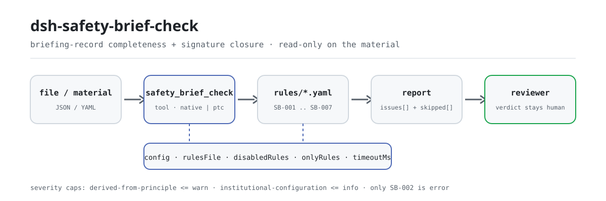

<div align="center">

<picture>
  <source media="(prefers-color-scheme: dark)" srcset="docs/assets/dsh-safety-brief-check-flow-dark.svg">
  
</picture>

# dsh-safety-brief-check

**Comprueba un registro de instrucción técnica de seguridad y obtiene la lista exacta de qué regla, qué columna, qué difiere y cómo corregirlo: el veredicto queda en manos del revisor.**

Un plugin verificador de registros de instrucción para DeepSeek Harness: lee un registro (cabecera, listas de 被交底人 y de 签字, lista de 工种), aplica el paquete de reglas versionado que incluye (`SB-001`..`SB-007`) y solo enumera las diferencias que puede señalar dentro del material — nunca un veredicto de cumplimiento, nunca una atribución de responsabilidad.

[Instalar](#instalación-en-tres-pasos) · [Configuración](#configuración) · [FAQ](#faq) · [简体中文](README.md) · [English](README.en.md) · [Español](README.es.md) · [Português](README.pt.md) · [हिन्दी](README.hi.md)

[](LICENSE)
[](#compatibilidad)
[](https://www.npmjs.com/package/dsh-safety-brief-check)
[](https://github.com/PerryLink/dsh-safety-brief-check/actions/workflows/ci.yml)
[](#compatibilidad)

[](https://github.com/PerryLink/dsh-safety-brief-check/stargazers)
[](https://www.npmjs.com/package/dsh-safety-brief-check)
[](https://dshfind.com/plugins/PerryLink/dsh-safety-brief-check?ref=badge)
[](https://securityscorecards.dev/viewer/?uri=github.com/PerryLink/dsh-safety-brief-check)
[](https://dsh.market/)
[](https://gitee.com/perrylink/dsh-safety-brief-check)

```sh
dsh plugin --profile <name> add dsh-safety-brief-check
```

</div>

<sub>Plugin de la comunidad, no afiliado a DeepSeek. Repositorio canónico: <https://github.com/PerryLink/dsh-safety-brief-check> (Gitee es un espejo).</sub>

## Qué es

`dsh-safety-brief-check` lee un **registro de instrucción técnica de seguridad** (安全技术交底记录) —sus campos de cabecera, sus listas de 被交底人 y de 签字, y su lista de 工种— y comprueba la completitud y el cierre de ese propio registro: que estén rellenas las columnas que exige su formulario, que toda persona instruida figure entre los firmantes y que nadie firme dos veces, que la 交底日期 no sea posterior a la 施工日期, que los oficios que ejecutan el trabajo aparezcan en la lista de 工种 instruidos, que el registro identifique su 工程部位 y su 交底人, que reserve un lugar para las firmas del 交底人, del 被交底人 y del 专职安全员, y que el contenido de la instrucción trate los factores de peligro, los procedimientos de operación y las medidas de emergencia.

No decide si el contenido de la instrucción fue suficiente, si apuntó a los peligros correctos, si una firma es de la propia persona ni si procede una sanción.

- **Para quién**: responsables de seguridad, jefes de obra y encargados de documentación; no hace falta saber usar la línea de comandos — entregue el material en el chat.
- **Qué aporta usted**: el material de origen sobre el que trabaja la comprobación (una tabla, un registro o un documento); el original nunca se modifica. Excel puede convertirse antes a JSON/YAML, en el chat si la plataforma lo permite.
- **Qué devuelve**: una lista de «qué regla, qué columna, qué difiere y cómo corregirlo»; cada comprobación que no pudo ejecutarse se enumera en `skipped` con su motivo.

## Instalación en tres pasos

1. **Instalar** (elija un canal):

   ```sh
   # canal git (último main; equivale a git+https://github.com/PerryLink/dsh-safety-brief-check.git)
   dsh plugin --profile <name> add github:PerryLink/dsh-safety-brief-check
   # canal npm (versiones publicadas)
   dsh plugin --profile <name> add dsh-safety-brief-check
   # canal tarball: tras pnpm pack en este repositorio
   dsh plugin --profile <name> add ./dsh-safety-brief-check-<version>.tgz
   ```

   El canal git ejecuta `prepare` (tsdown) y construye `lib/` en el momento; el canal npm ya trae los artefactos construidos — para el canal tarball, compruebe antes que `pnpm run build` haya producido `lib/`.

2. **Configuración mínima** (los valores por defecto sirven; sin bloque `config` en la fila del bundle todas las claves toman su valor por defecto y la ruta del paquete de reglas apunta a `rules/safety-brief-check.yaml`, incluido en el paquete):

   ```yaml
   - insert:
       - id: dsh-safety-brief-check
         name: dsh-safety-brief-check
   ```

3. **Verificar que se monta**:

   ```sh
   dsh --profile <name> --dump-config | grep 'dsh-safety-brief-check'
   ```

   Después entregue un registro, por ejemplo el ejemplo incluido en el repositorio (coincide con `samples/quickstart/expected/result.json`):

   ```text
   > Ejecuta esta comprobación con el ejemplo incluido y dime cuántos problemas encuentra y de qué nivel.
   safety_brief_check: 2 issue(s) — error 0, warn 2, info 0
   skipped: 5
   ```

**Desinstalar**: `dsh plugin --profile <name> remove dsh-safety-brief-check` (o quite la fila del patch del perfil).

<details>
<summary>Usarlo desde WorkBuddy / Coze</summary>

Busque «安全合规核对包» (Safety Compliance Suite) en WorkBuddy / Coze —el conjunto del que esta comprobación forma parte; disponibilidad según el catálogo— para acceder a la misma capacidad sin línea de comandos.

</details>

<details>
<summary>Instalar desde el mercado de DSH Desktop</summary>

Todos los plugins de PerryLink están en el mercado integrado de DSH Desktop: **Mercado → Fuentes → Añadir fuente → pegar** `https://perrylink-dsh-catalog.perrylink.workers.dev/catalog-source.json` **→ seleccionar**. La instalación sigue requiriendo la verificación de identidad npm del mercado y su confirmación.

</details>

## Capacidades clave

`dsh-safety-brief-check` registra la herramienta `safety_brief_check`: lee un registro de instrucción, aplica el paquete de reglas versionado y devuelve un informe.

- **Siete reglas en un paquete** — el paquete de reglas es dato, no código (`rules/safety-brief-check.yaml`); sustituirlo sustituye todo el conjunto de reglas sin tocar una línea de TypeScript. Los ids van de `SB-001` a `SB-007`.
- **Solo lectura del material** — acepta JSON o YAML y nunca modifica el original; ESM puro, sin peticiones de red ni llamadas al modelo.
- **Sin citas inventadas** — cada regla lleva `document` / `number` / `clause` / `excerpt` / `kind` / `source`, y `excerpt` debe ser una cita literal; si el texto no se obtuvo, el paquete lo dice en lugar de presentar una paráfrasis como cita.
- **La gravedad sigue a la evidencia** — `derived-from-principle` tiene tope `warn`, la configuración institucional (`institutional-configuration`) tope `info`, y un test lo verifica.
- **Una lista vacía no es un aprobado** — cada comprobación que no pudo ejecutarse se enumera en `skipped` con su motivo; una regla cuya lista obligatoria está sin configurar se declara en `skipped` en lugar de pasar en silencio.
- **Sin lenguaje que adjudique** — el informe solo enumera diferencias y nunca se pronuncia sobre cumplimiento, responsabilidad o corrección; un guardián de redacción (`src/shared/wording.ts`) lo impone y todo informe lleva el descargo de responsabilidad.

| Regla | Qué comprueba | Gravedad | Base |
|---|---|---|---|
| `SB-001` | el registro rellena las columnas que exige su formulario (sin configurar de fábrica) | info | GB 50870-2013 第8.2.3条 |
| `SB-002` | toda persona instruida figura entre los firmantes y nadie firma dos veces | **error** | 国务院令第393号 第二十七条 |
| `SB-003` | la 交底日期 no es posterior a la 施工日期 | warn | 第二十七条 (derivada) |
| `SB-004` | los 工种 instruidos cubren los 工种 que ejecutan el trabajo | warn | JGJ 59-2011 第3.1.3条第3款第2）项 |
| `SB-005` | el registro identifica su 工程部位 y su 交底人 | warn | GB 50870-2013 第8.2.1条 |
| `SB-006` | el registro reserva lugar para las tres firmas | warn | JGJ 59-2011 第3.1.3条第3款第4）项 |
| `SB-007` | el contenido de la instrucción trata peligro, procedimientos y emergencia | warn | GB 50870-2013 第8.2.3条 |

### Ejemplos

Estos son los puntos de entrada reales del plugin; instálelo una vez y llame a uno. La primera fila es el caso detallado y las demás son casos breves.

La salida siguiente es la ejecución real del plugin sobre su propio fixture de prueba `SB-002`, no un montaje; el paquete de reglas tampoco inventa citas: cada hallazgo nombra la cláusula en la que se apoya y si su `excerpt` es una cita literal o una inferencia de principio.

**Ejemplo detallado** — herramienta `safety_brief_check`, entrada:

```json
{"被交底人":"李四、王五、赵六","签字":"李四、王五"}
```

Salida:

```json
{
  "id": "dsh-safety-brief-check.SB-002.029bddbd",
  "ruleId": "SB-002",
  "severity": "error",
  "locator": {
    "row": 0,
    "column": "被交底人"
  },
  "found": "被交底人「赵六」在签字列表中未出现",
  "expected": "被交底人应当在交底记录上签字确认",
  "fix": "核对是否漏签；本条只比对名单，不判断签字是否为本人所签"
}
```

*Observado en `dsh-safety-brief-check/tests/fixtures/SB-002/SB-002-unsafe.json`*

| Usted pregunta | Qué responde |
|---|---|
| Una de las personas instruidas nunca firmó. ¿Qué dice el informe? | `SB-002` —la única regla de nivel `error` del paquete— compara la lista de 被交底人 con la lista de 签字 e informa de cada persona que no aparece en ella; un nombre que aparece dos veces en la lista de firmas se informa por separado, porque ambas lagunas se corrigen de forma distinta. Solo compara las dos listas: no puede saber si una firma es de la propia persona y no exige firma individual — si su institución admite una firma colectiva, indíquelo en el material o incluya la regla en `disabledRules`. |
| La 交底日期 es posterior a la 施工日期. ¿Es un error? | `SB-003` lo informa, y el mismo día cuenta como no posterior. La regla está limitada a `warn`: 第二十七条 da 施工前 como premisa temporal pero no enuncia esa comparación, así que el hallazgo es una pista para revisión — una instrucción añadida a mitad de obra por un peligro detectado después es legítimamente posterior y el registro debería decirlo. Una fecha que no se puede analizar se informa por sí sola en lugar de omitirse en silencio. |
| ¿Qué columnas debe rellenar el registro para pasar la comprobación? | `SB-001` lee `requiredFields`, que el paquete trae vacío, así que informa de `skipped` (sin configurar) en lugar de pasar. Cuando indique las columnas de su formulario, informa de cada una que falte o esté vacía — una cadena vacía cuenta como no rellenada — y no juzga si lo escrito en ellas es correcto. |
| El registro tiene columna de 被交底人 pero ningún sitio para el 专职安全员. | `SB-006` comprueba en la cabecera que haya un sitio para las tres partes — 交底人, 被交底人 y 专职安全员 — e informa de las que no tienen columna; los nombres de las columnas pueden sustituirse según su formulario. Sigue en `warn` porque el 第3.1.3条 de JGJ 59-2011 es una cláusula recomendatoria de evaluación (sus únicas disposiciones obligatorias, 第4.0.1、5.0.3条, fueron derogadas por el 住房和城乡建设部公告 2022 年第 164 号). Pregunta si el sitio existe, no si alguien firmó allí: eso es la pregunta de `SB-002`. |
| Los oficios que trabajaron en esa parte no figuran en la lista de 工种 de la instrucción. | `SB-004` compara los oficios que ejecutan el trabajo con la lista de 工种 del registro e informa de los que no aparecen. Está limitada a `warn` porque JGJ 59-2011 pide instrucciones 分部分项 pero no fija ninguna tabla obligatoria de correspondencia con los oficios, e informa de `skipped` cuando ni el material ni el parámetro `workTrades` nombran los oficios que trabajan, ya que no codifica ninguna lista de oficios. Solo compara nombres, de modo que 钢筋工 y 钢筋班组 cuentan como distintos, y no juzga si el contenido de la instrucción aborda ese oficio. |

### Parámetros de la herramienta

| Parámetro | Tipo | Significado |
|---|---|---|
| `file` | string | ruta absoluta del archivo de material (JSON o YAML); use `file` o `material` |
| `material` | string | texto del material en línea; use `file` o `material` |
| `rulesFile` | string | sustituye la ruta configurada del paquete de reglas (relativa a la raíz del paquete o absoluta) |
| `only` | string[] | ejecutar solo estas reglas; vacío ejecuta todas |

## Normas que sigue

| Documento | Número | Reglas que lo citan |
|---|---|---|
| 《建筑施工安全技术统一规范》 | GB 50870-2013 | SB-001, SB-002, SB-005, SB-007 |
| 《建筑施工安全检查标准》 | JGJ 59-2011 | SB-001, SB-002, SB-004, SB-006, SB-007 |
| 《建设工程安全生产管理条例》 | 国务院令第393号 | SB-002, SB-003 |

Los títulos canónicos en chino y el texto literal de las cláusulas están registrados en `rules/evidence/clause-verification.md`.

> ### ⚠️ Una `error`, y dos disposiciones obligatorias derogadas que el paquete se niega a usar mal
>
> **`SB-002` es la única regla de nivel `error`**, y se apoya en un reglamento administrativo: el 第二十七条 de 《建设工程安全生产管理条例》 exige que la instrucción se realice «y se confirme con la firma de ambas partes», con el 第六十四条第（一）项 como sanción. Todo lo demás está limitado a `warn` o `info`.
>
> El paquete registra dos correcciones que un lector, de otro modo, haría mal:
>
> **1. El 第3.1.3条 de JGJ 59-2011 —la cláusula más cercana a este plugin— es una cláusula *recomendatoria* de evaluación.** Las únicas disposiciones obligatorias de la norma eran 4.0.1 y 5.0.3, y **ambas fueron derogadas** por el 住房和城乡建设部公告 2022 年第 164 号 (en vigor desde 2023-06-01). Por eso `SB-006` (firmas de las tres partes) es `warn`, y su `note` explica por qué.
>
> **2. El 第10.0.6条 de GB 50656-2011 perdió su carácter obligatorio por el mismo anuncio, y su redacción sobre la instrucción previa al turno está en las notas explicativas, no en una cláusula.** Por eso este paquete **no cita esa norma en absoluto** — un test verifica que su número nunca aparece.
>
> **La ley nacional no regula las reuniones previas al turno.** La 《安全生产法》, con 119 artículos, no contiene la expresión 「班前」; ni la ley, ni un reglamento administrativo, ni una norma departamental, ni una norma nacional la abordan. Existen documentos provinciales (por ejemplo, la guía provincial de «reunión matinal» previa al turno), pero son **locales, no nacionales** — por eso cualquier comprobación previa al turno se entrega sin configurar y el paquete lo dice.
>
> Límites declarados: la comprobación de firmas **solo compara listas de nombres** y no puede saber si una firma es de la propia persona; la comprobación de contenido es una **prueba de aparición literal de palabras** y no puede saber si una instrucción fue buena — la propia tabla de puntuación de JGJ 59-2011 resta puntos cuando el contenido no está dirigido, un juicio que ninguna operación de cadenas puede hacer.

## Configuración

Todos los parámetros ajustables son campos Schemastery `Config` en `src/config.ts` (modificables desde cordis.yml); los umbrales por regla están en el paquete de reglas bajo `rules/`. Una sustitución dirigida por id reemplaza la fila entera: repita todas las claves que necesite.

| Clave | Tipo | Predeterminado | Descripción |
|---|---|---|---|
| `rulesFile` | string | `rules/safety-brief-check.yaml` | ruta del paquete de reglas, relativa a la raíz del paquete; una ruta relativa se resuelve primero por los directorios antecesores del módulo y solo después contra el directorio de trabajo, y un fallo lanza un error que enumera todas las ubicaciones probadas |
| `disabledRules` | string[] | `[]` | ids de reglas que se dejan de ejecutar; cada una aparece en `skipped` |
| `onlyRules` | string[] | `[]` | ejecutar solo estas reglas; vacío ejecuta todas |
| `skipNotes` | string | `""` | nota añadida a cada motivo de `skipped`, por ejemplo para citar las reglas de aplicación de su institución |
| `timeoutMs` | number | `120000` | presupuesto de tiempo de espera cooperativo de la herramienta, en milisegundos |

Parámetros a nivel de regla que conviene conocer (viven en el archivo del paquete de reglas bajo `rules/`, no en la Config de arriba):

- `SB-001` `requiredFields` — las columnas que el registro debe llevar, por ejemplo las de la cabecera de su formulario. Vacío significa que la regla no se ejecuta.
- `SB-004` `requireTradeMatch` — póngalo a `false` para dejar de comparar los 工种 instruidos con los 工种 del trabajo.
- `SB-005` `requireHeader` — póngalo a `false` si su registro legítimamente no lleva cabecera.
- `SB-006` `parties` — las partes firmantes que nombra la norma: 交底人, 被交底人 y 专职安全员.
- `SB-007` `terms` / `contentColumns` — las palabras que el contenido de la instrucción debería tocar y las columnas de las que leerlas. `terms` vacío significa que la regla no se ejecuta.

<details>
<summary>Detalle de claves y ejemplo de sustitución en el patch del perfil</summary>

- Orden de resolución de `rulesFile`: ruta absoluta, luego cada directorio antecesor del módulo, luego el directorio de trabajo del proceso; si no se encuentra nada, la herramienta lanza un error y el mensaje enumera las ubicaciones probadas. **Nunca recurre en silencio a otro paquete de reglas** — eso produciría un informe apoyado en la base equivocada.
- Cada id de `disabledRules` acaba en `skipped` con el motivo «desactivada en la configuración actual», y `skipNotes` se añade a continuación.
- Si se dan a la vez `onlyRules` y el argumento `only` de la herramienta, gana el argumento; las reglas excluidas de esa llamada también acaban en `skipped` con su motivo.
- `skipNotes` solo cambia la redacción de `skipped`; no cambia ningún veredicto.

```yaml
- insert:
    - id: dsh-safety-brief-check
      name: dsh-safety-brief-check
      config:
        disabledRules: [SB-007]
        skipNotes: reglas de aplicación de la institución, artículo 4
        timeoutMs: 180000
```

</details>

## Formato del material

La herramienta acepta JSON o YAML. Un registro es un mapeo plano; las listas de nombres y de 工种 pueden ser un arreglo o una cadena delimitada:

```yaml
工程名称: 某某厂房工程
交底部位: 二层结构
交底日期: 2026-03-10
施工日期: 2026-03-12
交底人: 张工
被交底人: 李四、王五、赵六
签字: 李四、王五、赵六
工种: 钢筋工、木工
```

```yaml
被交底人: [李四, 王五]      # la forma de arreglo también funciona
签字: 李四，王五；          # y la puntuación china separa igual
```

Los nombres de columna se reconocen mediante la tabla de alias de campos (`COLUMNS` en `src/model.ts`), de modo que se aceptan nombres de columna en inglés y en chino. Los nombres se comparan sin espacios en blanco, así que un nombre escrito con espacio es la misma persona que sin él. Una firma ausente y una firma repetida producen hallazgos **distintos**, porque necesitan correcciones distintas. Una fecha ilegible se informa como ilegible en lugar de omitirse, así que una celda mal formateada nunca puede ocultar la comprobación cronológica. Los campos son opcionales en la capa de lectura y los valida el motor, de modo que una exportación parcial produce hallazgos de «falta un elemento» en vez de un fallo.

## Fuentes de las reglas

Los datos de las reglas están en `rules/safety-brief-check.yaml`, separados del código: cada regla lleva documento, número, cláusula en la numeración propia de la fuente, extracto literal y URL de origen. El cargador impone que el extracto sea una cita real de al menos ocho caracteres y que una comprobación basada solo en un principio general o en una política local nunca se declare `error`. Un paquete que exagere su base falla al cargar en lugar de producir un informe de aspecto seguro.

Las cláusulas citadas provienen de:

- **《建设工程安全生产管理条例》** (国务院令第393号, en vigor desde 2004-02-01, sin modificaciones) — 第二十七条 y 第六十四条第（一）项
- **《建筑施工安全检查标准》** (JGJ 59-2011) — 第3.1.3条第3款第2）3）4）项 y la entrada de puntuación del apéndice B
- **《建筑施工安全技术统一规范》** (GB 50870-2013) — 第8.2.1条, 第8.2.3条 y 第8.2.4条

Dos correcciones dieron forma a este paquete y están registradas en su cabecera:

1. **La cláusula de la norma sectorial es recomendatoria.** Las disposiciones obligatorias de JGJ 59-2011 eran 4.0.1 y 5.0.3, y ambas fueron derogadas por el 住建部公告 2022 年第 164 号; por eso las reglas que citan 3.1.3 son `warn`.
2. **El 第10.0.6条 de GB 50656-2011 perdió su carácter obligatorio por el mismo anuncio**, y su redacción previa al turno está en las notas explicativas y no en una cláusula — por eso el paquete no cita esa norma en absoluto.

El informe completo de verificación de cláusulas, incluidas las fuentes comprobadas y descartadas, viaja en `rules/evidence/clause-verification.md`; `pnpm run check:citations` compara cada extracto del paquete con ese registro segmento a segmento, y `rules/citations-baseline.json` solo puede encoger.

## FAQ

<details>
<summary>¿Se sube el material? ¿Dónde viven el informe y los datos?</summary>

No. Es una comprobación puramente local: lee el material que se entrega a la herramienta, no hace peticiones de red, no incluye telemetría, analítica ni informes en segundo plano, y no escribe nada fuera del resultado de la herramienta y del almacenamiento de sesiones y registros del propio host de DSH. Ese almacenamiento lo controla el host y se conserva según su política; este paquete no añade una segunda copia. Desinstalar el paquete elimina su código; no borra los registros de sesión del host ni los documentos que usted ya haya creado.

</details>

<details>
<summary>¿Una lista `issues` vacía puede leerse como «este registro está bien»?</summary>

No. Cada comprobación que no pudo ejecutarse se enumera en `skipped` con su motivo (una lista de campos obligatorios vacía, ningún 工种 de trabajo en el material, una columna de contenido de la instrucción ausente). Lea los hallazgos y `skipped` juntos; `skipped` significa «no comprobado», no «aprobado».

</details>

<details>
<summary>¿Nos dará un veredicto de cumplimiento?</summary>

No. Solo enumera las diferencias que puede señalar dentro del material (qué regla, qué columna, qué difiere, cómo corregirlo); no decide hechos ni evalúa cumplimiento — la conclusión es siempre del revisor. La redacción del informe está limitada por el guardián de redacción (`src/shared/wording.ts`), y todo informe lleva el `DISCLAIMER`.

</details>

<details>
<summary>¿Compite con otros plugins por nombres de herramienta, claves de servicio o slots de interfaz?</summary>

No. Solo hace `inject: ['tools']`, registra una única herramienta con espacio de nombres `safety_brief_check`, no aporta ninguna clave de servicio, no registra slot de cliente ni prefijo `webServer`, no escucha ningún evento del host y no altera ningún global; el patch del bundle solo `insert` su propia fila. El argumento punto por punto está en «Interoperabilidad con otros plugins DSH».

</details>

<details>
<summary>¿Aguanta un lote entero de registros de instrucción?</summary>

Sí. La comprobación es comparación de columnas y aritmética de fechas, todo local: sin peticiones de red ni llamadas al modelo; y el paquete de reglas se analiza una sola vez por proceso y se cachea, así que las llamadas repetidas no vuelven a leer el disco. La herramienta funciona en `native` y en `ptc`; para un lote de registros use `ptc` (el coste del esquema se paga una vez). `timeoutMs` (120 segundos por defecto) es un presupuesto de tiempo de espera cooperativo.

</details>

## Límites de seguridad

Este plugin comprueba un **registro de instrucción técnica de seguridad** por lo que a un registro se le puede exigir — que estén rellenas las columnas que exige su formulario, que **toda persona instruida figure como firmante**, que la instrucción esté fechada no después del trabajo, que los 工种 instruidos cubran los 工种 que ejecutan el trabajo y que el registro identifique su 工程部位 y su 交底人. **No** juzga si el contenido de la instrucción fue adecuado, si apuntó a los peligros correctos ni si una firma es auténtica.

- **Solo lectura.** El material se lee y nunca se reescribe; no existe ninguna ruta de escritura.
- **Sin conexión.** Sin peticiones de red, sin credenciales almacenadas, sin llamadas al modelo; nada se escribe fuera del resultado de la herramienta (salvo el almacenamiento de sesiones y registros del propio host).
- **Un paquete de reglas ausente falla en voz alta.** Cuando `resolvePackageFile` no encuentra el paquete de reglas, lanza un error y enumera las ubicaciones probadas; nunca recurre en silencio a otro paquete — una base equivocada es peor que ninguna comprobación.
- **Una lista vacía no es un aprobado.** Cada comprobación que no pudo ejecutarse acaba en `skipped` con su motivo; una regla cuya lista obligatoria está sin configurar se declara en `skipped`.
- **Sin adjudicación.** El informe solo enumera diferencias y nunca se pronuncia sobre cumplimiento, responsabilidad o corrección; el guardián de redacción (`src/shared/wording.ts`) prohíbe el lenguaje adjudicativo y todo informe lleva el `DISCLAIMER`.

## Limitaciones conocidas

- **Solo listas de nombres.** La comprobación de firmas compara dos listas de nombres: no puede saber si una firma es de la propia persona y no exige firma individual — JGJ 59-2011 y GB 50870-2013 piden que «ambas partes» o «las tres partes» confirmen con su firma, y la ley nacional no dice nada sobre firma individual. Cuando su institución admita una firma colectiva, indíquelo en el material o desactive `SB-002`.
- **Solo aparición literal.** `SB-007` comprueba si las tres palabras peligro, procedimientos de operación y medidas de emergencia aparecen en el contenido de la instrucción; aparecer no es lo mismo que estar tratado, y el apéndice B de JGJ 59-2011 resta de 3 a 5 puntos cuando el contenido no está dirigido — un juicio que es inherentemente del inspector y que ninguna operación de cadenas puede hacer.
- **Dos reglas se entregan sin configurar.** `requiredFields` de `SB-001` y los 工种 de trabajo de `SB-004` están vacíos de fábrica, así que ambas informan de `skipped` en lugar de pasar en silencio; el paquete no codifica ninguna lista de columnas ni de 工种, porque ambas varían por institución y por proyecto.
- **Solo nombres.** `SB-004` compara nombres de 工种, de modo que 钢筋工 y 钢筋班组 cuentan como distintos, y las diferencias de escritura causan falsos positivos — mantenga una redacción uniforme en el registro.
- **Aritmética de reloj de pared.** Toda comparación de fechas es aritmética de reloj de pared sobre las cadenas de entrada, sin conversión de zona horaria; una fecha no analizable se informa por sí sola en lugar de omitirse.
- **Una fecha de instrucción posterior no es una violación.** `SB-003` está limitada a `warn`: una instrucción añadida a mitad de obra por un peligro descubierto después es legítimamente posterior y el registro debería decirlo — exactamente por eso la regla pide revisión humana en lugar de declarar un incumplimiento.
- **`SB-006` se queda en `warn`.** El 第3.1.3条 de JGJ 59-2011 es una cláusula recomendatoria de evaluación cuyas disposiciones obligatorias fueron derogadas por el 住房和城乡建设部公告 2022 年第 164 号, así que esto es una pista de norma sectorial, no un hallazgo de «disposición obligatoria incumplida».

## Interoperabilidad con otros plugins DSH

Este plugin solo hace `inject: ['tools']`; más allá de la superficie de la herramienta no toca ninguna capacidad del host:

- **Sin colisión de nombres de herramienta.** Registra una única herramienta con espacio de nombres, `safety_brief_check`; no ocupa ningún nombre desnudo de una herramienta incluida ni de otro plugin.
- **Sin colisión de claves de servicio.** No aporta ninguna clave de servicio, así que no puede colisionar en una.
- **Sin colisión de slots.** No registra ninguna clave de slot de cliente (este paquete no tiene mitad de navegador).
- **Sin colisión de rutas HTTP.** No registra ningún prefijo `webServer`.
- **Sin escuchas de eventos.** No registra ningún oyente en eventos sensibles al orden como `agent/pre-step` o `tools/post-execute`, así que no se une a ninguna cadena ni puede cortocircuitarla.
- **Sin colisión de capa de patch.** El patch del bundle (`cordis.patch.yml`) solo `insert` su propia fila; nunca sobrescribe el `config` de una fila incluida.
- **Sin mutación global.** No parchea prototipos, no reescribe `process.env` ni sustituye el despachador global de fetch.

## Compatibilidad

| Superficie | Estado |
|---|---|
| Harness | Rango de peers `>=0.1.2-rc.1 <0.2.0 \|\| >=0.2.0-0 <0.3.0` — verificado para aceptar tanto `0.2.0-rc.2` como `0.2.1-rc.2`. `engines.dsh` se declara como `>=0.2.1-0 <0.3.0` y el host lo aplica desde 0.2.1 |
| Node | `^22.19.0 \|\| >=24.0.0` |
| Plataformas | Todas (ESM puro; sin código nativo, sin red, sin llamada al modelo) |
| Modo de herramienta | Funciona en `native` y `ptc`; para un lote de registros use `ptc` |

## Solución de problemas

- **`SB-001` se informa como omitida.** Su lista de columnas está vacía. Rellene las columnas que usa su formulario.
- **`SB-004` no informa de nada.** Ni el material ni la llamada aportaron la lista de 工种 que ejecutan el trabajo. Pase `workTrades` o acepte que esta comparación no se está haciendo.
- **`SB-002` señala a alguien que sí firmó.** Puede que las dos columnas escriban el nombre de forma distinta (un espacio, un carácter diferente). La comparación elimina los espacios pero por lo demás es exacta.
- **`SB-003` se dispara en un registro correcto.** Si la instrucción siguió al trabajo —un peligro descubierto a mitad de obra—, la nota del paquete dice que es legítimo y debe explicarse en el registro. El hallazgo es una invitación a comprobar, nunca una determinación.
- **El plugin se instala pero la herramienta no aparece.** Compruebe que `main` resuelve a `lib/index.mjs` y que `pnpm run build` lo generó; un `main` equivocado hace que el cargador omita la entrada en silencio.
- **`dsh plugin add` rechaza el paquete por incompatibilidad.** El rango de peers cubre `0.1.x` y `0.2.x`; si su runtime queda fuera, conceda una exención explícita: `dsh plugin --profile <name> allow-version dsh-safety-brief-check@0.1.0 --dsh-version <runtime> --accept-risk`
- **`check` informa `manifest-peers` como fallo.** El comprobador estático compara con un rango de peers fijo que precede a la línea 0.2. El runtime aplica la compatibilidad de peers al instalar, así que el rango declarado es el correcto; es un problema conocido de `dsh-plugin-dev`.
- **Una regla no se ejecutó.** Lea el arreglo `skipped`: indica el id de la regla y el motivo.
- **Las horas parecen desplazadas.** Toda la aritmética es de reloj de pared sobre las cadenas que usted entregó; no hay conversión de zona horaria.

## Ecosistema y calidad

- [Espejo en Gitee](https://gitee.com/perrylink/dsh-safety-brief-check) (espejo sincronizado; GitHub es el canónico)
- [Página del plugin en dshfind](https://dshfind.com/plugins/PerryLink/dsh-safety-brief-check) (instalaciones y clasificación)
- [Informe de OpenSSF Scorecard](https://securityscorecards.dev/viewer/?uri=github.com/PerryLink/dsh-safety-brief-check) (impulsado por [.github/workflows/scorecard.yml](.github/workflows/scorecard.yml))
- [DSH Market](https://dsh.market/) (publicado)
- [Elegir un verificador según el material](https://perrylink.github.io/zh/checkers/choose/) (índice de la familia: qué verificador encaja con qué material)

## Desarrollo

```sh
pnpm install                                        # node ^22.19 || >=24
pnpm run typecheck                                  # tsc --noEmit
pnpm test                                           # vitest: suite compartida de plugins de tabla + fixtures emparejados (37 casos)
pnpm run build                                      # tsdown -> lib/index.mjs + lib/index.d.mts
pnpm run verify:self-contained                      # las especificaciones de dependencias resuelven desde el registro
pnpm run check:lockfile                             # comprobación de deriva del lockfile
pnpm run check:readmes                              # consistencia de los README en cinco idiomas
pnpm run check:citations                            # línea base de citas del paquete de reglas
node ../scripts/sync-shared.mjs dsh-safety-brief-check   # refrescar src/shared desde ../_shared
pnpm pack                                           # el tarball publicado
```

Este plugin es **guiado por datos**: `src/model.ts` declara la forma del registro, el kit compartido aporta el lector y el motor de comprobación, y el paquete de reglas declara cada comprobación. Ejecute el ejemplo incluido en local (genere antes `lib/`):

```sh
node samples/quickstart/run.mjs --json
# => {"tool":"safety_brief_check","issueCount":2,"summary":{"error":0,"warn":2,"info":0},"skippedCount":5}
```

La entrada del ejemplo está en `samples/quickstart/input/`, la salida esperada en `samples/quickstart/expected/result.json` y la captura en `docs/assets/quickstart.png`. Las imágenes del README las genera un programa, [`scripts/gen-readme-assets.py`](scripts/gen-readme-assets.py) (Python + Pillow), y se pueden volver a ejecutar sin riesgo; el diagrama de flujo de una sola versión, el hero y la demo antiguos permanecen en `docs/assets/` para enlaces externos, y los README solo referencian el nuevo par claro/oscuro.

Topics: `deepseek-harness`, `dsh`, `dsh-plugin`, `cordis`, `safety`, `brief`

## Familia y agradecimientos

Este proyecto forma parte de la familia de plugins de DeepSeek Harness de [PerryLink](https://github.com/PerryLink) (todos Apache-2.0). El índice completo de la familia es [elegir un verificador según el material](https://perrylink.github.io/zh/checkers/choose/). Si le resulta útil, **una estrella ayuda a que la siguiente persona lo encuentre** — nada queda bloqueado por ello.

- [@PerryLink](https://github.com/PerryLink) — creador y mantenedor: el paquete de reglas de solo datos (SB-001..SB-007), la herramienta `safety_brief_check`, el registro de verificación de cláusulas y la documentación en cinco idiomas.

<details>
<summary>Ver todos los plugins</summary>

| Plugin | Estado |
|---|---|
| **[dsh-aqua-input-check](https://github.com/PerryLink/dsh-aqua-input-check)** |  |
| **[dsh-archive-check](https://github.com/PerryLink/dsh-archive-check)** |  |
| **[dsh-auto-review](https://github.com/PerryLink/dsh-auto-review)** |  |
| **[dsh-autotier](https://github.com/PerryLink/dsh-autotier)** | 🧊 CONGELADO — ver el README del repo |
| **[dsh-bid-ca-precheck](https://github.com/PerryLink/dsh-bid-ca-precheck)** |  |
| **[dsh-bid-qual-check](https://github.com/PerryLink/dsh-bid-qual-check)** |  |
| **[dsh-cert-mcp](https://github.com/PerryLink/dsh-cert-mcp)** | 🧊 CONGELADO — ver el README del repo |
| **[dsh-checkpoint-rewind](https://github.com/PerryLink/dsh-checkpoint-rewind)** |  |
| **[dsh-click](https://github.com/PerryLink/dsh-click)** |  |
| **[dsh-composer-history](https://github.com/PerryLink/dsh-composer-history)** |  |
| **[dsh-contract-stance](https://github.com/PerryLink/dsh-contract-stance)** |  |
| **[dsh-customs-doc-check](https://github.com/PerryLink/dsh-customs-doc-check)** |  |
| **[dsh-data-quality](https://github.com/PerryLink/dsh-data-quality)** | 🧊 CONGELADO — ver el README del repo |
| **[dsh-demurrage-ledger](https://github.com/PerryLink/dsh-demurrage-ledger)** |  |
| **[dsh-doublecheck](https://github.com/PerryLink/dsh-doublecheck)** |  |
| **[dsh-drill-script-check](https://github.com/PerryLink/dsh-drill-script-check)** |  |
| **[dsh-eia-guide-check](https://github.com/PerryLink/dsh-eia-guide-check)** |  |
| **[dsh-emergency-plan](https://github.com/PerryLink/dsh-emergency-plan)** |  |
| **[dsh-essay-rubric-check](https://github.com/PerryLink/dsh-essay-rubric-check)** |  |
| **[dsh-evidence-check](https://github.com/PerryLink/dsh-evidence-check)** |  |
| **[dsh-export-ctl-check](https://github.com/PerryLink/dsh-export-ctl-check)** |  |
| **[dsh-fast](https://github.com/PerryLink/dsh-fast)** |  |
| **[dsh-fmea-table-check](https://github.com/PerryLink/dsh-fmea-table-check)** |  |
| **[dsh-forecast-penalty](https://github.com/PerryLink/dsh-forecast-penalty)** |  |
| **[dsh-fund-research](https://github.com/PerryLink/dsh-fund-research)** |  |
| **[dsh-github](https://github.com/PerryLink/dsh-github)** |  |
| **[dsh-gongwen-flow-check](https://github.com/PerryLink/dsh-gongwen-flow-check)** |  |
| **[dsh-gongwen-word-check](https://github.com/PerryLink/dsh-gongwen-word-check)** |  |
| **[dsh-guard-plan-qc](https://github.com/PerryLink/dsh-guard-plan-qc)** |  |
| **[dsh-hazchem-check](https://github.com/PerryLink/dsh-hazchem-check)** |  |
| **[dsh-hazplan-check](https://github.com/PerryLink/dsh-hazplan-check)** |  |
| **[dsh-hidden-risk-map](https://github.com/PerryLink/dsh-hidden-risk-map)** |  |
| **[dsh-hs-classify](https://github.com/PerryLink/dsh-hs-classify)** |  |
| **[dsh-icd-rule-check](https://github.com/PerryLink/dsh-icd-rule-check)** |  |
| **[dsh-industry-research](https://github.com/PerryLink/dsh-industry-research)** |  |
| **[dsh-lawcite-adapter](https://github.com/PerryLink/dsh-lawcite-adapter)** |  |
| **[dsh-laya](https://github.com/PerryLink/dsh-laya)** |  |
| **[dsh-lc-doc-check](https://github.com/PerryLink/dsh-lc-doc-check)** |  |
| **[dsh-learning-gap-check](https://github.com/PerryLink/dsh-learning-gap-check)** |  |
| **[dsh-library](https://github.com/PerryLink/dsh-library)** |  |
| **[dsh-local-ai](https://github.com/PerryLink/dsh-local-ai)** |  |
| **[dsh-lsp-actions](https://github.com/PerryLink/dsh-lsp-actions)** |  |
| **[dsh-mask](https://github.com/PerryLink/dsh-mask)** |  |
| **[dsh-mcp-panel](https://github.com/PerryLink/dsh-mcp-panel)** |  |
| **[dsh-medrec-qc](https://github.com/PerryLink/dsh-medrec-qc)** |  |
| **[dsh-memento](https://github.com/PerryLink/dsh-memento)** | 🧊 CONGELADO — ver el README del repo |
| **[dsh-nsfc-form-check](https://github.com/PerryLink/dsh-nsfc-form-check)** |  |
| **[dsh-nurse-record-check](https://github.com/PerryLink/dsh-nurse-record-check)** |  |
| **[dsh-observe](https://github.com/PerryLink/dsh-observe)** |  |
| **[dsh-origin-rvc-check](https://github.com/PerryLink/dsh-origin-rvc-check)** |  |
| **[dsh-ota-review-check](https://github.com/PerryLink/dsh-ota-review-check)** |  |
| **[dsh-output-styles](https://github.com/PerryLink/dsh-output-styles)** |  |
| **[dsh-paper-doc-adapter](https://github.com/PerryLink/dsh-paper-doc-adapter)** |  |
| **[dsh-permission-rules](https://github.com/PerryLink/dsh-permission-rules)** |  |
| **[dsh-permit-report-check](https://github.com/PerryLink/dsh-permit-report-check)** |  |
| **[dsh-pipeline-check](https://github.com/PerryLink/dsh-pipeline-check)** |  |
| **[dsh-pleading-draft](https://github.com/PerryLink/dsh-pleading-draft)** |  |
| **[dsh-plugin-doctor](https://github.com/PerryLink/dsh-plugin-doctor)** | 🚫 RETIRADO (repo archivado) |
| **[dsh-plugin-guide](https://github.com/PerryLink/dsh-plugin-guide)** |  |
| **[dsh-plugin-kit](https://github.com/PerryLink/dsh-plugin-kit)** | 🚫 RETIRADO (repo archivado) |
| **[dsh-plugin-upgrade](https://github.com/PerryLink/dsh-plugin-upgrade)** | 🚫 RETIRADO (repo archivado) |
| **[dsh-policy-brief-draft](https://github.com/PerryLink/dsh-policy-brief-draft)** |  |
| **[dsh-power-loss-split](https://github.com/PerryLink/dsh-power-loss-split)** |  |
| **[dsh-power-ticket-check](https://github.com/PerryLink/dsh-power-ticket-check)** |  |
| **[dsh-ppap-check](https://github.com/PerryLink/dsh-ppap-check)** |  |
| **[dsh-protest-deadline](https://github.com/PerryLink/dsh-protest-deadline)** |  |
| **[dsh-railway-window](https://github.com/PerryLink/dsh-railway-window)** |  |
| **[dsh-repair-order-qc](https://github.com/PerryLink/dsh-repair-order-qc)** |  |
| **[dsh-research-report](https://github.com/PerryLink/dsh-research-report)** |  |
| **[dsh-review-reply-check](https://github.com/PerryLink/dsh-review-reply-check)** |  |
| **[dsh-rulefile-check](https://github.com/PerryLink/dsh-rulefile-check)** |  |
| **[dsh-safety-brief-check](https://github.com/PerryLink/dsh-safety-brief-check)** |  |
| **[dsh-score](https://github.com/PerryLink/dsh-score)** | 🧊 CONGELADO — ver el README del repo |
| **[dsh-session-sync](https://github.com/PerryLink/dsh-session-sync)** |  |
| **[dsh-site-log-check](https://github.com/PerryLink/dsh-site-log-check)** |  |
| **[dsh-skill-pack-security](https://github.com/PerryLink/dsh-skill-pack-security)** |  |
| **[dsh-soe-decision-check](https://github.com/PerryLink/dsh-soe-decision-check)** |  |
| **[dsh-soilwater-check](https://github.com/PerryLink/dsh-soilwater-check)** |  |
| **[dsh-sop-sync-check](https://github.com/PerryLink/dsh-sop-sync-check)** |  |
| **[dsh-spc-gbt-adapter](https://github.com/PerryLink/dsh-spc-gbt-adapter)** |  |
| **[dsh-talk](https://github.com/PerryLink/dsh-talk)** |  |
| **[dsh-tender-extract](https://github.com/PerryLink/dsh-tender-extract)** |  |
| **[dsh-tender-matrix](https://github.com/PerryLink/dsh-tender-matrix)** |  |
| **[dsh-test-drive](https://github.com/PerryLink/dsh-test-drive)** |  |
| **[dsh-ticktick](https://github.com/PerryLink/dsh-ticktick)** | 🚫 RETIRADO (repo archivado) |
| **[dsh-translate](https://github.com/PerryLink/dsh-translate)** |  |
| **[dsh-warranty-calc](https://github.com/PerryLink/dsh-warranty-calc)** |  |
| **[dsh-budget](https://github.com/PerryLink/dsh-budget)** | 🧊 CONGELADO — ver el README del repo |
| **[dsh-claude-move](https://github.com/PerryLink/dsh-claude-move)** | 🧊 CONGELADO — ver el README del repo |
| **[dsh-defend](https://github.com/PerryLink/dsh-defend)** | 🧊 CONGELADO — ver el README del repo |
| **[dsh-draw](https://github.com/PerryLink/dsh-draw)** | 🧊 CONGELADO — ver el README del repo |
| **[dsh-reach](https://github.com/PerryLink/dsh-reach)** | 🧊 CONGELADO — ver el README del repo |
| **[dsh-background-agents](https://github.com/PerryLink/dsh-background-agents)** | 🚫 RETIRADO (repo archivado) |
| **[dsh-session-pin](https://github.com/PerryLink/dsh-session-pin)** | 🚫 RETIRADO (repo archivado) |
| **[dsh-team-rooms](https://github.com/PerryLink/dsh-team-rooms)** | 🚫 RETIRADO (repo archivado) |

</details>

## Licencia

[LICENSE](LICENSE) (Apache License 2.0) © 2026 dsh-safety-brief-check contributors

<p align="center"><sub>Apache-2.0 · Plugin de la comunidad, no afiliado a DeepSeek.</sub></p>
