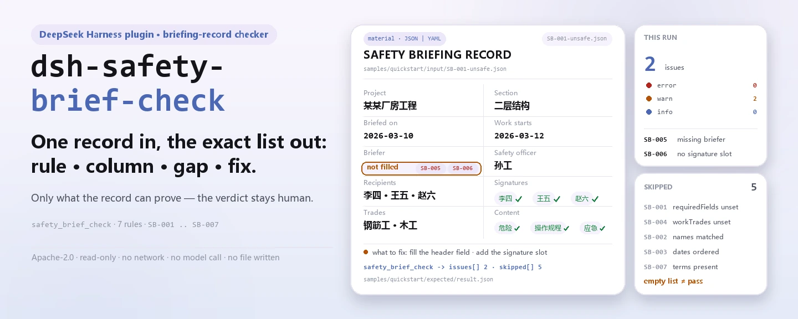

<div align="center">

<picture>
  <source media="(prefers-color-scheme: dark)" srcset="docs/assets/dsh-safety-brief-check-hero-en-dark.webp">
  
</picture>

# dsh-safety-brief-check

**एक सुरक्षा तकनीकी ब्रीफिंग रजिस्टर की जाँच करें और ठीक-ठीक वह सूची पाएँ कि कौन-सा नियम, कौन-सा कॉलम, क्या अंतर है और कैसे सुधारें — निर्णय समीक्षक के पास रहता है।**

DeepSeek Harness के लिए एक ब्रीफिंग-रजिस्टर जाँच प्लगइन: एक रजिस्टर पढ़ता है (हेडर, 被交底人 और 签字 की सूचियाँ, 工种 की सूची), साथ में आया संस्करणित नियम-पैक (`SB-001`..`SB-007`) लागू करता है, और सामग्री के भीतर उन्हीं अंतरों को सूचीबद्ध करता है जिन्हें वह इंगित कर सकता है — कभी कोई अनुपालन-निर्णय नहीं, कभी कोई उत्तरदायित्व-निर्धारण नहीं।

[इंस्टॉल](#तीन-चरणों-में-शुरुआत) · [कॉन्फ़िगरेशन](#कॉन्फ़िगरेशन) · [FAQ](#faq) · [简体中文](README.md) · [English](README.en.md) · [Español](README.es.md) · [Português](README.pt.md) · [हिन्दी](README.hi.md)

[](LICENSE)
[](#संगतता)
[](https://www.npmjs.com/package/dsh-safety-brief-check)
[](https://github.com/PerryLink/dsh-safety-brief-check/actions/workflows/ci.yml)
[](#संगतता)

[](https://github.com/PerryLink/dsh-safety-brief-check/stargazers)
[](https://www.npmjs.com/package/dsh-safety-brief-check)
[](https://dshfind.com/plugins/PerryLink/dsh-safety-brief-check?ref=badge)
[](https://securityscorecards.dev/viewer/?uri=github.com/PerryLink/dsh-safety-brief-check)
[](https://dsh.market/)
[](https://gitee.com/perrylink/dsh-safety-brief-check)

```sh
dsh plugin --profile <name> add dsh-safety-brief-check
```

</div>

<sub>सामुदायिक प्लगइन, DeepSeek से असंबद्ध। मानक रेपो: <https://github.com/PerryLink/dsh-safety-brief-check> (Gitee एक मिरर है)।</sub>

## यह क्या है

`dsh-safety-brief-check` एक **सुरक्षा तकनीकी ब्रीफिंग रजिस्टर** (安全技术交底记录) पढ़ता है — उसके हेडर फ़ील्ड, 被交底人 और 签字 की सूचियाँ, और 工种 की सूची — और उसी रजिस्टर की पूर्णता तथा बंद-लूप की जाँच करता है: आपके फ़ॉर्म में माँगे गए कॉलम भरे हैं या नहीं, हर ब्रीफ किया गया व्यक्ति हस्ताक्षरकर्ताओं में दिखता है और कोई दो बार हस्ताक्षर नहीं करता, 交底日期 施工日期 से बाद की नहीं है, काम करने वाले 工种 ब्रीफ किए गए 工种 की सूची में आते हैं, रजिस्टर अपना 工程部位 और 交底人 बताता है, उसमें 交底人, 被交底人 तथा 专职安全员 — तीनों हस्ताक्षरों के लिए स्थान है, और ब्रीफिंग की सामग्री खतरों, संचालन-प्रक्रियाओं तथा आपातकालीन उपायों को छूती है।

यह तय नहीं करता कि ब्रीफिंग की सामग्री पर्याप्त थी, सही खतरों पर लक्षित थी, हस्ताक्षर उसी व्यक्ति का है, या कोई दंड बनता है।

- **किसके लिए**: सुरक्षा अधिकारी, साइट फ़ोरमैन और दस्तावेज़ प्रबंधक; कमांड लाइन की ज़रूरत नहीं — सामग्री चैट में सौंप दें।
- **आप क्या देते हैं**: जिस सामग्री पर जाँच होती है (तालिका, रजिस्टर या दस्तावेज़); मूल कभी नहीं बदला जाता। Excel को पहले JSON/YAML में बदला जा सकता है, प्लेटफ़ॉर्म समर्थन दे तो चैट में ही।
- **यह क्या देता है**: «कौन-सा नियम, कौन-सा कॉलम, क्या अंतर है, कैसे सुधारें» की सूची; हर वह जाँच जो नहीं चल सकी, `skipped` में कारण के साथ दर्ज होती है।

<picture>
  <source media="(prefers-color-scheme: dark)" srcset="docs/assets/dsh-safety-brief-check-flow-v5-dark.svg">
  
</picture>

## तीन चरणों में शुरुआत

1. **इंस्टॉल करें** (कोई एक माध्यम चुनें):

   ```sh
   # git माध्यम (नवीनतम main; git+https://github.com/PerryLink/dsh-safety-brief-check.git के बराबर)
   dsh plugin --profile <name> add github:PerryLink/dsh-safety-brief-check
   # npm माध्यम (प्रकाशित संस्करण)
   dsh plugin --profile <name> add dsh-safety-brief-check
   # tarball माध्यम: इस रेपो में pnpm pack के बाद
   dsh plugin --profile <name> add ./dsh-safety-brief-check-<version>.tgz
   ```

   git माध्यम `prepare` (tsdown) चलाकर मौके पर `lib/` बनाता है; npm माध्यम पहले से बने आर्टिफ़ैक्ट लाता है — tarball माध्यम के लिए पहले जाँचें कि `pnpm run build` ने `lib/` बना दिया है।

2. **न्यूनतम कॉन्फ़िगरेशन** (डिफ़ॉल्ट चल जाते हैं; bundle पंक्ति पर `config` ब्लॉक न हो तो सभी कुंजियाँ डिफ़ॉल्ट पर रहती हैं और नियम-पैक का पथ पैकेज में आए `rules/safety-brief-check.yaml` की ओर जाता है):

   ```yaml
   - insert:
       - id: dsh-safety-brief-check
         name: dsh-safety-brief-check
   ```

3. **जाँचें कि माउंट हुआ**:

   ```sh
   dsh --profile <name> --dump-config | grep 'dsh-safety-brief-check'
   ```

   फिर एक रजिस्टर सौंपें, जैसे रेपो में आया नमूना (जो `samples/quickstart/expected/result.json` से मेल खाता है):

   ```text
   > इस जाँच को साथ आए नमूने पर चलाओ और बताओ कि कितनी समस्याएँ मिलीं और किस स्तर की।
   safety_brief_check: 2 issue(s) — error 0, warn 2, info 0
   skipped: 5
   ```

**अनइंस्टॉल**: `dsh plugin --profile <name> remove dsh-safety-brief-check` (या प्रोफ़ाइल patch से वह पंक्ति हटा दें)।

<details>
<summary>WorkBuddy / Coze से उपयोग करें</summary>

WorkBuddy / Coze में «安全合规核对包» (Safety Compliance Suite) खोजें — यह जाँच उसी का एक हिस्सा है; उपलब्धता स्टोर के अनुसार — और बिना कमांड लाइन वही जाँच-क्षमता पाएँ।

</details>

<details>
<summary>DSH Desktop मार्केट से इंस्टॉल करें</summary>

सभी PerryLink प्लगइन DSH Desktop के अंतर्निहित मार्केट में मिलते हैं: **मार्केट → स्रोत → स्रोत जोड़ें → चिपकाएँ** `https://perrylink-dsh-catalog.perrylink.workers.dev/catalog-source.json` **→ चुनें**। इंस्टॉल के लिए मार्केट की npm पहचान जाँच और आपकी पुष्टि अब भी आवश्यक है।

</details>

## मुख्य क्षमताएँ

`dsh-safety-brief-check` `safety_brief_check` उपकरण पंजीकृत करता है: एक ब्रीफिंग रजिस्टर पढ़ता है, संस्करणित नियम-पैक लागू करता है और एक रिपोर्ट लौटाता है।

- **एक पैक में सात नियम** — नियम-पैक डेटा है, कोड नहीं (`rules/safety-brief-check.yaml`); उसे बदलने से पूरा नियम-समुच्चय बदल जाता है, TypeScript की एक पंक्ति छुए बिना। नियम id `SB-001` से `SB-007` तक हैं।
- **सामग्री पर केवल पढ़ाई** — JSON या YAML स्वीकार करता है और मूल कभी नहीं बदलता; शुद्ध ESM, कोई नेटवर्क अनुरोध नहीं, कोई मॉडल कॉल नहीं।
- **कोई गढ़ा उद्धरण नहीं** — हर नियम में `document` / `number` / `clause` / `excerpt` / `kind` / `source` होते हैं, और `excerpt` शब्दशः उद्धरण होना चाहिए; जब मूल पाठ नहीं मिला तो पैक यह बताता है, किसी व्याख्या को उद्धरण बताकर प्रस्तुत नहीं करता।
- **गंभीरता साक्ष्य के अनुसार** — `derived-from-principle` की अधिकतम सीमा `warn`, संस्थागत कॉन्फ़िगरेशन (`institutional-configuration`) की `info`, और एक टेस्ट इसे जाँचता है।
- **खाली सूची पास नहीं है** — हर वह जाँच जो नहीं चल सकी, कारण के साथ `skipped` में दर्ज होती है; जिस नियम की आवश्यक सूची अनसेट है वह चुपचाप पास होने के बजाय स्वयं को `skipped` में बताता है।
- **कोई निर्णायक भाषा नहीं** — रिपोर्ट केवल अंतर सूचीबद्ध करती है और अनुपालन, उत्तरदायित्व या शुद्धता पर कभी निर्णय नहीं देती; भाषा-संरक्षक (`src/shared/wording.ts`) इसे लागू करता है और हर रिपोर्ट के साथ अस्वीकरण रहता है।

| नियम | क्या जाँचता है | गंभीरता | आधार |
|---|---|---|---|
| `SB-001` | रजिस्टर आपके फ़ॉर्म के माँगे कॉलम भरता है (फ़ैक्टरी में अनकॉन्फ़िगर्ड) | info | GB 50870-2013 第8.2.3条 |
| `SB-002` | हर ब्रीफ किया गया व्यक्ति हस्ताक्षरकर्ताओं में है और कोई दो बार हस्ताक्षर नहीं करता | **error** | 国务院令第393号 第二十七条 |
| `SB-003` | 交底日期 施工日期 से बाद की नहीं है | warn | 第二十七条 (व्युत्पन्न) |
| `SB-004` | ब्रीफ किए गए 工种 काम करने वाले 工种 को कवर करते हैं | warn | JGJ 59-2011 第3.1.3条第3款第2）项 |
| `SB-005` | रजिस्टर अपना 工程部位 और 交底人 बताता है | warn | GB 50870-2013 第8.2.1条 |
| `SB-006` | रजिस्टर तीनों हस्ताक्षरों के लिए स्थान रखता है | warn | JGJ 59-2011 第3.1.3条第3款第4）项 |
| `SB-007` | ब्रीफिंग की सामग्री खतरे, संचालन-प्रक्रिया और आपातकाल को छूती है | warn | GB 50870-2013 第8.2.3条 |

### उदाहरण

ये प्लगइन के वास्तविक प्रवेश-बिंदु हैं; एक बार इंस्टॉल करें, फिर एक को बुलाएँ। पहली पंक्ति विस्तृत केस है, बाकी संक्षिप्त केस हैं।

नीचे दिया आउटपुट प्लगइन के अपने ही `SB-002` टेस्ट फ़िक्स्चर पर वास्तविक चलाने का परिणाम है, कोई नकली चित्र नहीं; नियम-पैक उद्धरण भी नहीं गढ़ता: हर निष्कर्ष उस लागू धारा का नाम लेता है और यह भी बताता है कि उसका `excerpt` शब्दशः उद्धरण है या सिद्धांत-व्युत्पन्न।

**विस्तृत उदाहरण** — उपकरण `safety_brief_check`, इनपुट:

```json
{"被交底人":"李四、王五、赵六","签字":"李四、王五"}
```

आउटपुट:

```json
{
  "id": "dsh-safety-brief-check.SB-002.029bddbd",
  "ruleId": "SB-002",
  "severity": "error",
  "locator": {
    "row": 0,
    "column": "被交底人"
  },
  "found": "被交底人「赵六」在签字列表中未出现",
  "expected": "被交底人应当在交底记录上签字确认",
  "fix": "核对是否漏签；本条只比对名单，不判断签字是否为本人所签"
}
```

*स्रोत `dsh-safety-brief-check/tests/fixtures/SB-002/SB-002-unsafe.json`*

| आपका सवाल | इसका जवाब |
|---|---|
| ब्रीफ किए गए लोगों में से एक ने कभी हस्ताक्षर नहीं किया। रिपोर्ट क्या कहती है? | `SB-002` — पैक का एकमात्र `error` स्तर का नियम — 被交底人 की सूची की 签字 की सूची से तुलना करता है और हर उस व्यक्ति को दर्ज करता है जो उसमें नहीं मिलता; हस्ताक्षर सूची में दो बार आया नाम अलग से दर्ज होता है, क्योंकि दोनों कमियों का सुधार अलग-अलग है। यह केवल दोनों सूचियों की तुलना करता है: यह नहीं बता सकता कि हस्ताक्षर उसी व्यक्ति का है, और व्यक्ति-वार हस्ताक्षर की माँग नहीं करता — यदि आपकी संस्था सामूहिक हस्ताक्षर की अनुमति देती है तो सामग्री में वह लिखें या नियम को `disabledRules` में डालें। |
| 交底日期 施工日期 से बाद की है। क्या यह त्रुटि है? | `SB-003` इसे दर्ज करता है; एक ही दिन को बाद की नहीं माना जाता। नियम `warn` तक सीमित है: 第二十七条 में 施工前 केवल समय की पूर्व-शर्त है और वह यह तुलना शब्दशः नहीं कहता, इसलिए यह निष्कर्ष समीक्षा के लिए संकेत है — काम के बीच में बाद में मिले खतरे के लिए जोड़ी गई ब्रीफिंग का बाद की होना सामान्य है और रिकॉर्ड में वह लिखा होना चाहिए। जो तारीख़ पढ़ी न जा सके वह चुपचाप छोड़े जाने के बजाय अलग से दर्ज होती है। |
| जाँच पास होने के लिए रिकॉर्ड में कौन-से कॉलम भरने होंगे? | `SB-001` `requiredFields` पढ़ता है, जो पैक में खाली है, इसलिए यह पास होने के बजाय `skipped` (अनकॉन्फ़िगर्ड) दर्ज करता है। अपने फ़ॉर्म के कॉलम देने पर यह हर अनुपस्थित या खाली कॉलम दर्ज करता है — खाली स्ट्रिंग को भरा हुआ नहीं माना जाता — और यह नहीं आँकता कि उसमें लिखा सही है या नहीं। |
| रिकॉर्ड में 被交底人 कॉलम है, पर 专职安全员 के हस्ताक्षर का स्थान नहीं। | `SB-006` हेडर में तीनों पक्षों — 交底人, 被交底人, 专职安全员 — के लिए स्थान की जाँच करता है और जिसका कॉलम न हो उसे दर्ज करता है; कॉलम के नाम आपके फ़ॉर्म के अनुसार बदले जा सकते हैं। यह `warn` पर ही रहता है क्योंकि JGJ 59-2011 का 第3.1.3条 सिफ़ारिशी मूल्यांकन खंड है (मानक के अनिवार्य खंड 第4.0.1、5.0.3条 住房和城乡建设部公告 2022 年第 164 号 द्वारा निरस्त कर दिए गए)। यह देखता है कि स्थान मौजूद है या नहीं, यह नहीं कि किसी ने वहाँ हस्ताक्षर किया — वह `SB-002` का सवाल है। |
| उस हिस्से पर काम करने वाले 工种 ब्रीफिंग की 工种 सूची में नहीं हैं। | `SB-004` काम करने वाले 工种 की रिकॉर्ड की 工种 सूची से तुलना करता है और जो नहीं मिलते उन्हें दर्ज करता है। यह `warn` तक सीमित है क्योंकि JGJ 59-2011 ब्रीफिंग 分部分项 माँगता है पर 工种 के साथ कोई अनिवार्य मानचित्रण नहीं देता; और जब न सामग्री न `workTrades` पैरामीटर काम करने वाले 工种 बताते हैं, तब यह `skipped` दर्ज करता है — यह कोई 工种 सूची कठोरता से नहीं रखता। यह केवल नामों की तुलना करता है, इसलिए 钢筋工 और 钢筋班组 अलग गिने जाते हैं, और यह नहीं आँकता कि ब्रीफिंग की सामग्री उस 工种 को संबोधित करती है या नहीं। |

### उपकरण पैरामीटर

| पैरामीटर | प्रकार | अर्थ |
|---|---|---|
| `file` | string | सामग्री फ़ाइल का निरपेक्ष पथ (JSON या YAML); `file` या `material` में से एक |
| `material` | string | इनलाइन सामग्री पाठ; `file` या `material` में से एक |
| `rulesFile` | string | कॉन्फ़िगर किया गया नियम-पैक पथ बदलता है (पैकेज रूट के सापेक्ष या निरपेक्ष) |
| `only` | string[] | केवल ये नियम चलाएँ; खाली होने पर सभी नियम चलते हैं |

## यह किन मानकों पर आधारित है

| दस्तावेज़ | संख्यांक | इन्हें उद्धृत करने वाले नियम |
|---|---|---|
| 《建筑施工安全技术统一规范》 | GB 50870-2013 | SB-001, SB-002, SB-005, SB-007 |
| 《建筑施工安全检查标准》 | JGJ 59-2011 | SB-001, SB-002, SB-004, SB-006, SB-007 |
| 《建设工程安全生产管理条例》 | 国务院令第393号 | SB-002, SB-003 |

मानक चीनी शीर्षक और धाराओं का शब्दशः पाठ `rules/evidence/clause-verification.md` में दर्ज हैं।

> ### ⚠️ एक `error`, और दो निरस्त अनिवार्य प्रावधान जिनका दुरुपयोग यह पैक नहीं करता
>
> **`SB-002` एकमात्र `error` स्तर का नियम है**, और यह एक प्रशासनिक विनियम पर टिका है: 《建设工程安全生产管理条例》 का 第二十七条 कहता है कि ब्रीफिंग दी जाए «और दोनों पक्षों के हस्ताक्षर से पुष्टि हो», और 第六十四条第（一）项 उसका दंड है। बाकी सब `warn` या `info` तक सीमित है।
>
> पैक दो सुधार दर्ज करता है जिन्हें पाठक अन्यथा गलत समझेगा:
>
> **1. JGJ 59-2011 का 第3.1.3条 — इस प्लगइन से सबसे निकट — एक *सिफ़ारिशी* मूल्यांकन खंड है।** मानक के अनिवार्य प्रावधान केवल 4.0.1 और 5.0.3 थे, और **दोनों निरस्त** हो गए: 住房和城乡建设部公告 2022 年第 164 号 (2023-06-01 से प्रभावी)। इसलिए `SB-006` (तीन-पक्षीय हस्ताक्षर) `warn` है, और उसका `note` कारण बताता है।
>
> **2. GB 50656-2011 का 第10.0.6条 उसी घोषणा से अनिवार्य दर्जा खो चुका है, और उसका «班前» (पाली-पूर्व) शब्द प्रावधान में नहीं, टिप्पणियों में है।** इसलिए यह पैक **उस मानक को बिल्कुल उद्धृत नहीं करता** — एक टेस्ट जाँचता है कि वह संख्या कभी नहीं आती।
>
> **राष्ट्रीय कानून में पाली-पूर्व बैठकों पर कोई प्रावधान नहीं है।** 《安全生产法》 के 119 अनुच्छेदों में «班前» शब्द कहीं नहीं है; न कानून, न प्रशासनिक विनियम, न विभागीय नियम, न राष्ट्रीय मानक इसे संबोधित करता है। प्रांतीय दस्तावेज़ (जैसे किसी प्रांत का पाली-पूर्व «सुबह की बैठक» मार्गदर्शन) मौजूद हैं, पर वे **स्थानीय हैं, राष्ट्रीय नहीं** — इसलिए कोई भी पाली-पूर्व जाँच अनकॉन्फ़िगर्ड आती है और पैक यह बताता है।
>
> घोषित सीमाएँ: हस्ताक्षर जाँच **केवल नाम-सूचियों की तुलना** करती है और नहीं बता सकती कि हस्ताक्षर उसी व्यक्ति का है; सामग्री जाँच **शब्दों की शाब्दिक उपस्थिति** का परीक्षण है और नहीं बता सकती कि कोई ब्रीफिंग अच्छी थी या नहीं — JGJ 59-2011 की अपनी स्कोरिंग तालिका «लक्षित न होने» पर अंक घटाती है, और वह निर्णय कोई स्ट्रिंग ऑपरेशन नहीं कर सकता।

## कॉन्फ़िगरेशन

सभी समायोज्य पैरामीटर `src/config.ts` की Schemastery `Config` फ़ील्ड हैं (cordis.yml से बदले जा सकते हैं); प्रति-नियम सीमाएँ `rules/` के नियम-पैक में हैं। id के आधार पर बदलाव पूरी पंक्ति बदल देता है — आवश्यक सभी कुंजियाँ दोहराएँ।

| कुंजी | प्रकार | डिफ़ॉल्ट | विवरण |
|---|---|---|---|
| `rulesFile` | string | `rules/safety-brief-check.yaml` | नियम-पैक का पथ, पैकेज रूट के सापेक्ष; सापेक्ष पथ पहले मॉड्यूल के पूर्वज निर्देशिकाओं में और उसके बाद कार्य निर्देशिका में हल होता है, और न मिलने पर त्रुटि फेंकी जाती है जो हर आज़माई जगह गिनाती है |
| `disabledRules` | string[] | `[]` | बंद करने वाले नियम id; प्रत्येक `skipped` में दिखता है |
| `onlyRules` | string[] | `[]` | केवल ये नियम चलाएँ; खाली होने पर सभी नियम चलते हैं |
| `skipNotes` | string | `""` | हर `skipped` कारण के आगे जोड़ी जाने वाली टिप्पणी, जैसे अपनी संस्था के कार्यान्वयन नियम बताने के लिए |
| `timeoutMs` | number | `120000` | उपकरण का सहकारी समय-सीमा बजट (मिलीसेकंड में) |

नियम-स्तरीय पैरामीटर जिन्हें जानना उपयोगी है (ये `rules/` के नियम-पैक फ़ाइल में हैं, ऊपर की Config में नहीं):

- `SB-001` `requiredFields` — वे कॉलम जो रिकॉर्ड में होने चाहिए, जैसे आपके फ़ॉर्म के हेडर कॉलम। खाली का अर्थ है नियम नहीं चलता।
- `SB-004` `requireTradeMatch` — `false` करने पर ब्रीफ किए गए 工种 और काम के 工种 की तुलना बंद हो जाती है।
- `SB-005` `requireHeader` — यदि आपके रिकॉर्ड में वैध रूप से हेडर नहीं है तो `false` करें।
- `SB-006` `parties` — मानक द्वारा नामित हस्ताक्षर पक्ष: 交底人, 被交底人 और 专职安全员।
- `SB-007` `terms` / `contentColumns` — वे शब्द जिन्हें ब्रीफिंग की सामग्री छूनी चाहिए, और वे कॉलम जिनसे पढ़े जाएँ। `terms` खाली का अर्थ है नियम नहीं चलता।

<details>
<summary>कुंजियों का विवरण और प्रोफ़ाइल patch में बदलाव का उदाहरण</summary>

- `rulesFile` का हल क्रम: निरपेक्ष पथ, फिर मॉड्यूल की हर पूर्वज निर्देशिका, फिर प्रक्रिया की कार्य निर्देशिका; कुछ न मिलने पर उपकरण त्रुटि फेंकता है और संदेश आज़माई गई जगहें गिनाता है। यह **कभी चुपचाप किसी दूसरे नियम-पैक पर नहीं लौटता** — वह गलत आधार पर बनी रिपोर्ट देता।
- `disabledRules` का हर id «वर्तमान कॉन्फ़िगरेशन में बंद» कारण के साथ `skipped` में जाता है, और उसके बाद `skipNotes` जुड़ता है।
- जब `onlyRules` और उपकरण का `only` तर्क दोनों दिए जाएँ, तर्क जीतता है; उस कॉल से बाहर किए गए नियम भी कारण के साथ `skipped` में जाते हैं।
- `skipNotes` केवल `skipped` का शब्द चुनता है; कोई निर्णय नहीं बदलता।

```yaml
- insert:
    - id: dsh-safety-brief-check
      name: dsh-safety-brief-check
      config:
        disabledRules: [SB-007]
        skipNotes: संस्था के कार्यान्वयन नियम, अनुच्छेद 4
        timeoutMs: 180000
```

</details>

## सामग्री प्रारूप

उपकरण JSON या YAML स्वीकार करता है। एक रजिस्टर एक सपाट मैपिंग है; नाम और 工种 की सूचियाँ अर्रे या विभाजक-स्ट्रिंग हो सकती हैं:

```yaml
工程名称: 某某厂房工程
交底部位: 二层结构
交底日期: 2026-03-10
施工日期: 2026-03-12
交底人: 张工
被交底人: 李四、王五、赵六
签字: 李四、王五、赵六
工种: 钢筋工、木工
```

```yaml
被交底人: [李四, 王五]      # अर्रे रूप भी चलता है
签字: 李四，王五；          # और चीनी विराम-चिह्न भी उसी तरह विभाजित करते हैं
```

कॉलम नाम फ़ील्ड उपनाम तालिका (`src/model.ts` की `COLUMNS`) से पहचाने जाते हैं, इसलिए अंग्रेज़ी और चीनी दोनों कॉलम नाम स्वीकार्य हैं। नामों की तुलना श्वेत-स्थान हटाकर होती है, इसलिए जगह के साथ लिखा नाम उसी व्यक्ति का है जो बिना जगह के। अनुपस्थित हस्ताक्षर और दोहराया हुआ हस्ताक्षर **अलग-अलग** निष्कर्ष देते हैं, क्योंकि उनका सुधार अलग है। अपठनीय तारीख़ को छोड़े जाने के बजाय अपठनीय बताया जाता है, इसलिए खराब स्वरूप वाला सेल कालक्रम जाँच को कभी नहीं छिपा सकता। पढ़ने की परत में फ़ील्ड वैकल्पिक हैं और जाँच इंजन उन्हें सत्यापित करता है, इसलिए आंशिक निर्यात पर क्रैश के बजाय «अनुपस्थित» श्रेणी के निष्कर्ष मिलते हैं।

## नियमों के स्रोत

नियम-डेटा `rules/safety-brief-check.yaml` में, कोड से अलग है: प्रत्येक नियम में दस्तावेज़, संख्या, स्रोत की अपनी क्रमांकन-प्रणाली के अनुसार धारा, शब्दशः उद्धरण और स्रोत URL होता है। लोडर लागू करता है कि उद्धरण कम से कम आठ अक्षरों का वास्तविक उद्धरण हो, और जिस जाँच का आधार केवल सामान्य सिद्धांत या स्थानीय नीति हो, उसे कभी `error` घोषित न किया जाए। अपना आधार बढ़ा-चढ़ाकर बताने वाला पैक लोड पर विफल होता है, आत्मविश्वासी दिखने वाली रिपोर्ट नहीं देता।

उद्धृत धाराएँ यहाँ से हैं:

- **《建设工程安全生产管理条例》** (国务院令第393号, 2004-02-01 से प्रभावी, असंशोधित) — 第二十七条 और 第六十四条第（一）项
- **《建筑施工安全检查标准》** (JGJ 59-2011) — 第3.1.3条第3款第2）3）4）项 और परिशिष्ट B की स्कोरिंग प्रविष्टि
- **《建筑施工安全技术统一规范》** (GB 50870-2013) — 第8.2.1条, 第8.2.3条 और 第8.2.4条

दो सुधारों ने इस पैक को आकार दिया और वे इसके हेडर में दर्ज हैं:

1. **उद्योग मानक का खंड सिफ़ारिशी है।** JGJ 59-2011 के अनिवार्य प्रावधान 4.0.1 और 5.0.3 थे, और दोनों 住建部公告 2022 年第 164 号 से निरस्त हुए; इसलिए 3.1.3 उद्धृत करने वाले नियम `warn` हैं।
2. **GB 50656-2011 का 第10.0.6条 उसी घोषणा से अनिवार्य दर्जा खो चुका**, और उसका पाली-पूर्व शब्द प्रावधान में नहीं, टिप्पणियों में है — इसलिए पैक उस मानक को बिल्कुल उद्धृत नहीं करता।

पूरी धारा-सत्यापन रिपोर्ट, जिन स्रोतों की जाँच हुई और जो अस्वीकार हुए उन सहित, `rules/evidence/clause-verification.md` में आती है; `pnpm run check:citations` पैक के हर उद्धरण को उस रिकॉर्ड से खंड-दर-खंड मिलाता है, और `rules/citations-baseline.json` केवल छोटा हो सकता है।

## FAQ

<details>
<summary>क्या सामग्री अपलोड होती है? रिपोर्ट और डेटा कहाँ रहते हैं?</summary>

नहीं। यह पूरी तरह स्थानीय जाँच है: जो सामग्री उपकरण को दी जाती है उसे पढ़ती है, कोई नेटवर्क अनुरोध नहीं करती, कोई टेलीमेट्री, एनालिटिक्स या पृष्ठभूमि रिपोर्टिंग नहीं भेजती, और उपकरण के परिणाम तथा DSH होस्ट के अपने सत्र/लॉग भंडारण के बाहर कुछ नहीं लिखती। वह भंडारण होस्ट नियंत्रित करता है और उसकी अपनी नीति से रखा जाता है; यह पैकेज दूसरी प्रतिलिपि नहीं जोड़ता। पैकेज हटाने से उसका कोड हटता है; होस्ट के सत्र लॉग या आपके बनाए दस्तावेज़ नहीं मिटते।

</details>

<details>
<summary>क्या खाली `issues` सूची को «यह रजिस्टर ठीक है» पढ़ा जा सकता है?</summary>

नहीं। हर वह जाँच जो नहीं चल सकी, कारण के साथ `skipped` में दर्ज होती है (खाली अनिवार्य-फ़ील्ड सूची, सामग्री में काम के 工种 का अभाव, ब्रीफिंग-सामग्री कॉलम का अभाव)। निष्कर्ष और `skipped` दोनों साथ पढ़ें; `skipped` का अर्थ «जाँचा नहीं गया» है, «पास हुआ» नहीं।

</details>

<details>
<summary>क्या यह हमारे लिए अनुपालन का निर्णय देगा?</summary>

नहीं। यह केवल वे अंतर सूचीबद्ध करता है जिन्हें सामग्री के भीतर इंगित कर सकता है (कौन-सा नियम, कौन-सा कॉलम, क्या अंतर, कैसे सुधारें); कोई तथ्य तय नहीं करता और अनुपालन का मूल्यांकन नहीं करता — निष्कर्ष सदा समीक्षक का है। रिपोर्ट का शब्द भाषा-संरक्षक (`src/shared/wording.ts`) से सीमित है, और हर रिपोर्ट के साथ `DISCLAIMER` रहता है।

</details>

<details>
<summary>क्या यह अन्य प्लगइनों से उपकरण नाम, सेवा कुंजियों या UI स्लॉट के लिए टकराता है?</summary>

नहीं। यह केवल `inject: ['tools']` करता है, एक ही नेमस्पेस वाला उपकरण `safety_brief_check` पंजीकृत करता है, कोई सेवा कुंजी नहीं देता, कोई क्लाइंट स्लॉट या `webServer` प्रीफ़िक्स पंजीकृत नहीं करता, कोई होस्ट इवेंट नहीं सुनता और कोई ग्लोबल नहीं बदलता; bundle पैच केवल अपनी ही पंक्ति `insert` करता है। बिंदु-दर-बिंदु तर्क «अन्य DSH प्लगइनों के साथ इंटरऑपरेबिलिटी» में है।

</details>

<details>
<summary>क्या यह ब्रीफिंग रजिस्टरों का पूरा बैच संभाल सकता है?</summary>

हाँ। जाँच स्वयं स्थानीय कॉलम-मिलान और तिथि-गणना है — कोई नेटवर्क अनुरोध नहीं, कोई मॉडल कॉल नहीं — और नियम-पैक प्रति प्रक्रिया एक बार पढ़ा और कैश किया जाता है, इसलिए दोहराई गई कॉल डिस्क नहीं पढ़तीं। उपकरण `native` और `ptc` दोनों में चलता है; रजिस्टरों के बैच के लिए `ptc` चुनें (स्कीमा लागत एक बार)। `timeoutMs` (डिफ़ॉल्ट 120 सेकंड) सहकारी समय-सीमा बजट है।

</details>

## सुरक्षा सीमाएँ

यह प्लगइन एक **सुरक्षा तकनीकी ब्रीफिंग रजिस्टर** की उतनी जाँच करता है जितना एक रजिस्टर से अपेक्षित हो सकता है — कि आपके फ़ॉर्म के माँगे कॉलम भरे हैं, कि **हर ब्रीफ किया गया व्यक्ति हस्ताक्षरित के रूप में दिखता है**, कि ब्रीफिंग की तारीख़ काम से बाद की नहीं है, कि ब्रीफ किए गए 工种 काम करने वाले 工种 को कवर करते हैं, और कि रजिस्टर अपना 工程部位 और 交底人 बताता है। यह **नहीं** तय करता कि ब्रीफिंग की सामग्री पर्याप्त थी, सही खतरों पर लक्षित थी, या हस्ताक्षर प्रामाणिक है।

- **केवल पढ़ाई।** सामग्री पढ़ी जाती है और कभी वापस नहीं लिखी जाती; कोई लेखन-पथ ही नहीं है।
- **ऑफ़लाइन।** कोई नेटवर्क अनुरोध नहीं, कोई संग्रहीत क्रेडेंशियल नहीं, कोई मॉडल कॉल नहीं; उपकरण के परिणाम के बाहर कुछ नहीं लिखा जाता (होस्ट के अपने सत्र/लॉग भंडारण को छोड़कर)।
- **नियम-पैक न मिलने पर ज़ोर से विफलता।** जब `resolvePackageFile` नियम-पैक नहीं ढूँढ पाता, तो त्रुटि फेंकता है और आज़माई गई जगहें गिनाता है; कभी चुपचाप किसी दूसरे पैक पर नहीं लौटता — गलत आधार किसी भी जाँच से बुरा है।
- **खाली सूची पास नहीं है।** हर वह जाँच जो नहीं चल सकी, कारण के साथ `skipped` में जाती है; जिस नियम की आवश्यक सूची अनसेट है वह स्वयं को `skipped` में बताता है।
- **कोई निर्णय नहीं।** रिपोर्ट केवल अंतर सूचीबद्ध करती है और अनुपालन, उत्तरदायित्व या शुद्धता पर कभी निर्णय नहीं देती; भाषा-संरक्षक (`src/shared/wording.ts`) निर्णायक भाषा रोकता है और हर रिपोर्ट के साथ `DISCLAIMER` रहता है।

## ज्ञात सीमाएँ

- **केवल नाम-सूचियाँ।** हस्ताक्षर जाँच दो नाम-सूचियों की तुलना करती है: यह नहीं बता सकती कि हस्ताक्षर उसी व्यक्ति का है और व्यक्ति-वार हस्ताक्षर की माँग नहीं करती — JGJ 59-2011 और GB 50870-2013 «दोनों पक्षों» या «तीनों पक्षों» के हस्ताक्षर से पुष्टि माँगते हैं, और राष्ट्रीय कानून व्यक्ति-वार हस्ताक्षर पर कुछ नहीं कहता। जब आपकी संस्था सामूहिक हस्ताक्षर की अनुमति दे, तो सामग्री में लिखें या `SB-002` बंद करें।
- **केवल शाब्दिक उपस्थिति।** `SB-007` देखता है कि खतरा, संचालन-प्रक्रिया और आपातकालीन उपाय — तीनों शब्द ब्रीफिंग की सामग्री में आते हैं या नहीं; आना और संबोधित होना एक बात नहीं, और JGJ 59-2011 का परिशिष्ट B «सामग्री लक्षित न होने» पर 3 से 5 अंक घटाता है — यह निर्णय स्वाभाविक रूप से निरीक्षक का है, कोई स्ट्रिंग ऑपरेशन इसे नहीं कर सकता।
- **दो नियम अनकॉन्फ़िगर्ड आते हैं।** `SB-001` के `requiredFields` और `SB-004` के काम करने वाले 工种 फ़ैक्टरी में खाली हैं, इसलिए दोनों चुपचाप पास होने के बजाय `skipped` दर्ज करते हैं; पैक कोई कॉलम-सूची या 工种-सूची कठोरता से नहीं रखता, क्योंकि दोनों संस्था और परियोजना के अनुसार बदलती हैं।
- **केवल नाम।** `SB-004` 工种 के नामों की तुलना करता है, इसलिए 钢筋工 और 钢筋班组 अलग गिने जाते हैं, और लिखावट के अंतर झूठे संकेत देते हैं — रजिस्टर की शब्दावली एक-सी रखें।
- **वॉल-क्लॉक गणना।** हर तिथि तुलना इनपुट स्ट्रिंग पर वॉल-क्लॉक गणना है, कोई समय-क्षेत्र रूपांतरण नहीं; जो तारीख़ पढ़ी न जा सके वह अलग से दर्ज होती है, चुपचाप छोड़ी नहीं जाती।
- **बाद की ब्रीफिंग-तिथि उल्लंघन नहीं है।** `SB-003` `warn` तक सीमित है: काम के बीच में बाद में मिले खतरे के लिए जोड़ी गई ब्रीफिंग का बाद की होना सामान्य है और रजिस्टर में वह लिखा होना चाहिए — इसीलिए यह नियम उल्लंघन घोषित करने के बजाय मानवीय समीक्षा माँगता है।
- **`SB-006` `warn` पर ही रहता है।** JGJ 59-2011 का 第3.1.3条 सिफ़ारिशी मूल्यांकन खंड है जिसके अनिवार्य प्रावधान 住房和城乡建设部公告 2022 年第 164 号 से निरस्त हुए, इसलिए यह उद्योग-मानक का संकेत है, «अनिवार्य प्रावधान का उल्लंघन» नहीं।

## अन्य DSH प्लगइनों के साथ इंटरऑपरेबिलिटी

यह प्लगइन केवल `inject: ['tools']` करता है; उपकरण की सतह के परे यह होस्ट की किसी क्षमता को नहीं छूता:

- **उपकरण-नाम का कोई टकराव नहीं।** यह एक ही नेमस्पेस वाला उपकरण `safety_brief_check` पंजीकृत करता है; साथ आए उपकरण या किसी अन्य प्लगइन का कोई नंगा नाम नहीं लेता।
- **सेवा-कुंजी का कोई टकराव नहीं।** कोई सेवा कुंजी नहीं देता, इसलिए टकरा ही नहीं सकता।
- **स्लॉट का कोई टकराव नहीं।** कोई क्लाइंट स्लॉट कुंजी पंजीकृत नहीं करता (इस पैकेज का ब्राउज़र-आधा नहीं है)।
- **HTTP रूट का कोई टकराव नहीं।** कोई `webServer` प्रीफ़िक्स पंजीकृत नहीं करता।
- **कोई इवेंट श्रोता नहीं।** `agent/pre-step` या `tools/post-execute` जैसे क्रम-संवेदी इवेंट पर कोई श्रोता पंजीकृत नहीं करता, इसलिए किसी श्रृंखला में नहीं जुड़ता और उसे काट भी नहीं सकता।
- **पैच परत का कोई टकराव नहीं।** bundle पैच (`cordis.patch.yml`) केवल अपनी ही पंक्ति `insert` करता है; किसी साथ आई पंक्ति का `config` कभी नहीं ढकता।
- **कोई ग्लोबल बदलाव नहीं।** प्रोटोटाइप नहीं पैच करता, `process.env` नहीं लिखता, वैश्विक fetch डिस्पैचर नहीं बदलता।

## संगतता

| सतह | स्थिति |
|---|---|
| Harness | peer रेंज `>=0.1.2-rc.1 <0.2.0 \|\| >=0.2.0-0 <0.3.0` — `0.2.0-rc.2` और `0.2.1-rc.2` दोनों को स्वीकार करने के लिए सत्यापित। `engines.dsh` `>=0.2.1-0 <0.3.0` के रूप में घोषित है और 0.2.1 से होस्ट इसे लागू करता है |
| Node | `^22.19.0 \|\| >=24.0.0` |
| प्लेटफ़ॉर्म | सभी (शुद्ध ESM; कोई नेटिव कोड नहीं, कोई नेटवर्क नहीं, कोई मॉडल कॉल नहीं) |
| टूल मोड | `native` और `ptc` में काम करता है; रजिस्टरों के बैच के लिए `ptc` चुनें |

## समस्या निवारण

- **`SB-001` स्वयं को छोड़ा हुआ बताता है।** उसकी कॉलम-सूची खाली है। अपने फ़ॉर्म में प्रयुक्त कॉलम भरें।
- **`SB-004` कुछ नहीं बताता।** न सामग्री न कॉल ने काम करने वाले 工种 की सूची दी। `workTrades` दें, या स्वीकारें कि यह तुलना नहीं हो रही।
- **`SB-002` ऐसे व्यक्ति को चिह्नित करता है जिसने हस्ताक्षर किया था।** दोनों कॉलम नाम अलग लिख सकते हैं (एक जगह, एक अलग अक्षर)। तुलना श्वेत-स्थान हटाती है, बाकी सटीक है।
- **`SB-003` सही रजिस्टर पर चल पड़ता है।** यदि ब्रीफिंग काम के बाद हुई — काम के बीच में मिला खतरा — तो पैक का नोट कहता है कि यह वैध है और रजिस्टर में समझाया जाना चाहिए। यह निष्कर्ष जाँच का संकेत है, कभी निर्णय नहीं।
- **प्लगइन इंस्टॉल हो गया पर उपकरण दिखता नहीं।** जाँचें कि `main` `lib/index.mjs` पर जाता है और `pnpm run build` ने उसे बनाया है; गलत `main` लोडर को प्रविष्टि चुपचाप छोड़ने पर मजबूर करता है।
- **`dsh plugin add` असंगत बताकर मना करता है।** peer range `0.1.x` और `0.2.x` दोनों को कवर करती है; बाहर होने पर स्पष्ट छूट दें: `dsh plugin --profile <name> allow-version dsh-safety-brief-check@0.1.0 --dsh-version <runtime> --accept-risk`
- **`check` में `manifest-peers` विफल दिखता है।** स्थिर परीक्षक 0.2 पंक्ति से पहले की कठोर peer रेंज से तुलना करता है। रनटाइम इंस्टॉल के समय peer अनुकूलता लागू करता है, इसलिए घोषित रेंज सही है; यह `dsh-plugin-dev` की ज्ञात अपस्ट्रीम समस्या है।
- **कोई नियम नहीं चला।** `skipped` सरणी देखें: वह नियम id और कारण बताती है।
- **समय खिसका हुआ लगता है।** सारी गणना दिए गए स्ट्रिंग पर वॉल-क्लॉक है; कोई समय-क्षेत्र रूपांतरण नहीं होता।

## इकोसिस्टम और गुणवत्ता

- [Gitee मिरर](https://gitee.com/perrylink/dsh-safety-brief-check) (समन्वित मिरर; GitHub मानक है)
- [dshfind प्लगइन पृष्ठ](https://dshfind.com/plugins/PerryLink/dsh-safety-brief-check) (इंस्टॉल और रैंकिंग)
- [OpenSSF Scorecard रिपोर्ट](https://securityscorecards.dev/viewer/?uri=github.com/PerryLink/dsh-safety-brief-check) ([.github/workflows/scorecard.yml](.github/workflows/scorecard.yml) से संचालित)
- [DSH Market](https://dsh.market/) (सूचीबद्ध)
- [सामग्री के अनुसार जाँच चुनें](https://perrylink.github.io/zh/checkers/choose/) (परिवार सूचकांक: कौन-सी सामग्री के लिए कौन-सी जाँच)

## डेवलपमेंट

```sh
pnpm install                                        # node ^22.19 || >=24
pnpm run typecheck                                  # tsc --noEmit
pnpm test                                           # vitest: साझा टेबल-प्लगइन सूट + युग्मित फ़िक्स्चर (37 केस)
pnpm run build                                      # tsdown -> lib/index.mjs + lib/index.d.mts
pnpm run verify:self-contained                      # निर्भरता स्पेक registry से हल होते हैं
pnpm run check:lockfile                             # lockfile ड्रिफ़्ट जाँच
pnpm run check:readmes                              # पाँच-भाषा README एकरूपता
pnpm run check:citations                            # नियम-पैक उद्धरण आधार-रेखा
node ../scripts/sync-shared.mjs dsh-safety-brief-check   # ../_shared से src/shared ताज़ा करें
pnpm pack                                           # प्रकाशित tarball
```

यह प्लगइन **डेटा-चालित** है: `src/model.ts` रजिस्टर का आकार बताता है, साझा किट पाठक और जाँच-इंजन देता है, और नियम-पैक हर जाँच बताता है। साथ आया नमूना स्थानीय रूप से चलाएँ (पहले `lib/` बनाएँ):

```sh
node samples/quickstart/run.mjs --json
# => {"tool":"safety_brief_check","issueCount":2,"summary":{"error":0,"warn":2,"info":0},"skippedCount":5}
```

नमूना इनपुट `samples/quickstart/input/` में, अपेक्षित आउटपुट `samples/quickstart/expected/result.json` में और स्क्रीनशॉट `docs/assets/quickstart.png` में है। README की तस्वीरें [`scripts/gen-readme-assets.py`](scripts/gen-readme-assets.py) से कार्यक्रमपूर्वक बनती हैं — hero बैनर Pillow से (zh/en × लाइट/डार्क, चार WebP फ़ाइलें) और संरचना चित्र हाथ से लिखे SVG से (flow-v5, लाइट/डार्क) — और दोबारा चलाना सुरक्षित है; पुराना एक-संस्करण प्रवाह-चित्र, hero और डेमो बाहरी लिंक के लिए `docs/assets/` में रहते हैं, और README केवल नए hero और flow-v5 जोड़े का संदर्भ देते हैं।

Topics: `deepseek-harness`, `dsh`, `dsh-plugin`, `cordis`, `safety`, `brief`

## परिवार और आभार

यह परियोजना [PerryLink](https://github.com/PerryLink) द्वारा अनुरक्षित DeepSeek Harness प्लगइन परिवार का सदस्य है (सभी Apache-2.0)। पूरा परिवार सूचकांक [सामग्री के अनुसार जाँच चुनें](https://perrylink.github.io/zh/checkers/choose/) पर है। यदि यह उपयोगी हो, तो **एक स्टार अगले व्यक्ति को इसे खोजने में मदद करता है** — इसके पीछे कोई सुविधा बंद नहीं है।

- [@PerryLink](https://github.com/PerryLink) — निर्माता और अनुरक्षक: डेटा-मात्र नियम-पैक (SB-001..SB-007), `safety_brief_check` उपकरण, धारा-सत्यापन रिकॉर्ड और पाँच-भाषा दस्तावेज़।

<details>
<summary>सभी प्लगइन देखें</summary>

| प्लगइन | स्थिति |
|---|---|
| **[dsh-aqua-input-check](https://github.com/PerryLink/dsh-aqua-input-check)** |  |
| **[dsh-archive-check](https://github.com/PerryLink/dsh-archive-check)** |  |
| **[dsh-auto-review](https://github.com/PerryLink/dsh-auto-review)** |  |
| **[dsh-autotier](https://github.com/PerryLink/dsh-autotier)** | 🧊 फ़्रोज़न — रेपो README देखें |
| **[dsh-bid-ca-precheck](https://github.com/PerryLink/dsh-bid-ca-precheck)** |  |
| **[dsh-bid-qual-check](https://github.com/PerryLink/dsh-bid-qual-check)** |  |
| **[dsh-cert-mcp](https://github.com/PerryLink/dsh-cert-mcp)** | 🧊 फ़्रोज़न — रेपो README देखें |
| **[dsh-checkpoint-rewind](https://github.com/PerryLink/dsh-checkpoint-rewind)** |  |
| **[dsh-click](https://github.com/PerryLink/dsh-click)** |  |
| **[dsh-composer-history](https://github.com/PerryLink/dsh-composer-history)** |  |
| **[dsh-contract-stance](https://github.com/PerryLink/dsh-contract-stance)** |  |
| **[dsh-customs-doc-check](https://github.com/PerryLink/dsh-customs-doc-check)** |  |
| **[dsh-data-quality](https://github.com/PerryLink/dsh-data-quality)** | 🧊 फ़्रोज़न — रेपो README देखें |
| **[dsh-demurrage-ledger](https://github.com/PerryLink/dsh-demurrage-ledger)** |  |
| **[dsh-doublecheck](https://github.com/PerryLink/dsh-doublecheck)** |  |
| **[dsh-drill-script-check](https://github.com/PerryLink/dsh-drill-script-check)** |  |
| **[dsh-eia-guide-check](https://github.com/PerryLink/dsh-eia-guide-check)** |  |
| **[dsh-emergency-plan](https://github.com/PerryLink/dsh-emergency-plan)** |  |
| **[dsh-essay-rubric-check](https://github.com/PerryLink/dsh-essay-rubric-check)** |  |
| **[dsh-evidence-check](https://github.com/PerryLink/dsh-evidence-check)** |  |
| **[dsh-export-ctl-check](https://github.com/PerryLink/dsh-export-ctl-check)** |  |
| **[dsh-fast](https://github.com/PerryLink/dsh-fast)** |  |
| **[dsh-fmea-table-check](https://github.com/PerryLink/dsh-fmea-table-check)** |  |
| **[dsh-forecast-penalty](https://github.com/PerryLink/dsh-forecast-penalty)** |  |
| **[dsh-fund-research](https://github.com/PerryLink/dsh-fund-research)** |  |
| **[dsh-github](https://github.com/PerryLink/dsh-github)** |  |
| **[dsh-gongwen-flow-check](https://github.com/PerryLink/dsh-gongwen-flow-check)** |  |
| **[dsh-gongwen-word-check](https://github.com/PerryLink/dsh-gongwen-word-check)** |  |
| **[dsh-guard-plan-qc](https://github.com/PerryLink/dsh-guard-plan-qc)** |  |
| **[dsh-hazchem-check](https://github.com/PerryLink/dsh-hazchem-check)** |  |
| **[dsh-hazplan-check](https://github.com/PerryLink/dsh-hazplan-check)** |  |
| **[dsh-hidden-risk-map](https://github.com/PerryLink/dsh-hidden-risk-map)** |  |
| **[dsh-hs-classify](https://github.com/PerryLink/dsh-hs-classify)** |  |
| **[dsh-icd-rule-check](https://github.com/PerryLink/dsh-icd-rule-check)** |  |
| **[dsh-industry-research](https://github.com/PerryLink/dsh-industry-research)** |  |
| **[dsh-lawcite-adapter](https://github.com/PerryLink/dsh-lawcite-adapter)** |  |
| **[dsh-laya](https://github.com/PerryLink/dsh-laya)** |  |
| **[dsh-lc-doc-check](https://github.com/PerryLink/dsh-lc-doc-check)** |  |
| **[dsh-learning-gap-check](https://github.com/PerryLink/dsh-learning-gap-check)** |  |
| **[dsh-library](https://github.com/PerryLink/dsh-library)** |  |
| **[dsh-local-ai](https://github.com/PerryLink/dsh-local-ai)** |  |
| **[dsh-lsp-actions](https://github.com/PerryLink/dsh-lsp-actions)** |  |
| **[dsh-mask](https://github.com/PerryLink/dsh-mask)** |  |
| **[dsh-mcp-panel](https://github.com/PerryLink/dsh-mcp-panel)** |  |
| **[dsh-medrec-qc](https://github.com/PerryLink/dsh-medrec-qc)** |  |
| **[dsh-memento](https://github.com/PerryLink/dsh-memento)** | 🧊 फ़्रोज़न — रेपो README देखें |
| **[dsh-nsfc-form-check](https://github.com/PerryLink/dsh-nsfc-form-check)** |  |
| **[dsh-nurse-record-check](https://github.com/PerryLink/dsh-nurse-record-check)** |  |
| **[dsh-observe](https://github.com/PerryLink/dsh-observe)** |  |
| **[dsh-origin-rvc-check](https://github.com/PerryLink/dsh-origin-rvc-check)** |  |
| **[dsh-ota-review-check](https://github.com/PerryLink/dsh-ota-review-check)** |  |
| **[dsh-output-styles](https://github.com/PerryLink/dsh-output-styles)** |  |
| **[dsh-paper-doc-adapter](https://github.com/PerryLink/dsh-paper-doc-adapter)** |  |
| **[dsh-permission-rules](https://github.com/PerryLink/dsh-permission-rules)** |  |
| **[dsh-permit-report-check](https://github.com/PerryLink/dsh-permit-report-check)** |  |
| **[dsh-pipeline-check](https://github.com/PerryLink/dsh-pipeline-check)** |  |
| **[dsh-pleading-draft](https://github.com/PerryLink/dsh-pleading-draft)** |  |
| **[dsh-plugin-doctor](https://github.com/PerryLink/dsh-plugin-doctor)** | 🚫 रिटायर्ड (रेपो संग्रहीत) |
| **[dsh-plugin-guide](https://github.com/PerryLink/dsh-plugin-guide)** |  |
| **[dsh-plugin-kit](https://github.com/PerryLink/dsh-plugin-kit)** | 🚫 रिटायर्ड (रेपो संग्रहीत) |
| **[dsh-plugin-upgrade](https://github.com/PerryLink/dsh-plugin-upgrade)** | 🚫 रिटायर्ड (रेपो संग्रहीत) |
| **[dsh-policy-brief-draft](https://github.com/PerryLink/dsh-policy-brief-draft)** |  |
| **[dsh-power-loss-split](https://github.com/PerryLink/dsh-power-loss-split)** |  |
| **[dsh-power-ticket-check](https://github.com/PerryLink/dsh-power-ticket-check)** |  |
| **[dsh-ppap-check](https://github.com/PerryLink/dsh-ppap-check)** |  |
| **[dsh-protest-deadline](https://github.com/PerryLink/dsh-protest-deadline)** |  |
| **[dsh-railway-window](https://github.com/PerryLink/dsh-railway-window)** |  |
| **[dsh-repair-order-qc](https://github.com/PerryLink/dsh-repair-order-qc)** |  |
| **[dsh-research-report](https://github.com/PerryLink/dsh-research-report)** |  |
| **[dsh-review-reply-check](https://github.com/PerryLink/dsh-review-reply-check)** |  |
| **[dsh-rulefile-check](https://github.com/PerryLink/dsh-rulefile-check)** |  |
| **[dsh-safety-brief-check](https://github.com/PerryLink/dsh-safety-brief-check)** |  |
| **[dsh-score](https://github.com/PerryLink/dsh-score)** | 🧊 फ़्रोज़न — रेपो README देखें |
| **[dsh-session-sync](https://github.com/PerryLink/dsh-session-sync)** |  |
| **[dsh-site-log-check](https://github.com/PerryLink/dsh-site-log-check)** |  |
| **[dsh-skill-pack-security](https://github.com/PerryLink/dsh-skill-pack-security)** |  |
| **[dsh-soe-decision-check](https://github.com/PerryLink/dsh-soe-decision-check)** |  |
| **[dsh-soilwater-check](https://github.com/PerryLink/dsh-soilwater-check)** |  |
| **[dsh-sop-sync-check](https://github.com/PerryLink/dsh-sop-sync-check)** |  |
| **[dsh-spc-gbt-adapter](https://github.com/PerryLink/dsh-spc-gbt-adapter)** |  |
| **[dsh-talk](https://github.com/PerryLink/dsh-talk)** |  |
| **[dsh-tender-extract](https://github.com/PerryLink/dsh-tender-extract)** |  |
| **[dsh-tender-matrix](https://github.com/PerryLink/dsh-tender-matrix)** |  |
| **[dsh-test-drive](https://github.com/PerryLink/dsh-test-drive)** |  |
| **[dsh-ticktick](https://github.com/PerryLink/dsh-ticktick)** | 🚫 रिटायर्ड (रेपो संग्रहीत) |
| **[dsh-translate](https://github.com/PerryLink/dsh-translate)** |  |
| **[dsh-warranty-calc](https://github.com/PerryLink/dsh-warranty-calc)** |  |
| **[dsh-budget](https://github.com/PerryLink/dsh-budget)** | 🧊 फ़्रोज़न — रेपो README देखें |
| **[dsh-claude-move](https://github.com/PerryLink/dsh-claude-move)** | 🧊 फ़्रोज़न — रेपो README देखें |
| **[dsh-defend](https://github.com/PerryLink/dsh-defend)** | 🧊 फ़्रोज़न — रेपो README देखें |
| **[dsh-draw](https://github.com/PerryLink/dsh-draw)** | 🧊 फ़्रोज़न — रेपो README देखें |
| **[dsh-reach](https://github.com/PerryLink/dsh-reach)** | 🧊 फ़्रोज़न — रेपो README देखें |
| **[dsh-background-agents](https://github.com/PerryLink/dsh-background-agents)** | 🚫 रिटायर्ड (रेपो संग्रहीत) |
| **[dsh-session-pin](https://github.com/PerryLink/dsh-session-pin)** | 🚫 रिटायर्ड (रेपो संग्रहीत) |
| **[dsh-team-rooms](https://github.com/PerryLink/dsh-team-rooms)** | 🚫 रिटायर्ड (रेपो संग्रहीत) |

</details>

## लाइसेंस

[LICENSE](LICENSE) (Apache License 2.0) © 2026 dsh-safety-brief-check contributors

<p align="center"><sub>Apache-2.0 · सामुदायिक प्लगइन, DeepSeek से असंबद्ध।</sub></p>
