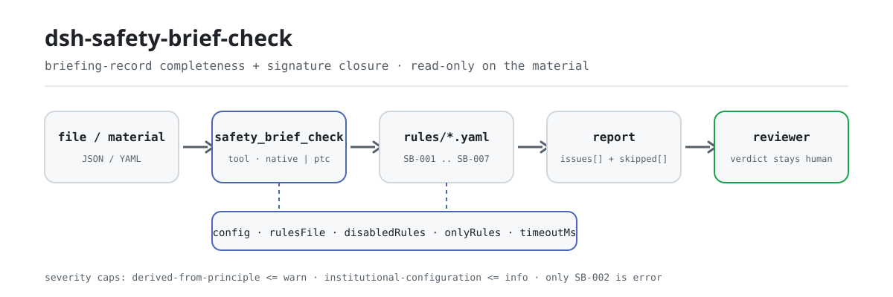

<div align="center">

<picture>
  <source media="(prefers-color-scheme: dark)" srcset="docs/assets/dsh-safety-brief-check-flow-dark.svg">
  
</picture>

# dsh-safety-brief-check

**核完一份安全技术交底记录，直接拿到「哪一条、哪一栏、差什么、怎么补」的清单——结论留给审核人。**

面向 DeepSeek Harness 的交底记录核查插件：读一份交底记录（表头、被交底人与签字两份名单、工种列表），按随包的版本化规则包（SB-001..SB-007）逐条核对，只列材料内部能逐条指认的差异，不判合规、不认定责任、不替代审核人。

[安装](#三步上手) · [配置](#配置) · [FAQ](#faq) · [简体中文](README.md) · [English](README.en.md) · [Español](README.es.md) · [Português](README.pt.md) · [हिन्दी](README.hi.md)

[](LICENSE)
[](#兼容性)
[](https://www.npmjs.com/package/dsh-safety-brief-check)
[](https://github.com/PerryLink/dsh-safety-brief-check/actions/workflows/ci.yml)
[](#兼容性)

[](https://github.com/PerryLink/dsh-safety-brief-check/stargazers)
[](https://www.npmjs.com/package/dsh-safety-brief-check)
[](https://dshfind.com/plugins/PerryLink/dsh-safety-brief-check?ref=badge)
[](https://securityscorecards.dev/viewer/?uri=github.com/PerryLink/dsh-safety-brief-check)
[](https://dsh.market/)
[](https://gitee.com/perrylink/dsh-safety-brief-check)

```sh
dsh plugin --profile <name> add dsh-safety-brief-check
```

</div>

<sub>社区插件，与 DeepSeek 官方无关。唯一仓库：<https://github.com/PerryLink/dsh-safety-brief-check>（Gitee 为镜像）。</sub>

## 它是什么

`dsh-safety-brief-check` 读取一份**安全技术交底记录**——表头字段、被交底人与签字两份名单、工种列表——核对这份记录自身的齐备与闭环：本机构表式要求的栏目是否填写、被交底人是否都在签字名单中出现且无人重复签字、交底日期是否不晚于施工日期、实际参建工种是否出现在交底记录的工种列表中、记录是否写明工程部位与交底人、是否留有交底人、被交底人、专职安全员三方签字的位置、交底内容是否涉及危险因素、操作规程与应急措施。

它不判定交底内容是否充分、是否针对了正确的危险源、签字是否本人所签，也不判定是否应当处罚。

- **给谁用**：安全员、施工班组长、资料员；不用懂命令行，在对话里把材料交给它即可。
- **你交什么**：这项核对用到的原始材料（表格、清单或文书）；不改原件。Excel 可先转成 JSON/YAML，对话里也能代转。
- **它交什么**：一份「哪一条、哪一栏、差什么、怎么补」的清单；没能执行的检查逐条列入 `skipped` 并写明原因。

## 三步上手

1. **安装**（三选一）：

   ```sh
   # git 通道（最新 main；等价于 git+https://github.com/PerryLink/dsh-safety-brief-check.git）
   dsh plugin --profile <name> add github:PerryLink/dsh-safety-brief-check
   # npm 通道（已发布版本）
   dsh plugin --profile <name> add dsh-safety-brief-check
   # tarball 通道：本仓库 pnpm pack 后
   dsh plugin --profile <name> add ./dsh-safety-brief-check-<version>.tgz
   ```

   git 通道会跑 `prepare`（tsdown）现场构建 `lib/`；npm 通道带来的已是构建产物，tarball 通道请先确认 `pnpm run build` 已产出 `lib/`。

2. **最小配置**（默认即可用；bundle 行不带 `config` 时全部走默认值，规则包路径指向随包的 `rules/safety-brief-check.yaml`）：

   ```yaml
   - insert:
       - id: dsh-safety-brief-check
         name: dsh-safety-brief-check
   ```

3. **验证已生效**：

   ```sh
   dsh --profile <name> --dump-config | grep 'dsh-safety-brief-check'
   ```

   然后把一份记录交给它，例如用仓内自带样例（对应 `samples/quickstart/expected/result.json`）：

   ```text
   > 用自带样例跑一次这项检查，告诉我发现了几条问题、分别是什么级别。
   safety_brief_check: 2 issue(s) — error 0, warn 2, info 0
   skipped: 5
   ```

**卸载**：`dsh plugin --profile <name> remove dsh-safety-brief-check`（或从 profile patch 删掉该行）。

<details>
<summary>在 WorkBuddy / 扣子中使用</summary>

在 WorkBuddy / 扣子搜「安全合规核对包」（总包，本检查是其中一项；上架以商城为准）即可调用同一套核对能力，无需命令行。

</details>

<details>
<summary>从 DSH Desktop 市场安装</summary>

所有 PerryLink 插件均可在 DSH Desktop 内置市场中浏览：**市场 → 来源 → 添加来源 → 粘贴** `https://perrylink-dsh-catalog.perrylink.workers.dev/catalog-source.json` **→ 选中**。安装仍需通过市场的 npm 身份校验与你的确认。

</details>

## 核心能力

`dsh-safety-brief-check` 注册 `safety_brief_check` 工具：读入一份交底记录，套用版本化规则包，返回一份报告。

- **七条规则一包带走** —— 规则包是数据不是代码（`rules/safety-brief-check.yaml`），换掉规则包即换掉整套检查，不动一行 TypeScript；规则 id 为 `SB-001`..`SB-007`。
- **只读材料** —— 接受 JSON 或 YAML，原件永不修改；纯 ESM，无网络请求、不调用模型。
- **引文不造假** —— 每条规则带 `document` / `number` / `clause` / `excerpt` / `kind` / `source`，`excerpt` 必须是逐字引文；未取得原文的规则在规则包里如实写明，绝不把概述当成引文。
- **严重级跟着证据走** —— `derived-from-principle` 最高 `warn`，本机构配置（`institutional-configuration`）最高 `info`，并有测试断言。
- **空清单 ≠ 没问题** —— 每条没能执行的检查都进 `skipped` 并写明原因；必填清单未配置的规则自我报告 `skipped`，绝不静默通过。
- **措辞不作裁决** —— 报告只列差异，不判定合规、责任或正确性；措辞守卫（`src/shared/wording.ts`）强制执行，报告永远附带免责声明。

| 规则 | 核对内容 | 严重级 | 依据 |
|---|---|---|---|
| `SB-001` | 记录填写了本机构表式要求的栏目（出厂未配置） | info | GB 50870-2013 第8.2.3条 |
| `SB-002` | 每名被交底人都在签字名单中出现，且无人重复签字 | **error** | 国务院令第393号 第二十七条 |
| `SB-003` | 交底日期不晚于施工日期 | warn | 第二十七条（推论） |
| `SB-004` | 被交底工种覆盖实际参建工种 | warn | JGJ 59-2011 第3.1.3条第3款第2）项 |
| `SB-005` | 记录写明工程部位与交底人 | warn | GB 50870-2013 第8.2.1条 |
| `SB-006` | 记录留有交底人、被交底人、专职安全员三方签字位置 | warn | JGJ 59-2011 第3.1.3条第3款第4）项 |
| `SB-007` | 交底内容涉及危险、操作规程、应急 | warn | GB 50870-2013 第8.2.3条 |

### 示例

以下为插件真实入口；安装后调用一次即可。第一行是详细走查，其余是简短案例。

下面的输出是本插件对自己 `SB-002` 测试夹具的真实运行结果，不是示意图；规则库也不伪造引文——每条发现都写明所引条款，以及该条 `excerpt` 是逐字引文还是原则性推论。

**详细示例** — 工具 `safety_brief_check`，输入：

```json
{"被交底人":"李四、王五、赵六","签字":"李四、王五"}
```

输出：

```json
{
  "id": "dsh-safety-brief-check.SB-002.029bddbd",
  "ruleId": "SB-002",
  "severity": "error",
  "locator": {
    "row": 0,
    "column": "被交底人"
  },
  "found": "被交底人「赵六」在签字列表中未出现",
  "expected": "被交底人应当在交底记录上签字确认",
  "fix": "核对是否漏签；本条只比对名单，不判断签字是否为本人所签"
}
```

*Observed from `dsh-safety-brief-check/tests/fixtures/SB-002/SB-002-unsafe.json`*

| 你会问 | 它怎么答 |
|---|---|
| 有一位被交底人始终没有签字，报告会说什么？ | `SB-002`——本插件唯一的 `error` 级规则——把被交底人名单与签字名单逐条比对，凡在签字名单中找不到的人都会报出；同一姓名在签字名单中重复出现则单独报出，因为两种缺口的补正方式不同。它只比对这两份名单：无法判断签名是否为本人所签，也不要求逐人签署——若本机构允许集体签署，请在材料中写明签署方式，或把本条列入 `disabledRules`。 |
| 交底日期晚于施工日期，算不算错？ | `SB-003` 会报出；同一天视为不晚于。本条封顶 `warn`：第二十七条只把「施工前」作为时间前提，并未逐字规定这一先后比较，所以它提示的是人工复核线索——作业中途为新发现的危险源补充交底，晚于施工日期是正常的，记录中应加以说明。日期无法解析时会单独报出，不会静默跳过。 |
| 要填哪些栏目才算通过？ | `SB-001` 读取 `requiredFields`，出厂为空，因此它报 `skipped`（未配置），而不是通过。把你表式的栏目列进去之后，它会报出缺失或为空的栏目——空串视为未填——但不判断填写内容是否正确。 |
| 记录里有被交底人栏，却没有专职安全员签字的位置。 | `SB-006` 在表头层面核对三方——交底人、被交底人、专职安全员——是否都有位置，缺哪一栏就报哪一栏；栏位名可按本机构表式替换。本条封顶 `warn`，因为 JGJ 59-2011 第3.1.3条属推荐性检查评定条款（该标准的强制性条文第4.0.1、5.0.3条已被住房和城乡建设部公告 2022 年第 164 号废止）。它只核对位置是否齐备，不判断是否有人签了字——那是 `SB-002` 的问题。 |
| 在该部位作业的工种没有出现在交底记录的工种列表里。 | `SB-004` 把实际参建工种与记录中的工种列表比对，报出未出现的工种。本条封顶 `warn`：JGJ 59-2011 要求交底「分部分项进行」，但未规定交底内容与工种的强制映射表；当材料与 `workTrades` 参数都未提供实际参建工种时，本条报 `skipped`，不硬编码任何工种表。它只比对名称，像「钢筋工」与「钢筋班组」会被算作不同，也不判断交底内容是否针对该工种。 |

### 工具参数

| 参数 | 类型 | 说明 |
|---|---|---|
| `file` | string | 材料文件绝对路径（JSON 或 YAML）；与 `material` 二选一 |
| `material` | string | 内联材料文本；与 `file` 二选一 |
| `rulesFile` | string | 覆盖配置中的规则库路径（相对插件包根或绝对路径） |
| `only` | string[] | 只执行这些规则 id；留空表示执行全部规则 |

## 依据的标准

| 文件 | 文号 | 引用它的规则 |
|---|---|---|
| 《建筑施工安全技术统一规范》 | GB 50870-2013 | SB-001, SB-002, SB-005, SB-007 |
| 《建筑施工安全检查标准》 | JGJ 59-2011 | SB-001, SB-002, SB-004, SB-006, SB-007 |
| 《建设工程安全生产管理条例》 | 国务院令第393号 | SB-002, SB-003 |

> ### ⚠️ 一条 `error`，以及两项已废止的强制性条文——本规则库拒绝误用它们
>
> **`SB-002` 是唯一一条 `error` 级规则**，它依据的是一部行政法规：《建设工程安全生产管理条例》**第二十七条**要求交底「并由双方签字确认」，并以第六十四条第（一）项作为罚则。其余规则的严重级上限都是 `warn` 或 `info`。
>
> 规则库记录了两处更正，否则读者容易弄错：
>
> **1. JGJ 59-2011 第 3.1.3 条——与本插件最贴近的条款——是一条*推荐性*的检查评定条款。** 该标准原本仅有 4.0.1 与 5.0.3 两条强制性条文，而**两条均已被废止**：住房和城乡建设部公告 2022 年第 164 号（2023-06-01 起施行）。因此 `SB-006`（三方签字）为 `warn`，其 note 写明了原因。
>
> **2. GB 50656-2011 第 10.0.6 条因同一份公告失去强制性效力，且其「班前安全操作规程交底」的表述位于条文说明，而不在条文之中。** 因此本规则库**完全不引用该标准**——有测试断言该标准编号从不出现在库中。
>
> **国家法律对班前会没有任何规定。**《安全生产法》共 119 条，其中没有出现「班前」二字；无论是该法、行政法规、部门规章还是国家标准，都没有涉及此事。省级文件（例如山东的班前「晨会」指引）确实存在，但属于**地方性文件，不是国家规定**——因此任何班前检查出厂时都未配置，规则库对此如实说明。
>
> 已写明的局限：签字核对**只比较姓名清单**，无法判断签字是否出自本人；内容核对是**字面词出现与否的检测**，无法判断一次交底做得好不好——JGJ 59-2011 自己的评分表会对「针对性不强」扣分，而这是任何字符串操作都做不出的判断。

## 配置

全部可调参数都是 `src/config.ts` 里的 Schemastery `Config` 字段（可从 cordis.yml 覆盖），逐条阈值在 `rules/` 下的规则库文件里。按 id 覆盖会替换整行——请重述所有需要的键。

| 键 | 类型 | 默认值 | 说明 |
|---|---|---|---|
| `rulesFile` | string | `rules/safety-brief-check.yaml` | 规则库文件路径，相对插件包根目录；相对路径按模块目录逐级向上解析，最后才回退到进程工作目录，解析不到即报错并列出尝试过的位置 |
| `disabledRules` | string[] | `[]` | 要停用的规则 id 列表；每条都会出现在 `skipped` 中 |
| `onlyRules` | string[] | `[]` | 只执行这些规则 id；留空表示执行全部规则 |
| `skipNotes` | string | `""` | 附加到每条 `skipped` 说明后的备注，例如标注本机构实施细则 |
| `timeoutMs` | number | `120000` | 工具协作式超时预算（毫秒） |

值得了解的规则级参数（写在 `rules/` 的规则库文件里，不在上面的 Config 中）：

- `SB-001` `requiredFields` —— 记录必须携带的栏目，例如 `[工程名称, 交底部位, 交底日期, 交底人, 被交底人]`。留空表示本条不执行。
- `SB-004` `requireTradeMatch` —— 设为 `false` 即停止把被交底工种与实际参建工种比对。
- `SB-005` `requireHeader` —— 若本机构记录本就不带表头，设为 `false`。
- `SB-006` `parties` —— 标准点名的签字三方，`[交底人, 被交底人, 专职安全员]`。
- `SB-007` `terms` / `contentColumns` —— 交底内容应涉及的词，以及从哪些栏目读取。`terms` 留空表示本条不执行。

<details>
<summary>逐键细节与 profile patch 覆盖示例</summary>

- `rulesFile` 解析顺序：绝对路径 → 模块目录的每一级祖先目录 → 进程工作目录；全都找不到时抛错，错误信息列出尝试过的位置。**绝不静默回退到另一份规则库**——那会产出一份用错依据的报告。
- `disabledRules` 里写下的每条规则都进 `skipped`，原因写明「该规则在当前配置中被禁用」，`skipNotes` 会追加在其后。
- `onlyRules` 与工具参数 `only` 同时给时，参数优先；本次调用之外被排除的规则同样进 `skipped` 并写明原因。
- `skipNotes` 只影响 `skipped` 的措辞，不改变任何判定。

```yaml
- insert:
    - id: dsh-safety-brief-check
      name: dsh-safety-brief-check
      config:
        disabledRules: [SB-007]
        skipNotes: 本机构实施细则第 4 条
        timeoutMs: 180000
```

</details>

## 材料格式

工具接受 JSON 或 YAML。一份记录就是一张扁平映射；名单与工种列表可以是数组，也可以是分隔符串：

```yaml
工程名称: 某某厂房工程
交底部位: 二层结构
交底日期: 2026-03-10
施工日期: 2026-03-12
交底人: 张工
被交底人: 李四、王五、赵六
签字: 李四、王五、赵六
工种: 钢筋工、木工
```

```yaml
被交底人: [李四, 王五]      # 数组写法同样可用
签字: 李四，王五；          # 中文标点也按同样的分隔规则切分
```

列名按字段的别名表识别（`src/model.ts` 的 `COLUMNS`），中英文列名都能认；名称比对时去掉空白字符，所以 `李 四` 与 `李四` 是同一个人。缺签字与重复签字会产生**两条不同的**发现，因为两种缺口需要不同的补正方式。日期无法解析时会被当作「无法解析」报出，而不是跳过——因此一个格式写坏的单元格永远藏不住先后顺序这条核对。字段在读取层是可选的，由检查引擎校验，因此部分导出的材料会产生「缺项」类差异，而不是让程序崩溃。

## 规则来源

规则数据在 `rules/safety-brief-check.yaml`，与代码分离：每条规则都带文件名、文号、按原文自身编号体系的条款号、逐字摘录与来源地址。加载期强制：摘录必须是真实引文且不少于八个字符；依据仅为原则性条款（`kind: derived-from-principle`，严重级上限 `warn`）或本机构配置（`kind: institutional-configuration`，上限 `info`）的检查不得标为 `error`。夸大依据的规则库会在加载期失败，而不会产出一份看起来很有底气的报告。

被引用的条款来自：

- **《建设工程安全生产管理条例》**（国务院令第393号，2004-02-01 施行，未修正）—— 第二十七条、第六十四条第（一）项
- **《建筑施工安全检查标准》**（JGJ 59-2011）—— 第3.1.3条第3款第2）3）4）项，以及附录B 的评分条目
- **《建筑施工安全技术统一规范》**（GB 50870-2013）—— 第8.2.1条、第8.2.3条、第8.2.4条

两处更正塑造了这个规则包，它们都写在规则库头部：

1. **行业标准的那一条是推荐性的。** JGJ 59-2011 的强制性条文只有 4.0.1 与 5.0.3，两条均已被住建部公告 2022 年第 164 号废止；因此引用 3.1.3 的规则一律封顶 `warn`。
2. **GB 50656-2011 第 10.0.6 条因同一份公告失去强制性效力**，且它的班前表述位于条文说明而非条文之中——因此规则库完全不引用该标准。

引文核验记录（含已核对并排除的来源）随包收录在 `rules/evidence/clause-verification.md`；`pnpm run check:citations` 会拿规则包的每条摘录去 `rules/evidence/` 里逐段比对，`rules/citations-baseline.json` 只能缩小、不能放大。

## FAQ

<details>
<summary>材料会被上传吗？报告和数据存在哪？</summary>

不会被上传。本插件是纯本地核查：读取你交给工具的材料内容，不发起网络请求，不带遥测、统计或后台上报，也不在你的工具结果与 DSH 宿主自身的会话/日志存储之外写任何数据。那份存储由宿主控制、按宿主的留存策略处理，本包不额外留第二份副本。卸载本包只删掉代码，不会删除宿主已有的会话日志，也不会删除你已经创建的材料。

</details>

<details>
<summary>`issues` 为空，能当作「这份记录没问题」吗？</summary>

不能。每条没能执行的检查都列在 `skipped` 里并写明原因（例如必填栏目清单为空、材料未提供实际参建工种、交底内容栏缺失）。判读报告时请把差异条目与 `skipped` 一起看完；`skipped` 的含义是「这条没查」，不是「这条通过了」。

</details>

<details>
<summary>它会替我们下「合规 / 不合规」的结论吗？</summary>

不会。它只列出材料内部能逐条指认的差异（哪一条、哪一栏、差什么、怎么补），不下事实判断，也不评价合规性——结论永远留给审核人。报告措辞由措辞守卫（`src/shared/wording.ts`）强制约束，且每份报告都附带免责声明（`DISCLAIMER`）。

</details>

<details>
<summary>会和别的插件抢工具名、服务键或界面位置吗？</summary>

不会。它只 `inject: ['tools']`，只注册一个带命名空间的工具 `safety_brief_check`，不提供任何服务键、不注册客户端 slot、不注册 `webServer` 前缀、不监听任何宿主事件、不改写全局对象；组合包 patch 也只 `insert` 自己那一行。逐条说明见「与其他 DSH 插件的互操作性」。

</details>

<details>
<summary>一整批交底记录一起查，性能吃得消吗？</summary>

吃得消。检查本身是纯本地的列匹配与日期算术，无网络请求、不调用模型；规则包每进程只解析一次并缓存，重复调用不重复读盘。工具在 `native` 与 `ptc` 两种模式都能跑，批量校验建议 `ptc`（schema 成本只付一次）；`timeoutMs`（默认 120 秒）是协作式超时预算。

</details>

## 安全边界

本插件核对一份**安全技术交底记录**在记录层面可以要求到的内容——你的表单所要求的栏目是否填写，**每一位被交底人是否都显示为已签字**，交底日期是否不晚于作业日期，被交底工种是否覆盖实际作业的工种，以及记录是否写明其地点与交底人。它**不**判定交底内容是否充分、交底是否针对了正确的危险源，或签字是否真实。

- **只读材料。** 材料由工具读入后即不再修改，原件永远不动；也没有任何写回路径。
- **离线。** 不发起网络请求、不存凭据、不调用模型；工具结果之外不写盘（宿主自身的会话/日志存储除外）。
- **规则库路径解析失败即报错。** `resolvePackageFile` 找不到规则库时抛错并列出尝试过的位置，绝不静默回退到另一份规则库——用错依据比不查更糟。
- **空清单不等于通过。** 每条没能执行的检查都进 `skipped` 并写明原因；必填清单未配置的规则自我报告 `skipped`。
- **不裁决。** 报告只列差异，不判定合规、责任或正确性；措辞守卫（`src/shared/wording.ts`）禁止裁决性措辞，每份报告都附带 `DISCLAIMER` 免责声明。

## 已知限制

- **只比对名单。** 签字核对比较的是两份姓名清单：判断不了签名是否本人所签，也不要求逐人签署——JGJ 59-2011 与 GB 50870-2013 只要求「双方/三方签字确认」，国家层面亦无逐人签字的明文。本机构允许集体签署时，请在材料中写明签署方式，或停用 `SB-002`。
- **只做字面出现性检测。** `SB-007` 核对「危险 / 操作规程 / 应急」三个词是否出现在交底内容中，字面出现不等于讲清楚了；JGJ 59-2011 附录B 对「交底内容针对性不强」扣 3~5 分，说明这一项本就是检查人员的主观判断，任何字符串操作都做不出。
- **出厂未配置的两条。** `SB-001` 的 `requiredFields` 与 `SB-004` 的实际参建工种出厂都为空，两条都报 `skipped` 而不是静默通过；规则包不硬编码任何栏目表或工种表，因为栏杆与工种因机构、工程而异。
- **只认名称。** `SB-004` 比对工种名称，像「钢筋工」与「钢筋班组」会被算作不同，写法的差异会造成误报——建议统一台账用词。
- **墙上时钟。** 全部日期比较都是对输入字符串做墙上时钟运算，不做时区换算；解析不了的日期单独报出，不静默跳过。
- **日期晚于施工日期不等于违规。** `SB-003` 封顶 `warn`：作业中途为新发现的危险源补充交底，晚于施工日期是正常的，此时应在记录中说明——这正是本条提示人工核对而不直接认定的原因。
- **`SB-006` 停在 `warn`。** JGJ 59-2011 第3.1.3条属推荐性检查评定条款，其强制性条文已被住建部公告 2022 年第 164 号废止，因此这里只按行业标准提示，不按「违反强制性条文」处理。

## 与其他 DSH 插件的互操作性

本插件只 `inject: ['tools']`，工具面之外不触及其他宿主能力：

- **无工具名冲突。** 只注册一个工具 `safety_brief_check`，带命名空间；不占用任何内置工具或其他插件持有的裸名。
- **无服务键冲突。** 不提供任何服务键，因此不可能撞键。
- **无 slot 冲突。** 不注册客户端 slot key（本包没有浏览器半）。
- **无 HTTP 路由冲突。** 不注册任何 `webServer` 前缀。
- **无事件监听。** 不注册 `agent/pre-step`、`tools/post-execute` 一类顺序敏感事件的监听器，因此不参与任何链条，也无从短路它。
- **无 patch 层冲突。** 组合包 patch（`cordis.patch.yml`）只 `insert` 自己那一行，从不覆写内置行的 `config`。
- **无全局改写。** 不改原型、不改写 `process.env`、不替换全局 fetch dispatcher。

## 兼容性

| 项目 | 状态 |
|---|---|
| Harness | 对等版本范围 `>=0.1.2-rc.1 <0.2.0 \|\| >=0.2.0-0 <0.3.0` —— 已实测同时接受 `0.2.0-rc.2` 与 `0.2.1-rc.2`。已声明 `engines.dsh`：0.2.1 起由宿主单独裁决，范围为 `>=0.2.1-0 <0.3.0` |
| Node | `^22.19.0 \|\| >=24.0.0` |
| 平台 | 全平台（纯 ESM；无原生代码、无联网、不调用模型） |
| 工具模式 | `native` / `ptc` 均可；批量校验整个目录时建议 `ptc`，schema 成本只付一次 |

## 排障

- **`SB-001` 报告自身为 `skipped`。** 它的栏目清单为空。填入你表式实际使用的栏目。
- **`SB-004` 什么都不报。** 材料与调用参数都没提供实际参建工种。传入 `workTrades`，或接受这一项没有被核对。
- **`SB-002` 标了一个确实签过字的人。** 两栏的写法可能不同（多一个空格、换了一个字）。比对会去掉空白字符，其余按原样精确比较。
- **`SB-003` 在一条正确的记录上命中。** 若交底晚于作业（作业中途发现新危险源），规则包的注记说明这是正常情形，应在记录中说明。该发现是提示核对，从不是认定。
- **插件装上了但工具不出现。** 确认 `main` 解析到 `lib/index.mjs`，且 `pnpm run build` 已产出该文件；`main` 写错会让加载器静默跳过该条目。
- **`dsh plugin add` 以不兼容为由拒绝安装。** peer 范围覆盖 `0.1.x` 与 `0.2.x`；若运行时在其之外，可显式豁免：`dsh plugin --profile <name> allow-version dsh-safety-brief-check@0.1.0 --dsh-version <runtime> --accept-risk`
- **`check` 把 `manifest-peers` 报为失败。** 静态检查器比对的是一份早于 0.2 世代的硬编码 peer 范围；安装期的 peer 校验以运行时为准，声明的范围才是正确的。这是 `dsh-plugin-dev` 的已知上游问题。
- **某条规则没有执行。** 查看 `skipped` 数组，其中写明了规则 id 与原因。
- **时间看起来偏移。** 全部计算都是对输入字符串做墙上时钟运算，不做时区换算。

## 生态与质量

- [Gitee 镜像](https://gitee.com/perrylink/dsh-safety-brief-check)（同步镜像，以 GitHub 为准）
- [dshfind 插件页](https://dshfind.com/plugins/PerryLink/dsh-safety-brief-check)（安装量与排名）
- [OpenSSF Scorecard 报告](https://securityscorecards.dev/viewer/?uri=github.com/PerryLink/dsh-safety-brief-check)（由 [.github/workflows/scorecard.yml](.github/workflows/scorecard.yml) 驱动）
- [DSH Market](https://dsh.market/)（已上架）
- [按材料选核查器](https://perrylink.github.io/zh/checkers/choose/)（家族索引：哪份材料配哪个核查器）

## 开发

```sh
pnpm install                                        # node ^22.19 || >=24
pnpm run typecheck                                  # tsc --noEmit
pnpm test                                           # vitest：共享表格插件套件 + 成对夹具（37 个用例）
pnpm run build                                      # tsdown -> lib/index.mjs + lib/index.d.mts
pnpm run verify:self-contained                      # 依赖 spec 均来自 registry
pnpm run check:lockfile                             # lockfile 漂移检查
pnpm run check:readmes                              # 五语 README 一致性
pnpm run check:citations                            # 规则包引文基线
node ../scripts/sync-shared.mjs dsh-safety-brief-check   # 从 ../_shared 刷新 src/shared
pnpm pack                                           # 发布 tarball
```

本插件是**数据型**的：`src/model.ts` 声明记录结构，共享套件提供读取器与检查引擎，规则包声明每一条检查。本地样例试跑（需先 `pnpm run build` 产出 `lib/`）：

```sh
node samples/quickstart/run.mjs --json
# => {"tool":"safety_brief_check","issueCount":2,"summary":{"error":0,"warn":2,"info":0},"skippedCount":5}
```

样例输入在 `samples/quickstart/input/`，期望输出在 `samples/quickstart/expected/result.json`，截图见 `docs/assets/quickstart.png`。README 配图由 [`scripts/gen-readme-assets.py`](scripts/gen-readme-assets.py) 程序化生成（Python + Pillow），可重复执行；旧的单版流程图、hero 与演示图保留在 `docs/assets/` 供外链使用，README 只引用新生成的深浅双版。

Topics：`deepseek-harness`, `dsh`, `dsh-plugin`, `cordis`, `safety`, `brief`

## 家族与致谢

本项目是 [PerryLink](https://github.com/PerryLink) 维护的 DeepSeek Harness 插件家族成员（全部 Apache-2.0）。完整家族索引见[按材料选核查器](https://perrylink.github.io/zh/checkers/choose/)。如果这个插件帮到了你，**给个 star**——它不解锁任何功能，但会让下一个人更容易找到它。

- [@PerryLink](https://github.com/PerryLink) —— 创建者与维护者：数据型规则包（SB-001..SB-007）、`safety_brief_check` 工具、引文核验记录与五语文档。

<details>
<summary>展开全部插件</summary>

| 插件 | 状态 |
|---|---|
| **[dsh-aqua-input-check](https://github.com/PerryLink/dsh-aqua-input-check)** |  |
| **[dsh-archive-check](https://github.com/PerryLink/dsh-archive-check)** |  |
| **[dsh-auto-review](https://github.com/PerryLink/dsh-auto-review)** |  |
| **[dsh-autotier](https://github.com/PerryLink/dsh-autotier)** | 🧊 已冻结 — 见仓库 README |
| **[dsh-bid-ca-precheck](https://github.com/PerryLink/dsh-bid-ca-precheck)** |  |
| **[dsh-bid-qual-check](https://github.com/PerryLink/dsh-bid-qual-check)** |  |
| **[dsh-cert-mcp](https://github.com/PerryLink/dsh-cert-mcp)** | 🧊 已冻结 — 见仓库 README |
| **[dsh-checkpoint-rewind](https://github.com/PerryLink/dsh-checkpoint-rewind)** |  |
| **[dsh-click](https://github.com/PerryLink/dsh-click)** |  |
| **[dsh-composer-history](https://github.com/PerryLink/dsh-composer-history)** |  |
| **[dsh-contract-stance](https://github.com/PerryLink/dsh-contract-stance)** |  |
| **[dsh-customs-doc-check](https://github.com/PerryLink/dsh-customs-doc-check)** |  |
| **[dsh-data-quality](https://github.com/PerryLink/dsh-data-quality)** | 🧊 已冻结 — 见仓库 README |
| **[dsh-demurrage-ledger](https://github.com/PerryLink/dsh-demurrage-ledger)** |  |
| **[dsh-doublecheck](https://github.com/PerryLink/dsh-doublecheck)** |  |
| **[dsh-drill-script-check](https://github.com/PerryLink/dsh-drill-script-check)** |  |
| **[dsh-eia-guide-check](https://github.com/PerryLink/dsh-eia-guide-check)** |  |
| **[dsh-emergency-plan](https://github.com/PerryLink/dsh-emergency-plan)** |  |
| **[dsh-essay-rubric-check](https://github.com/PerryLink/dsh-essay-rubric-check)** |  |
| **[dsh-evidence-check](https://github.com/PerryLink/dsh-evidence-check)** |  |
| **[dsh-export-ctl-check](https://github.com/PerryLink/dsh-export-ctl-check)** |  |
| **[dsh-fast](https://github.com/PerryLink/dsh-fast)** |  |
| **[dsh-fmea-table-check](https://github.com/PerryLink/dsh-fmea-table-check)** |  |
| **[dsh-forecast-penalty](https://github.com/PerryLink/dsh-forecast-penalty)** |  |
| **[dsh-fund-research](https://github.com/PerryLink/dsh-fund-research)** |  |
| **[dsh-github](https://github.com/PerryLink/dsh-github)** |  |
| **[dsh-gongwen-flow-check](https://github.com/PerryLink/dsh-gongwen-flow-check)** |  |
| **[dsh-gongwen-word-check](https://github.com/PerryLink/dsh-gongwen-word-check)** |  |
| **[dsh-guard-plan-qc](https://github.com/PerryLink/dsh-guard-plan-qc)** |  |
| **[dsh-hazchem-check](https://github.com/PerryLink/dsh-hazchem-check)** |  |
| **[dsh-hazplan-check](https://github.com/PerryLink/dsh-hazplan-check)** |  |
| **[dsh-hidden-risk-map](https://github.com/PerryLink/dsh-hidden-risk-map)** |  |
| **[dsh-hs-classify](https://github.com/PerryLink/dsh-hs-classify)** |  |
| **[dsh-icd-rule-check](https://github.com/PerryLink/dsh-icd-rule-check)** |  |
| **[dsh-industry-research](https://github.com/PerryLink/dsh-industry-research)** |  |
| **[dsh-lawcite-adapter](https://github.com/PerryLink/dsh-lawcite-adapter)** |  |
| **[dsh-laya](https://github.com/PerryLink/dsh-laya)** |  |
| **[dsh-lc-doc-check](https://github.com/PerryLink/dsh-lc-doc-check)** |  |
| **[dsh-learning-gap-check](https://github.com/PerryLink/dsh-learning-gap-check)** |  |
| **[dsh-library](https://github.com/PerryLink/dsh-library)** |  |
| **[dsh-local-ai](https://github.com/PerryLink/dsh-local-ai)** |  |
| **[dsh-lsp-actions](https://github.com/PerryLink/dsh-lsp-actions)** |  |
| **[dsh-mask](https://github.com/PerryLink/dsh-mask)** |  |
| **[dsh-mcp-panel](https://github.com/PerryLink/dsh-mcp-panel)** |  |
| **[dsh-medrec-qc](https://github.com/PerryLink/dsh-medrec-qc)** |  |
| **[dsh-memento](https://github.com/PerryLink/dsh-memento)** | 🧊 已冻结 — 见仓库 README |
| **[dsh-nsfc-form-check](https://github.com/PerryLink/dsh-nsfc-form-check)** |  |
| **[dsh-nurse-record-check](https://github.com/PerryLink/dsh-nurse-record-check)** |  |
| **[dsh-observe](https://github.com/PerryLink/dsh-observe)** |  |
| **[dsh-origin-rvc-check](https://github.com/PerryLink/dsh-origin-rvc-check)** |  |
| **[dsh-ota-review-check](https://github.com/PerryLink/dsh-ota-review-check)** |  |
| **[dsh-output-styles](https://github.com/PerryLink/dsh-output-styles)** |  |
| **[dsh-paper-doc-adapter](https://github.com/PerryLink/dsh-paper-doc-adapter)** |  |
| **[dsh-permission-rules](https://github.com/PerryLink/dsh-permission-rules)** |  |
| **[dsh-permit-report-check](https://github.com/PerryLink/dsh-permit-report-check)** |  |
| **[dsh-pipeline-check](https://github.com/PerryLink/dsh-pipeline-check)** |  |
| **[dsh-pleading-draft](https://github.com/PerryLink/dsh-pleading-draft)** |  |
| **[dsh-plugin-doctor](https://github.com/PerryLink/dsh-plugin-doctor)** | 🚫 已退役（仓库已归档） |
| **[dsh-plugin-guide](https://github.com/PerryLink/dsh-plugin-guide)** |  |
| **[dsh-plugin-kit](https://github.com/PerryLink/dsh-plugin-kit)** | 🚫 已退役（仓库已归档） |
| **[dsh-plugin-upgrade](https://github.com/PerryLink/dsh-plugin-upgrade)** | 🚫 已退役（仓库已归档） |
| **[dsh-policy-brief-draft](https://github.com/PerryLink/dsh-policy-brief-draft)** |  |
| **[dsh-power-loss-split](https://github.com/PerryLink/dsh-power-loss-split)** |  |
| **[dsh-power-ticket-check](https://github.com/PerryLink/dsh-power-ticket-check)** |  |
| **[dsh-ppap-check](https://github.com/PerryLink/dsh-ppap-check)** |  |
| **[dsh-protest-deadline](https://github.com/PerryLink/dsh-protest-deadline)** |  |
| **[dsh-railway-window](https://github.com/PerryLink/dsh-railway-window)** |  |
| **[dsh-repair-order-qc](https://github.com/PerryLink/dsh-repair-order-qc)** |  |
| **[dsh-research-report](https://github.com/PerryLink/dsh-research-report)** |  |
| **[dsh-review-reply-check](https://github.com/PerryLink/dsh-review-reply-check)** |  |
| **[dsh-rulefile-check](https://github.com/PerryLink/dsh-rulefile-check)** |  |
| **[dsh-safety-brief-check](https://github.com/PerryLink/dsh-safety-brief-check)** |  |
| **[dsh-score](https://github.com/PerryLink/dsh-score)** | 🧊 已冻结 — 见仓库 README |
| **[dsh-session-sync](https://github.com/PerryLink/dsh-session-sync)** |  |
| **[dsh-site-log-check](https://github.com/PerryLink/dsh-site-log-check)** |  |
| **[dsh-skill-pack-security](https://github.com/PerryLink/dsh-skill-pack-security)** |  |
| **[dsh-soe-decision-check](https://github.com/PerryLink/dsh-soe-decision-check)** |  |
| **[dsh-soilwater-check](https://github.com/PerryLink/dsh-soilwater-check)** |  |
| **[dsh-sop-sync-check](https://github.com/PerryLink/dsh-sop-sync-check)** |  |
| **[dsh-spc-gbt-adapter](https://github.com/PerryLink/dsh-spc-gbt-adapter)** |  |
| **[dsh-talk](https://github.com/PerryLink/dsh-talk)** |  |
| **[dsh-tender-extract](https://github.com/PerryLink/dsh-tender-extract)** |  |
| **[dsh-tender-matrix](https://github.com/PerryLink/dsh-tender-matrix)** |  |
| **[dsh-test-drive](https://github.com/PerryLink/dsh-test-drive)** |  |
| **[dsh-ticktick](https://github.com/PerryLink/dsh-ticktick)** | 🚫 已退役（仓库已归档） |
| **[dsh-translate](https://github.com/PerryLink/dsh-translate)** |  |
| **[dsh-warranty-calc](https://github.com/PerryLink/dsh-warranty-calc)** |  |
| **[dsh-budget](https://github.com/PerryLink/dsh-budget)** | 🧊 已冻结 — 见仓库 README |
| **[dsh-claude-move](https://github.com/PerryLink/dsh-claude-move)** | 🧊 已冻结 — 见仓库 README |
| **[dsh-defend](https://github.com/PerryLink/dsh-defend)** | 🧊 已冻结 — 见仓库 README |
| **[dsh-draw](https://github.com/PerryLink/dsh-draw)** | 🧊 已冻结 — 见仓库 README |
| **[dsh-reach](https://github.com/PerryLink/dsh-reach)** | 🧊 已冻结 — 见仓库 README |
| **[dsh-background-agents](https://github.com/PerryLink/dsh-background-agents)** | 🚫 已退役（仓库已归档） |
| **[dsh-session-pin](https://github.com/PerryLink/dsh-session-pin)** | 🚫 已退役（仓库已归档） |
| **[dsh-team-rooms](https://github.com/PerryLink/dsh-team-rooms)** | 🚫 已退役（仓库已归档） |

</details>

## License

[LICENSE](LICENSE)（Apache License 2.0）© 2026 dsh-safety-brief-check contributors

<p align="center"><sub>Apache-2.0 · 社区插件，与 DeepSeek 无关。</sub></p>
