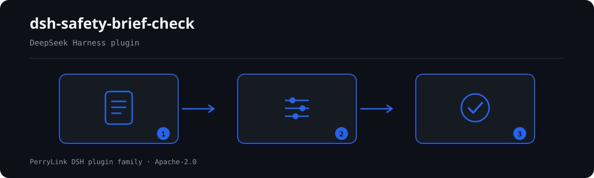

# dsh-safety-brief-check — Safety technical briefing record completeness and signature closure check

[English](README.md) · [简体中文](README-zh.md) · [Español](README-es.md) · [Português](README-pt.md) · [हिन्दी](README-hi.md)

[](https://dsh.market/)
[](https://dshfind.com/en/plugins/PerryLink/dsh-safety-brief-check?ref=badge)

`dsh-safety-brief-check` reads one 安全技术交底记录 — its header fields, its 被交底人 and 签字 lists, and its 工种 lists — and checks that record's own completeness and closure: that the columns your form requires are filled, that every person briefed appears among the signers and that nobody signs twice, that the 交底日期 is not later than the 施工日期, that the trades at work appear in the briefed 工种 list, that the record identifies its 工程部位 and its 交底人, and that it carries a place for the 交底人, 被交底人 and 专职安全员 signatures.

## Install

```sh
dsh plugin --profile <name> add dsh-safety-brief-check
dsh --profile <name> --dump-config | grep 'dsh-safety-brief-check'
```

## What it looks like



*Workflow overview: document → rule pack → findings. The examples below use the real command surface.*


## What it answers

### Examples

The table below is the example set: the first row is the detailed walkthrough, the remaining rows are short cases.

#### Detailed output

**Tool** `safety_brief_check`

**Input**

~~~json
{"被交底人":"李四、王五、赵六","签字":"李四、王五"}
~~~
 
**Output**

~~~json
{
  "id": "dsh-safety-brief-check.SB-002.029bddbd",
  "ruleId": "SB-002",
  "severity": "error",
  "locator": {
    "row": 0,
    "column": "被交底人"
  },
  "found": "被交底人「赵六」在签字列表中未出现",
  "expected": "被交底人应当在交底记录上签字确认",
  "fix": "核对是否漏签；本条只比对名单，不判断签字是否为本人所签"
}
~~~

*Observed from `dsh-safety-brief-check/tests/fixtures/SB-002/SB-002-unsafe.json`*

| You ask | What it answers |
|---|---|
| One of the people briefed never signed. What does the report say? | `SB-002` — the pack's only `error`-level rule — compares the 被交底人 list with the 签字 list and reports every person who does not appear in it; a name that appears twice in the signature list is reported separately, because the two gaps need different fixes. It only compares the two lists: it cannot tell whether a signature is the person's own, and it does not require per-person signing — if your institution allows one signature for a group, say so in the material or list the rule under `disabledRules`. |
| The 交底日期 is later than the 施工日期. Is that an error? | `SB-003` reports it, and the same day counts as not later. The rule is capped at `warn`: 第二十七条 gives 施工前 as a time premise but does not spell out that comparison, so the finding is a lead for review — a briefing added mid-job for a hazard found later is legitimately later, and the record should say so. A date that cannot be parsed is reported on its own rather than dropped in silence. |
| Which columns must the record fill before the check passes? | `SB-001` reads `requiredFields`, which the pack ships empty, so it reports `skipped` (未配置) instead of passing. Once you list your form's columns it reports each one that is absent or empty — an empty string counts as unfilled — and it does not judge whether what was written in them is correct. |
| The record has a 被交底人 column but no place for the 专职安全员. | `SB-006` checks the header for a place for each of the three parties — 交底人, 被交底人, 专职安全员 — and reports the ones with no column; the column names may be replaced to match your form. It stays at `warn` because JGJ 59-2011's 第3.1.3条 is a recommendatory assessment clause (the standard's mandatory 第4.0.1、5.0.3条 were annulled by 住房和城乡建设部公告 2022 年第 164 号). It asks whether the place exists, not whether anyone signed there — that is `SB-002`'s question. |
| The trades that worked on the section are missing from the briefing's 工种 list. | `SB-004` compares the trades at work with the record's 工种 list and reports those that do not appear. It is capped at `warn` because JGJ 59-2011 asks for briefings 分部分项 but sets no mandatory trade mapping, and it reports `skipped` when neither the material nor the `workTrades` parameter names the trades at work — it hard-codes no trade list. It compares names only, so 钢筋工 and 钢筋班组 count as different, and it does not judge whether the briefing content addresses that trade. |
| The record never says which 工程部位 it covers, or who gave the briefing. | `SB-005` requires the header to identify the 工程部位 (`subject`) and the 交底人 (`briefer`), and reports whichever is missing; with `requireHeader` set to false the rule does not run. It is capped at `warn` because GB 50870-2013 第8.2.1条 does not spell out header fields: without them the record cannot show who briefed whom about which part, so the finding is a traceability lead rather than a statement that the clause was broken. |

## Standards it follows

| Document | Number | Cited by rules |
|---|---|---|
| 《建筑施工安全技术统一规范》 | GB 50870-2013 | SB-001, SB-002, SB-005, SB-007 |
| 《建筑施工安全检查标准》 | JGJ 59-2011 | SB-001, SB-002, SB-004, SB-006, SB-007 |
| 《建设工程安全生产管理条例》 | 国务院令第393号 | SB-002, SB-003 |

**Boundary:** this plugin checks one **安全技术交底记录** for what a record can be held to — that the
columns your form requires are filled, that **everyone briefed appears as having signed**, that the
briefing is dated no later than the work, that the briefed trades cover the trades doing the work, and
that the record identifies its location and briefer. It does **not** judge whether the briefing content
was adequate, whether it was targeted at the right hazards, or whether a signature is genuine.

> ### ⚠️ One `error`, and two annulled mandatory provisions the pack refuses to misuse
>
> **`SB-002` is the only `error`-level rule**, and it rests on an administrative regulation:
> 《建设工程安全生产管理条例》**第二十七条** requires the briefing to be given "并由双方签字确认", with
> 第六十四条第（一）项 as its penalty. Everything else is capped at `warn` or `info`.
>
> The pack records two corrections that a reader would otherwise get wrong:
>
> **1. JGJ 59-2011's clause 3.1.3 — this plugin's closest fit — is a *recommendatory* assessment clause.**
> The standard's only mandatory provisions were 4.0.1 and 5.0.3, and **both were annulled** by
> 住房和城乡建设部公告 2022 年第 164 号 (effective 2023-06-01). So `SB-006` (three-party signatures) is
> `warn`, and its note says why.
>
> **2. GB 50656-2011's clause 10.0.6 lost its mandatory status by the same公告, and its "班前安全操作规程交底"
> wording sits in the 条文说明, not in a clause.** So this pack **does not cite that standard at all** —
> a test asserts the number never appears.
>
> **National law has no provision on pre-shift meetings.** 《安全生产法》's 119 articles contain no
> occurrence of 班前; neither the law, an administrative regulation, a departmental rule nor a national
> standard addresses it. Provincial documents (Shandong's 班前"晨会" guidance, for instance) exist but are
> **local, not national** — so any pre-shift check ships unconfigured and the pack says so.
>
> Stated limits: the signature check **compares name lists only** and cannot tell whether a signature is
> the person's own; the content check is a **literal word-occurrence test** and cannot tell whether a
> briefing was any good — JGJ 59-2011's own scoring table deducts points for "针对性不强", a judgement no
> string operation can make.

## Compatibility

| Surface | Status |
|---|---|
| Harness | Peer range `>=0.1.2-rc.1 <0.2.0 \|\| >=0.2.0-0 <0.3.0` — verified to accept both `0.2.0-rc.2` and `0.2.1-rc.2`. `engines.dsh` is declared as `>=0.2.1-0 <0.3.0` and is enforced by the host since 0.2.1 |
| Node | `^22.19.0 || >=24.0.0` |
| Platforms | All (plain ESM; no native code, no network, no model call) |
| Tool mode | Works in `native` and `ptc`; for a batch of records use `ptc` |

## What it does

Registers the `safety_brief_check` tool. It reads one record — its header fields, its recipient and
signer lists, and its trade lists — applies a versioned rule pack, and returns a report.

| Rule | Check | Severity | Basis |
|---|---|---|---|
| `SB-001` | the record fills the columns your form requires (off by default) | info | GB 50870-2013 8.2.3 |
| `SB-002` | every recipient appears among the signers, and nobody signs twice | **error** | 国务院令第393号 第二十七条 |
| `SB-003` | the briefing date is not later than the work date | warn | 第二十七条（推论） |
| `SB-004` | the briefed trades cover the trades doing the work | warn | JGJ 59-2011 3.1.3-3-2) |
| `SB-005` | the record names its location and its briefer | warn | GB 50870-2013 8.2.1 |
| `SB-006` | the record carries a place for all three signatures | warn | JGJ 59-2011 3.1.3-3-4) |
| `SB-007` | the briefing text touches 危险 / 操作规程 / 应急 | warn | GB 50870-2013 8.2.3 |

## Configuration

| Key | Type | Default | Description |
|---|---|---|---|
| `rulesFile` | string | `rules/safety-brief-check.yaml` | Rule-pack path, relative to the package root |
| `disabledRules` | string[] | `[]` | Rule ids to stop running; each appears in `skipped` |
| `onlyRules` | string[] | `[]` | Run only these rule ids; empty runs every rule |
| `skipNotes` | string | `""` | Note appended to every `skipped` reason |
| `timeoutMs` | number | `120000` | Cooperative tool timeout budget |

Rule-level parameters worth knowing:

- `SB-001` `requiredFields` — the columns the record must carry, e.g.
  `[工程名称, 交底部位, 交底日期, 交底人, 被交底人]`. Empty means the rule does not run.
- `SB-004` `requireTradeMatch` — set to `false` to stop comparing the briefed trades with the work trades.
- `SB-005` `requireHeader` — set to `false` if your record legitimately carries no header.
- `SB-006` `parties` — the signature parties the standard names, `[交底人, 被交底人, 专职安全员]`.
- `SB-007` `terms` / `contentColumns` — the words the briefing text should touch, and the columns to read
  them from. Empty `terms` means the rule does not run.

## Material format

The tool accepts JSON or YAML. One record is one flat mapping; name and trade lists may be an array or a
delimited string:

```yaml
工程名称: 某某厂房工程
交底部位: 二层结构
交底日期: 2026-03-10
施工日期: 2026-03-12
交底人: 张工
被交底人: 李四、王五、赵六
签字: 李四、王五、赵六
工种: 钢筋工、木工
```

```yaml
被交底人: [李四, 王五]      # the array form also works
签字: 李四，王五；          # and Chinese punctuation splits the same way
```

Names are compared with whitespace removed, so `李 四` and `李四` are the same person. A missing
signature and a repeated signature produce **different** findings, because they need different fixes.
An unreadable date is reported as unreadable rather than skipped, so a badly formatted cell can never
hide the chronology check.

## Rule sources

Rule data lives in `rules/safety-brief-check.yaml`. Every rule carries a document, a document number, a
clause in the source's own numbering, a verbatim excerpt and the URL the excerpt was read from. The loader
enforces that an excerpt is a real quotation of at least eight characters, and that a check resting on a
general principle or a local policy can never be declared `error`.

The clauses quoted come from:

- **《建设工程安全生产管理条例》** (国务院令第393号, in force 2004-02-01, unamended) — 第二十七条, 第六十四条第（一）项
- **《建筑施工安全检查标准》** (JGJ 59-2011) — 第3.1.3条第3款第2）3）4）项 and 附录B's scoring entry
- **《建筑施工安全技术统一规范》** (GB 50870-2013) — 第8.2.1条, 第8.2.3条, 第8.2.4条

Two corrections shaped this pack and are recorded in its header:

1. **The industry standard's clause is recommendatory.** JGJ 59-2011's mandatory provisions were 4.0.1 and
   5.0.3, both annulled by 住建部公告 2022 年第 164 号; so rules citing 3.1.3 are `warn`.
2. **GB 50656-2011 clause 10.0.6 lost its mandatory status by the same公告**, and its pre-shift wording is
   in the 条文说明 rather than a clause — so the pack does not cite that standard at all.

The full clause-verification report, including the sources that were checked and rejected, is in
`rules/evidence/clause-verification.md`.

## Troubleshooting

- **`SB-001` reports itself as skipped.** Its field list is empty. Fill in the columns your form uses.
- **`SB-004` reports nothing.** Neither the material nor the call supplied a list of the trades doing the
  work. Pass `workTrades`, or accept that this comparison is not being made.
- **`SB-002` flags a name that did sign.** The two columns may spell the name differently (a space, a
  different character). The comparison strips whitespace but is otherwise exact.
- **`SB-003` fires on a record that is correct.** If the briefing followed the work — a hazard found
  mid-job — the pack's note says that is legitimate and should be explained in the record. The finding is
  a prompt to check, never a determination.
- **The plugin installs but the tool never appears.** Check that `main` resolves to `lib/index.mjs` and
  that `pnpm run build` produced it; a wrong `main` makes the loader skip the entry silently.
- **`dsh plugin add` refuses the package as incompatible.** The peer range covers `0.1.x` and `0.2.x`; if
  your runtime sits outside it, grant an explicit exemption:
  `dsh plugin --profile <name> allow-version dsh-safety-brief-check@0.1.0 --dsh-version <runtime> --accept-risk`
- **`check` reports `manifest-peers` as failed.** The static checker compares against a hard-coded peer
  range that predates the 0.2 line. The runtime enforces peer compatibility at install time, so the
  declared range is the correct one; this is a known upstream issue in `dsh-plugin-dev`.

## Development

```sh
pnpm install
pnpm run typecheck   # tsc --noEmit
pnpm test            # vitest, paired fixtures per rule
pnpm run build       # tsdown -> lib/index.mjs + lib/index.d.mts
node ../scripts/sync-shared.mjs dsh-safety-brief-check   # refresh src/shared from ../_shared
```

## PerryLink DSH Plugin Family

This project is part of the DeepSeek Harness plugin family from [PerryLink](https://github.com/PerryLink). The roster stays collapsed below so every README keeps a short first screen; expand it to see every row and its status.

<details>
<summary>Expand all plugins</summary>

| Plugin | Status |
|---|---|
| **[dsh-aqua-input-check](https://github.com/PerryLink/dsh-aqua-input-check)** |  |
| **[dsh-archive-check](https://github.com/PerryLink/dsh-archive-check)** |  |
| **[dsh-auto-review](https://github.com/PerryLink/dsh-auto-review)** |  |
| **[dsh-autotier](https://github.com/PerryLink/dsh-autotier)** |  |
| **[dsh-bid-ca-precheck](https://github.com/PerryLink/dsh-bid-ca-precheck)** |  |
| **[dsh-bid-qual-check](https://github.com/PerryLink/dsh-bid-qual-check)** |  |
| **[dsh-cert-mcp](https://github.com/PerryLink/dsh-cert-mcp)** |  |
| **[dsh-checkpoint-rewind](https://github.com/PerryLink/dsh-checkpoint-rewind)** |  |
| **[dsh-click](https://github.com/PerryLink/dsh-click)** |  |
| **[dsh-composer-history](https://github.com/PerryLink/dsh-composer-history)** |  |
| **[dsh-contract-stance](https://github.com/PerryLink/dsh-contract-stance)** |  |
| **[dsh-customs-doc-check](https://github.com/PerryLink/dsh-customs-doc-check)** |  |
| **[dsh-data-quality](https://github.com/PerryLink/dsh-data-quality)** |  |
| **[dsh-demurrage-ledger](https://github.com/PerryLink/dsh-demurrage-ledger)** |  |
| **[dsh-doublecheck](https://github.com/PerryLink/dsh-doublecheck)** |  |
| **[dsh-drill-script-check](https://github.com/PerryLink/dsh-drill-script-check)** |  |
| **[dsh-eia-guide-check](https://github.com/PerryLink/dsh-eia-guide-check)** |  |
| **[dsh-emergency-plan](https://github.com/PerryLink/dsh-emergency-plan)** |  |
| **[dsh-essay-rubric-check](https://github.com/PerryLink/dsh-essay-rubric-check)** |  |
| **[dsh-evidence-check](https://github.com/PerryLink/dsh-evidence-check)** |  |
| **[dsh-export-ctl-check](https://github.com/PerryLink/dsh-export-ctl-check)** |  |
| **[dsh-fast](https://github.com/PerryLink/dsh-fast)** |  |
| **[dsh-fmea-table-check](https://github.com/PerryLink/dsh-fmea-table-check)** |  |
| **[dsh-forecast-penalty](https://github.com/PerryLink/dsh-forecast-penalty)** |  |
| **[dsh-fund-research](https://github.com/PerryLink/dsh-fund-research)** |  |
| **[dsh-github](https://github.com/PerryLink/dsh-github)** |  |
| **[dsh-gongwen-flow-check](https://github.com/PerryLink/dsh-gongwen-flow-check)** |  |
| **[dsh-gongwen-word-check](https://github.com/PerryLink/dsh-gongwen-word-check)** |  |
| **[dsh-guard-plan-qc](https://github.com/PerryLink/dsh-guard-plan-qc)** |  |
| **[dsh-hazchem-check](https://github.com/PerryLink/dsh-hazchem-check)** |  |
| **[dsh-hazplan-check](https://github.com/PerryLink/dsh-hazplan-check)** |  |
| **[dsh-hidden-risk-map](https://github.com/PerryLink/dsh-hidden-risk-map)** |  |
| **[dsh-hs-classify](https://github.com/PerryLink/dsh-hs-classify)** |  |
| **[dsh-icd-rule-check](https://github.com/PerryLink/dsh-icd-rule-check)** |  |
| **[dsh-industry-research](https://github.com/PerryLink/dsh-industry-research)** |  |
| **[dsh-lawcite-adapter](https://github.com/PerryLink/dsh-lawcite-adapter)** |  |
| **[dsh-laya](https://github.com/PerryLink/dsh-laya)** |  |
| **[dsh-lc-doc-check](https://github.com/PerryLink/dsh-lc-doc-check)** |  |
| **[dsh-learning-gap-check](https://github.com/PerryLink/dsh-learning-gap-check)** |  |
| **[dsh-library](https://github.com/PerryLink/dsh-library)** |  |
| **[dsh-local-ai](https://github.com/PerryLink/dsh-local-ai)** |  |
| **[dsh-lsp-actions](https://github.com/PerryLink/dsh-lsp-actions)** |  |
| **[dsh-mask](https://github.com/PerryLink/dsh-mask)** |  |
| **[dsh-mcp-panel](https://github.com/PerryLink/dsh-mcp-panel)** |  |
| **[dsh-medrec-qc](https://github.com/PerryLink/dsh-medrec-qc)** |  |
| **[dsh-memento](https://github.com/PerryLink/dsh-memento)** |  |
| **[dsh-nsfc-form-check](https://github.com/PerryLink/dsh-nsfc-form-check)** |  |
| **[dsh-nurse-record-check](https://github.com/PerryLink/dsh-nurse-record-check)** |  |
| **[dsh-observe](https://github.com/PerryLink/dsh-observe)** |  |
| **[dsh-origin-rvc-check](https://github.com/PerryLink/dsh-origin-rvc-check)** |  |
| **[dsh-ota-review-check](https://github.com/PerryLink/dsh-ota-review-check)** |  |
| **[dsh-output-styles](https://github.com/PerryLink/dsh-output-styles)** |  |
| **[dsh-paper-doc-adapter](https://github.com/PerryLink/dsh-paper-doc-adapter)** |  |
| **[dsh-permission-rules](https://github.com/PerryLink/dsh-permission-rules)** |  |
| **[dsh-permit-report-check](https://github.com/PerryLink/dsh-permit-report-check)** |  |
| **[dsh-pipeline-check](https://github.com/PerryLink/dsh-pipeline-check)** |  |
| **[dsh-pleading-draft](https://github.com/PerryLink/dsh-pleading-draft)** |  |
| **[dsh-plugin-doctor](https://github.com/PerryLink/dsh-plugin-doctor)** |  |
| **[dsh-plugin-guide](https://github.com/PerryLink/dsh-plugin-guide)** |  |
| **[dsh-plugin-kit](https://github.com/PerryLink/dsh-plugin-kit)** |  |
| **[dsh-plugin-upgrade](https://github.com/PerryLink/dsh-plugin-upgrade)** |  |
| **[dsh-policy-brief-draft](https://github.com/PerryLink/dsh-policy-brief-draft)** |  |
| **[dsh-power-loss-split](https://github.com/PerryLink/dsh-power-loss-split)** |  |
| **[dsh-power-ticket-check](https://github.com/PerryLink/dsh-power-ticket-check)** |  |
| **[dsh-ppap-check](https://github.com/PerryLink/dsh-ppap-check)** |  |
| **[dsh-protest-deadline](https://github.com/PerryLink/dsh-protest-deadline)** |  |
| **[dsh-railway-window](https://github.com/PerryLink/dsh-railway-window)** |  |
| **[dsh-repair-order-qc](https://github.com/PerryLink/dsh-repair-order-qc)** |  |
| **[dsh-research-report](https://github.com/PerryLink/dsh-research-report)** |  |
| **[dsh-review-reply-check](https://github.com/PerryLink/dsh-review-reply-check)** |  |
| **[dsh-rulefile-check](https://github.com/PerryLink/dsh-rulefile-check)** |  |
| **[dsh-safety-brief-check](https://github.com/PerryLink/dsh-safety-brief-check)** |  |
| **[dsh-score](https://github.com/PerryLink/dsh-score)** |  |
| **[dsh-session-sync](https://github.com/PerryLink/dsh-session-sync)** |  |
| **[dsh-site-log-check](https://github.com/PerryLink/dsh-site-log-check)** |  |
| **[dsh-skill-pack-security](https://github.com/PerryLink/dsh-skill-pack-security)** |  |
| **[dsh-soe-decision-check](https://github.com/PerryLink/dsh-soe-decision-check)** |  |
| **[dsh-soilwater-check](https://github.com/PerryLink/dsh-soilwater-check)** |  |
| **[dsh-sop-sync-check](https://github.com/PerryLink/dsh-sop-sync-check)** |  |
| **[dsh-spc-gbt-adapter](https://github.com/PerryLink/dsh-spc-gbt-adapter)** |  |
| **[dsh-talk](https://github.com/PerryLink/dsh-talk)** |  |
| **[dsh-tender-extract](https://github.com/PerryLink/dsh-tender-extract)** |  |
| **[dsh-tender-matrix](https://github.com/PerryLink/dsh-tender-matrix)** |  |
| **[dsh-test-drive](https://github.com/PerryLink/dsh-test-drive)** |  |
| **[dsh-ticktick](https://github.com/PerryLink/dsh-ticktick)** |  |
| **[dsh-translate](https://github.com/PerryLink/dsh-translate)** |  |
| **[dsh-warranty-calc](https://github.com/PerryLink/dsh-warranty-calc)** |  |
| **[dsh-budget](https://github.com/PerryLink/dsh-budget)** | 🧊 FROZEN — see the repo README |
| **[dsh-claude-move](https://github.com/PerryLink/dsh-claude-move)** | 🧊 FROZEN — see the repo README |
| **[dsh-defend](https://github.com/PerryLink/dsh-defend)** | 🧊 FROZEN — see the repo README |
| **[dsh-draw](https://github.com/PerryLink/dsh-draw)** | 🧊 FROZEN — see the repo README |
| **[dsh-reach](https://github.com/PerryLink/dsh-reach)** | 🧊 FROZEN — see the repo README |
| **[dsh-background-agents](https://github.com/PerryLink/dsh-background-agents)** | 🚫 RETIRED — see the repo README |
| **[dsh-session-pin](https://github.com/PerryLink/dsh-session-pin)** | 🚫 RETIRED — see the repo README |
| **[dsh-team-rooms](https://github.com/PerryLink/dsh-team-rooms)** | 🚫 RETIRED — see the repo README |

</details>

## License

[Apache License 2.0](LICENSE) © 2026 dsh-safety-brief-check contributors.
