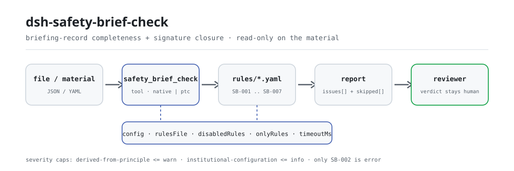

<div align="center">

<picture>
  <source media="(prefers-color-scheme: dark)" srcset="docs/assets/dsh-safety-brief-check-flow-dark.svg">
  
</picture>

# dsh-safety-brief-check

**Verifica um registo de instrução técnica de segurança e recebe a lista exata de que regra, que coluna, o que difere e como corrigir — o veredito fica com o revisor.**

Um plugin verificador de registos de instrução para o DeepSeek Harness: lê um registo (cabeçalho, listas de 被交底人 e de 签字, lista de 工种), aplica o pacote de regras versionado que traz consigo (`SB-001`..`SB-007`) e apenas lista as diferenças que consegue apontar dentro do material — nunca um veredito de conformidade, nunca uma atribuição de responsabilidade.

[Instalar](#instalação-em-três-passos) · [Configuração](#configuração) · [FAQ](#faq) · [简体中文](README.md) · [English](README.en.md) · [Español](README.es.md) · [Português](README.pt.md) · [हिन्दी](README.hi.md)

[](LICENSE)
[](#compatibilidade)
[](https://www.npmjs.com/package/dsh-safety-brief-check)
[](https://github.com/PerryLink/dsh-safety-brief-check/actions/workflows/ci.yml)
[](#compatibilidade)

[](https://github.com/PerryLink/dsh-safety-brief-check/stargazers)
[](https://www.npmjs.com/package/dsh-safety-brief-check)
[](https://dshfind.com/plugins/PerryLink/dsh-safety-brief-check?ref=badge)
[](https://securityscorecards.dev/viewer/?uri=github.com/PerryLink/dsh-safety-brief-check)
[](https://dsh.market/)
[](https://gitee.com/perrylink/dsh-safety-brief-check)

```sh
dsh plugin --profile <name> add dsh-safety-brief-check
```

</div>

<sub>Plugin da comunidade, sem afiliação com a DeepSeek. Repositório canónico: <https://github.com/PerryLink/dsh-safety-brief-check> (o Gitee é um espelho).</sub>

## O que é

`dsh-safety-brief-check` lê um **registo de instrução técnica de segurança** (安全技术交底记录) —os seus campos de cabeçalho, as suas listas de 被交底人 e de 签字, e a sua lista de 工种— e verifica a completude e o fecho desse próprio registo: se estão preenchidas as colunas que o seu formulário exige, se cada pessoa instruída consta dos signatários e ninguém assina duas vezes, se a 交底日期 não é posterior à 施工日期, se os ofícios que executam o trabalho constam da lista de 工种 instruídos, se o registo identifica o seu 工程部位 e o seu 交底人, se reserva um lugar para as assinaturas do 交底人, do 被交底人 e do 专职安全员, e se o conteúdo da instrução aborda fatores de perigo, procedimentos de operação e medidas de emergência.

Não decide se o conteúdo da instrução foi suficiente, se visou os perigos certos, se uma assinatura é da própria pessoa ou se cabe uma sanção.

- **Para quem**: responsáveis de segurança, encarregados de obra e gestores documentais; não é preciso saber usar a linha de comandos — entregue o material no chat.
- **O que entrega**: o material de origem sobre o qual a verificação trabalha (uma tabela, um registo ou um documento); o original nunca é modificado. O Excel pode ser convertido antes para JSON/YAML, no chat se a plataforma o permitir.
- **O que recebe**: uma lista de «que regra, que coluna, o que difere e como corrigir»; cada verificação que não pôde ser executada é enumerada em `skipped` com o motivo.

## Instalação em três passos

1. **Instalar** (escolha um canal):

   ```sh
   # canal git (último main; equivale a git+https://github.com/PerryLink/dsh-safety-brief-check.git)
   dsh plugin --profile <name> add github:PerryLink/dsh-safety-brief-check
   # canal npm (versões publicadas)
   dsh plugin --profile <name> add dsh-safety-brief-check
   # canal tarball: após pnpm pack neste repositório
   dsh plugin --profile <name> add ./dsh-safety-brief-check-<version>.tgz
   ```

   O canal git executa `prepare` (tsdown) e constrói `lib/` no momento; o canal npm já traz os artefactos construídos — para o canal tarball, confirme antes que `pnpm run build` produziu `lib/`.

2. **Configuração mínima** (os valores por omissão servem; sem bloco `config` na linha do bundle todas as chaves usam o valor por omissão e o caminho do pacote de regras aponta para `rules/safety-brief-check.yaml`, incluído no pacote):

   ```yaml
   - insert:
       - id: dsh-safety-brief-check
         name: dsh-safety-brief-check
   ```

3. **Confirmar que monta**:

   ```sh
   dsh --profile <name> --dump-config | grep 'dsh-safety-brief-check'
   ```

   Depois entregue um registo, por exemplo o exemplo incluído no repositório (coincide com `samples/quickstart/expected/result.json`):

   ```text
   > Executa esta verificação com o exemplo incluído e diz-me quantos problemas encontra e de que nível.
   safety_brief_check: 2 issue(s) — error 0, warn 2, info 0
   skipped: 5
   ```

**Desinstalar**: `dsh plugin --profile <name> remove dsh-safety-brief-check` (ou retire a linha do patch do perfil).

<details>
<summary>Usar a partir do WorkBuddy / Coze</summary>

Procure «安全合规核对包» (Safety Compliance Suite) no WorkBuddy / Coze —o conjunto de que esta verificação faz parte; disponibilidade conforme a loja— para aceder à mesma capacidade sem linha de comandos.

</details>

<details>
<summary>Instalar a partir do mercado do DSH Desktop</summary>

Todos os plugins PerryLink estão no mercado integrado do DSH Desktop: **Mercado → Fontes → Adicionar fonte → colar** `https://perrylink-dsh-catalog.perrylink.workers.dev/catalog-source.json` **→ selecionar**. A instalação continua a exigir a verificação de identidade npm do mercado e a sua confirmação.

</details>

## Capacidades principais

`dsh-safety-brief-check` regista a ferramenta `safety_brief_check`: lê um registo de instrução, aplica o pacote de regras versionado e devolve um relatório.

- **Sete regras num pacote** — o pacote de regras é dado, não código (`rules/safety-brief-check.yaml`); substituí-lo substitui todo o conjunto de regras sem tocar numa linha de TypeScript. Os ids vão de `SB-001` a `SB-007`.
- **Só leitura do material** — aceita JSON ou YAML e nunca modifica o original; ESM puro, sem pedidos de rede nem chamadas ao modelo.
- **Sem citações inventadas** — cada regra leva `document` / `number` / `clause` / `excerpt` / `kind` / `source`, e `excerpt` tem de ser uma citação literal; quando o texto não foi obtido, o pacote di-lo em vez de apresentar uma paráfrase como citação.
- **A gravidade segue a evidência** — `derived-from-principle` tem teto `warn`, a configuração institucional (`institutional-configuration`) teto `info`, e um teste verifica-o.
- **Uma lista vazia não é uma aprovação** — cada verificação que não pôde ser executada é enumerada em `skipped` com o motivo; uma regra cuja lista obrigatória está por configurar declara-se em `skipped` em vez de passar em silêncio.
- **Sem linguagem que adjudique** — o relatório apenas lista diferenças e nunca se pronuncia sobre conformidade, responsabilidade ou correção; um guarda de redação (`src/shared/wording.ts`) impõe-no e todo o relatório leva a declaração de exoneração.

| Regra | O que verifica | Gravidade | Base |
|---|---|---|---|
| `SB-001` | o registo preenche as colunas que o seu formulário exige (por configurar de fábrica) | info | GB 50870-2013 第8.2.3条 |
| `SB-002` | cada pessoa instruída consta dos signatários e ninguém assina duas vezes | **error** | 国务院令第393号 第二十七条 |
| `SB-003` | a 交底日期 não é posterior à 施工日期 | warn | 第二十七条 (derivada) |
| `SB-004` | os 工种 instruídos cobrem os 工种 que executam o trabalho | warn | JGJ 59-2011 第3.1.3条第3款第2）项 |
| `SB-005` | o registo identifica o seu 工程部位 e o seu 交底人 | warn | GB 50870-2013 第8.2.1条 |
| `SB-006` | o registo reserva lugar para as três assinaturas | warn | JGJ 59-2011 第3.1.3条第3款第4）项 |
| `SB-007` | o conteúdo da instrução aborda perigo, procedimentos e emergência | warn | GB 50870-2013 第8.2.3条 |

### Exemplos

Estes são os pontos de entrada reais do plugin; instale uma vez e chame um. A primeira linha é o caso detalhado e as restantes são casos curtos.

A saída abaixo é a execução real do plugin sobre o seu próprio fixture de teste `SB-002`, não uma simulação; o pacote de regras também não inventa citações: cada achado nomeia a cláusula em que se apoia e se o seu `excerpt` é uma citação literal ou uma inferência de princípio.

**Exemplo detalhado** — ferramenta `safety_brief_check`, entrada:

```json
{"被交底人":"李四、王五、赵六","签字":"李四、王五"}
```

Saída:

```json
{
  "id": "dsh-safety-brief-check.SB-002.029bddbd",
  "ruleId": "SB-002",
  "severity": "error",
  "locator": {
    "row": 0,
    "column": "被交底人"
  },
  "found": "被交底人「赵六」在签字列表中未出现",
  "expected": "被交底人应当在交底记录上签字确认",
  "fix": "核对是否漏签；本条只比对名单，不判断签字是否为本人所签"
}
```

*Observado em `dsh-safety-brief-check/tests/fixtures/SB-002/SB-002-unsafe.json`*

| Você pergunta | O que ele responde |
|---|---|
| Uma das pessoas instruídas nunca assinou. O que diz o relatório? | `SB-002` —a única regra de nível `error` do pacote— compara a lista de 被交底人 com a lista de 签字 e reporta cada pessoa que não aparece nela; um nome que aparece duas vezes na lista de assinaturas é reportado em separado, porque as duas falhas se corrigem de maneira diferente. Compara apenas as duas listas: não consegue saber se uma assinatura é da própria pessoa e não exige assinatura individual — se a sua instituição admite uma assinatura coletiva, indique-o no material ou inclua a regra em `disabledRules`. |
| A 交底日期 é posterior à 施工日期. É um erro? | `SB-003` reporta-o, e o mesmo dia conta como não posterior. A regra está limitada a `warn`: 第二十七条 dá 施工前 como premissa temporal mas não enuncia essa comparação, pelo que o achado é uma pista para revisão — uma instrução acrescentada a meio da obra por um perigo detetado mais tarde é legitimamente posterior e o registo deve dizê-lo. Uma data que não se consegue analisar é reportada por si, em vez de ser omitida em silêncio. |
| Que colunas tem o registo de preencher para passar a verificação? | `SB-001` lê `requiredFields`, que o pacote traz vazio, pelo que reporta `skipped` (por configurar) em vez de passar. Quando indicar as colunas do seu formulário, reporta cada uma que falte ou esteja vazia — uma cadeia vazia conta como não preenchida — e não julga se o que nelas está escrito é correto. |
| O registo tem coluna de 被交底人 mas nenhum lugar para o 专职安全员. | `SB-006` verifica no cabeçalho se há um lugar para as três partes — 交底人, 被交底人 e 专职安全员 — e reporta as que não têm coluna; os nomes das colunas podem ser substituídos conforme o seu formulário. Mantém-se em `warn` porque o 第3.1.3条 da JGJ 59-2011 é uma cláusula recomendatória de avaliação (as suas únicas disposições obrigatórias, 第4.0.1、5.0.3条, foram revogadas pelo 住房和城乡建设部公告 2022 年第 164 号). Pergunta se o lugar existe, não se alguém ali assinou: essa é a pergunta do `SB-002`. |
| Os ofícios que trabalharam nessa parte não constam da lista de 工种 da instrução. | `SB-004` compara os ofícios que executam o trabalho com a lista de 工种 do registo e reporta os que não aparecem. Está limitada a `warn` porque a JGJ 59-2011 pede instruções 分部分项 mas não fixa nenhuma tabela obrigatória de correspondência com ofícios, e reporta `skipped` quando nem o material nem o parâmetro `workTrades` nomeiam os ofícios que trabalham, pois não codifica nenhuma lista de ofícios. Compara apenas nomes, pelo que 钢筋工 e 钢筋班组 contam como diferentes, e não julga se o conteúdo da instrução aborda esse ofício. |

### Parâmetros da ferramenta

| Parâmetro | Tipo | Significado |
|---|---|---|
| `file` | string | caminho absoluto do ficheiro de material (JSON ou YAML); use `file` ou `material` |
| `material` | string | texto do material em linha; use `file` ou `material` |
| `rulesFile` | string | substitui o caminho configurado do pacote de regras (relativo à raiz do pacote ou absoluto) |
| `only` | string[] | executar apenas estas regras; vazio executa todas |

## Normas que segue

| Documento | Número | Regras que o citam |
|---|---|---|
| 《建筑施工安全技术统一规范》 | GB 50870-2013 | SB-001, SB-002, SB-005, SB-007 |
| 《建筑施工安全检查标准》 | JGJ 59-2011 | SB-001, SB-002, SB-004, SB-006, SB-007 |
| 《建设工程安全生产管理条例》 | 国务院令第393号 | SB-002, SB-003 |

Os títulos canónicos em chinês e o texto literal das cláusulas estão registados em `rules/evidence/clause-verification.md`.

> ### ⚠️ Uma `error`, e duas disposições obrigatórias revogadas que o pacote se recusa a usar mal
>
> **`SB-002` é a única regra de nível `error`** e assenta num regulamento administrativo: o 第二十七条 de 《建设工程安全生产管理条例》 exige que a instrução seja dada «e confirmada com a assinatura de ambas as partes», com o 第六十四条第（一）项 como sanção. Tudo o resto está limitado a `warn` ou `info`.
>
> O pacote regista duas correções que um leitor, de outro modo, faria mal:
>
> **1. O 第3.1.3条 da JGJ 59-2011 —a cláusula mais próxima deste plugin— é uma cláusula *recomendatória* de avaliação.** As únicas disposições obrigatórias da norma eram 4.0.1 e 5.0.3, e **ambas foram revogadas** pelo 住房和城乡建设部公告 2022 年第 164 号 (em vigor desde 2023-06-01). Por isso `SB-006` (assinaturas das três partes) é `warn`, e a sua `note` explica porquê.
>
> **2. O 第10.0.6条 da GB 50656-2011 perdeu o carácter obrigatório pelo mesmo anúncio, e a sua redação sobre a instrução antes do turno está nas notas explicativas, não numa cláusula.** Por isso este pacote **não cita essa norma de todo** — um teste verifica que o número nunca aparece.
>
> **A lei nacional não regula as reuniões antes do turno.** A 《安全生产法》, com 119 artigos, não contém a expressão 「班前」; nem a lei, nem um regulamento administrativo, nem uma norma departamental, nem uma norma nacional a abordam. Existem documentos provinciais (por exemplo, um guia provincial de «reunião matinal» antes do turno), mas são **locais, não nacionais** — por isso qualquer verificação antes do turno é entregue por configurar e o pacote di-lo.
>
> Limites declarados: a verificação de assinaturas **compara apenas listas de nomes** e não consegue saber se uma assinatura é da própria pessoa; a verificação de conteúdo é um **teste de ocorrência literal de palavras** e não consegue saber se uma instrução foi boa — a própria tabela de pontuação da JGJ 59-2011 desconta pontos quando o conteúdo não é dirigido, um juízo que nenhuma operação de cadeias consegue fazer.

## Configuração

Todos os parâmetros ajustáveis são campos Schemastery `Config` em `src/config.ts` (alteráveis a partir do cordis.yml); os limites por regra estão no pacote de regras em `rules/`. Uma substituição dirigida por id substitui a linha inteira — repita todas as chaves de que precisa.

| Chave | Tipo | Padrão | Descrição |
|---|---|---|---|
| `rulesFile` | string | `rules/safety-brief-check.yaml` | caminho do pacote de regras, relativo à raiz do pacote; um caminho relativo é resolvido primeiro pelos diretórios antecessores do módulo e só depois contra o diretório de trabalho, e uma falha lança um erro que enumera todas as localizações tentadas |
| `disabledRules` | string[] | `[]` | ids de regras a desativar; cada uma aparece em `skipped` |
| `onlyRules` | string[] | `[]` | executar apenas estas regras; vazio executa todas |
| `skipNotes` | string | `""` | nota acrescentada a cada motivo de `skipped`, por exemplo para citar as regras de aplicação da sua instituição |
| `timeoutMs` | number | `120000` | orçamento de tempo limite cooperativo da ferramenta, em milissegundos |

Parâmetros ao nível da regra que vale a pena conhecer (ficam no ficheiro do pacote de regras em `rules/`, não na Config acima):

- `SB-001` `requiredFields` — as colunas que o registo deve levar, por exemplo as do cabeçalho do seu formulário. Vazio significa que a regra não corre.
- `SB-004` `requireTradeMatch` — coloque em `false` para deixar de comparar os 工种 instruídos com os 工种 do trabalho.
- `SB-005` `requireHeader` — coloque em `false` se o seu registo legitimamente não tiver cabeçalho.
- `SB-006` `parties` — as partes assinantes que a norma nomeia: 交底人, 被交底人 e 专职安全员.
- `SB-007` `terms` / `contentColumns` — as palavras que o conteúdo da instrução deveria tocar e as colunas de onde as ler. `terms` vazio significa que a regra não corre.

<details>
<summary>Detalhe das chaves e exemplo de substituição no patch do perfil</summary>

- Ordem de resolução de `rulesFile`: caminho absoluto, depois cada diretório antecessor do módulo, depois o diretório de trabalho do processo; se nada for encontrado, a ferramenta lança um erro e a mensagem enumera as localizações tentadas. **Nunca recorre em silêncio a outro pacote de regras** — isso produziria um relatório apoiado na base errada.
- Cada id de `disabledRules` acaba em `skipped` com o motivo «desativada na configuração atual», e `skipNotes` é acrescentado a seguir.
- Quando `onlyRules` e o argumento `only` da ferramenta são dados em conjunto, o argumento ganha; as regras excluídas dessa chamada também acabam em `skipped` com o motivo.
- `skipNotes` só altera a redação de `skipped`; não altera nenhum veredito.

```yaml
- insert:
    - id: dsh-safety-brief-check
      name: dsh-safety-brief-check
      config:
        disabledRules: [SB-007]
        skipNotes: regras de aplicação da instituição, artigo 4
        timeoutMs: 180000
```

</details>

## Formato do material

A ferramenta aceita JSON ou YAML. Um registo é um mapeamento plano; as listas de nomes e de 工种 podem ser um arranjo ou uma cadeia delimitada:

```yaml
工程名称: 某某厂房工程
交底部位: 二层结构
交底日期: 2026-03-10
施工日期: 2026-03-12
交底人: 张工
被交底人: 李四、王五、赵六
签字: 李四、王五、赵六
工种: 钢筋工、木工
```

```yaml
被交底人: [李四, 王五]      # a forma de arranjo também funciona
签字: 李四，王五；          # e a pontuação chinesa separa da mesma forma
```

Os nomes das colunas são reconhecidos pela tabela de alias de campos (`COLUMNS` em `src/model.ts`), pelo que se aceitam nomes de coluna em inglês e em chinês. Os nomes são comparados sem espaços em branco, pelo que um nome escrito com espaço é a mesma pessoa que sem ele. Uma assinatura em falta e uma assinatura repetida produzem achados **diferentes**, porque exigem correções diferentes. Uma data ilegível é reportada como ilegível em vez de omitida, pelo que uma célula mal formatada nunca consegue esconder a verificação cronológica. Os campos são opcionais na camada de leitura e validados pelo motor, pelo que uma exportação parcial produz achados de «falta um elemento» em vez de uma falha.

## Fontes das regras

Os dados das regras ficam em `rules/safety-brief-check.yaml`, separados do código: cada regra leva documento, número, cláusula na numeração própria da fonte, trecho literal e URL de origem. O carregador impõe que o trecho seja citação real de pelo menos oito caracteres e que uma verificação baseada apenas em princípio geral ou em política local nunca seja declarada `error`. Um pacote que exagere a sua base falha ao carregar em vez de produzir um relatório com aparência segura.

As cláusulas citadas vêm de:

- **《建设工程安全生产管理条例》** (国务院令第393号, em vigor desde 2004-02-01, sem alterações) — 第二十七条 e 第六十四条第（一）项
- **《建筑施工安全检查标准》** (JGJ 59-2011) — 第3.1.3条第3款第2）3）4）项 e a entrada de pontuação do apêndice B
- **《建筑施工安全技术统一规范》** (GB 50870-2013) — 第8.2.1条, 第8.2.3条 e 第8.2.4条

Duas correções deram forma a este pacote e estão registadas no seu cabeçalho:

1. **A cláusula da norma setorial é recomendatória.** As disposições obrigatórias da JGJ 59-2011 eram 4.0.1 e 5.0.3, e ambas foram revogadas pelo 住建部公告 2022 年第 164 号; por isso as regras que citam 3.1.3 são `warn`.
2. **O 第10.0.6条 da GB 50656-2011 perdeu o carácter obrigatório pelo mesmo anúncio**, e a sua redação antes do turno está nas notas explicativas e não numa cláusula — por isso o pacote não cita essa norma de todo.

O relatório completo de verificação de cláusulas, incluindo as fontes verificadas e rejeitadas, viaja em `rules/evidence/clause-verification.md`; `pnpm run check:citations` compara cada trecho do pacote com esse registo segmento a segmento, e `rules/citations-baseline.json` só pode encolher.

## FAQ

<details>
<summary>O material é enviado? Onde ficam o relatório e os dados?</summary>

Não. É uma verificação puramente local: lê o material que é entregue à ferramenta, não faz pedidos de rede, não inclui telemetria, analítica nem relatórios em segundo plano, e não escreve nada fora do resultado da ferramenta e do armazenamento de sessões e registos do próprio host do DSH. Esse armazenamento é controlado pelo host e conservado segundo a sua política; este pacote não acrescenta uma segunda cópia. Desinstalar o pacote remove o seu código; não apaga os registos de sessão do host nem os documentos que já criou.

</details>

<details>
<summary>Uma lista `issues` vazia pode ler-se como «este registo está bem»?</summary>

Não. Cada verificação que não pôde ser executada é enumerada em `skipped` com o motivo (uma lista de campos obrigatórios vazia, nenhum 工种 de trabalho no material, uma coluna de conteúdo da instrução em falta). Leia os achados e `skipped` em conjunto; `skipped` significa «não verificado», não «aprovado».

</details>

<details>
<summary>Vai dar-nos um veredito de conformidade?</summary>

Não. Apenas lista as diferenças que consegue apontar dentro do material (que regra, que coluna, o que difere, como corrigir); não decide factos nem avalia conformidade — a conclusão é sempre do revisor. A redação do relatório é limitada pelo guarda de redação (`src/shared/wording.ts`), e todo o relatório leva a `DISCLAIMER`.

</details>

<details>
<summary>Compete com outros plugins por nomes de ferramenta, chaves de serviço ou slots de interface?</summary>

Não. Apenas faz `inject: ['tools']`, regista uma única ferramenta com espaço de nomes `safety_brief_check`, não fornece nenhuma chave de serviço, não regista slot de cliente nem prefixo `webServer`, não escuta nenhum evento do host e não altera nenhum global; o patch do bundle apenas `insert` a sua própria linha. O argumento ponto por ponto está em «Interoperabilidade com outros plugins DSH».

</details>

<details>
<summary>Aguenta um lote inteiro de registos de instrução?</summary>

Sim. A verificação é comparação de colunas e aritmética de datas, tudo local: sem pedidos de rede nem chamadas ao modelo; e o pacote de regras é analisado uma única vez por processo e fica em cache, pelo que chamadas repetidas não voltam a ler o disco. A ferramenta corre em `native` e em `ptc`; para um lote de registos use `ptc` (o custo do esquema paga-se uma vez). `timeoutMs` (120 segundos por omissão) é um orçamento de tempo limite cooperativo.

</details>

## Limites de segurança

Este plugin verifica um **registo de instrução técnica de segurança** pelo que a um registo se pode exigir — que estejam preenchidas as colunas que o seu formulário exige, que **cada pessoa instruída conste como tendo assinado**, que a instrução esteja datada não depois do trabalho, que os 工种 instruídos cubram os 工种 que executam o trabalho e que o registo identifique o seu 工程部位 e o seu 交底人. **Não** julga se o conteúdo da instrução foi adequado, se visou os perigos certos ou se uma assinatura é autêntica.

- **Só leitura.** O material é lido e nunca reescrito; não existe nenhum caminho de escrita.
- **Offline.** Sem pedidos de rede, sem credenciais guardadas, sem chamadas ao modelo; nada é escrito fora do resultado da ferramenta (salvo o armazenamento de sessões e registos do próprio host).
- **Um pacote de regras ausente falha em voz alta.** Quando `resolvePackageFile` não encontra o pacote de regras, lança um erro e enumera as localizações tentadas; nunca recorre em silêncio a outro pacote — uma base errada é pior do que nenhuma verificação.
- **Uma lista vazia não é uma aprovação.** Cada verificação que não pôde ser executada acaba em `skipped` com o motivo; uma regra cuja lista obrigatória está por configurar declara-se em `skipped`.
- **Sem adjudicação.** O relatório apenas lista diferenças e nunca se pronuncia sobre conformidade, responsabilidade ou correção; o guarda de redação (`src/shared/wording.ts`) proíbe linguagem adjudicativa e todo o relatório leva a `DISCLAIMER`.

## Limitações conhecidas

- **Apenas listas de nomes.** A verificação de assinaturas compara duas listas de nomes: não consegue saber se uma assinatura é da própria pessoa e não exige assinatura individual — a JGJ 59-2011 e a GB 50870-2013 pedem que «ambas as partes» ou «as três partes» confirmem com assinatura, e a lei nacional nada diz sobre assinatura individual. Quando a sua instituição admitir uma assinatura coletiva, indique-o no material ou desative `SB-002`.
- **Apenas ocorrência literal.** `SB-007` verifica se as três palavras perigo, procedimentos de operação e medidas de emergência aparecem no conteúdo da instrução; aparecer não é o mesmo que estar tratado, e o apêndice B da JGJ 59-2011 desconta 3 a 5 pontos quando o conteúdo não é dirigido — um juízo que é inerentemente do inspetor e que nenhuma operação de cadeias consegue fazer.
- **Duas regras são entregues por configurar.** Os `requiredFields` do `SB-001` e os 工种 de trabalho do `SB-004` estão vazios de fábrica, pelo que ambas reportam `skipped` em vez de passar em silêncio; o pacote não codifica nenhuma lista de colunas nem de 工种, porque ambas variam por instituição e por projeto.
- **Apenas nomes.** O `SB-004` compara nomes de 工种, pelo que 钢筋工 e 钢筋班组 contam como diferentes, e diferenças de escrita causam falsos positivos — mantenha uma redação uniforme no registo.
- **Aritmética de relógio de parede.** Toda a comparação de datas é aritmética de relógio de parede sobre as cadeias de entrada, sem conversão de fuso horário; uma data não analisável é reportada por si em vez de omitida.
- **Uma data de instrução posterior não é uma violação.** O `SB-003` está limitado a `warn`: uma instrução acrescentada a meio da obra por um perigo descoberto mais tarde é legitimamente posterior e o registo deve dizê-lo — exatamente por isso a regra pede revisão humana em vez de declarar um incumprimento.
- **O `SB-006` fica em `warn`.** O 第3.1.3条 da JGJ 59-2011 é uma cláusula recomendatória de avaliação cujas disposições obrigatórias foram revogadas pelo 住房和城乡建设部公告 2022 年第 164 号, pelo que isto é uma pista de norma setorial, não um achado de «disposição obrigatória incumprida».

## Interoperabilidade com outros plugins DSH

Este plugin apenas faz `inject: ['tools']`; para além da superfície da ferramenta não toca nenhuma capacidade do host:

- **Sem colisão de nomes de ferramenta.** Regista uma única ferramenta com espaço de nomes, `safety_brief_check`; não ocupa nenhum nome nu de uma ferramenta incluída nem de outro plugin.
- **Sem colisão de chaves de serviço.** Não fornece nenhuma chave de serviço, pelo que não pode colidir numa.
- **Sem colisão de slots.** Não regista nenhuma chave de slot de cliente (este pacote não tem metade de navegador).
- **Sem colisão de rotas HTTP.** Não regista nenhum prefixo `webServer`.
- **Sem escutas de eventos.** Não regista nenhum ouvinte em eventos sensíveis à ordem como `agent/pre-step` ou `tools/post-execute`, pelo que não entra em nenhuma cadeia nem a pode curto-circuitar.
- **Sem colisão de camada de patch.** O patch do bundle (`cordis.patch.yml`) apenas `insert` a sua própria linha; nunca sobrepõe o `config` de uma linha incluída.
- **Sem mutação global.** Não remenda protótipos, não reescreve `process.env` nem substitui o despachante global de fetch.

## Compatibilidade

| Superfície | Estado |
|---|---|
| Harness | Faixa de peers `>=0.1.2-rc.1 <0.2.0 \|\| >=0.2.0-0 <0.3.0` — verificada para aceitar tanto `0.2.0-rc.2` quanto `0.2.1-rc.2`. `engines.dsh` é declarado como `>=0.2.1-0 <0.3.0` e o host aplica-o desde 0.2.1 |
| Node | `^22.19.0 \|\| >=24.0.0` |
| Plataformas | Todas (ESM puro; sem código nativo, sem rede, sem chamada ao modelo) |
| Modo de ferramenta | Funciona em `native` e `ptc`; para um lote de registos use `ptc` |

## Resolução de problemas

- **O `SB-001` reporta-se como omitido.** A sua lista de colunas está vazia. Preencha as colunas que o seu formulário usa.
- **O `SB-004` não reporta nada.** Nem o material nem a chamada forneceram a lista de 工种 que executam o trabalho. Passe `workTrades` ou aceite que esta comparação não está a ser feita.
- **O `SB-002` assinala alguém que assinou.** As duas colunas podem escrever o nome de forma diferente (um espaço, um carácter diferente). A comparação remove os espaços mas, de resto, é exata.
- **O `SB-003` dispara num registo correto.** Se a instrução veio depois do trabalho — um perigo descoberto a meio da obra —, a nota do pacote diz que é legítimo e deve ser explicado no registo. O achado é um convite a verificar, nunca uma determinação.
- **O plugin instala-se mas a ferramenta não aparece.** Confirme que `main` resolve para `lib/index.mjs` e que `pnpm run build` o gerou; um `main` errado faz o carregador ignorar a entrada em silêncio.
- **O `dsh plugin add` recusa o pacote por incompatibilidade.** A faixa de peers cobre `0.1.x` e `0.2.x`; se o seu runtime ficar fora dela, conceda isenção explícita: `dsh plugin --profile <name> allow-version dsh-safety-brief-check@0.1.0 --dsh-version <runtime> --accept-risk`
- **O `check` reporta `manifest-peers` como falha.** O verificador estático compara com uma faixa de peers fixa anterior à linha 0.2. O runtime aplica a compatibilidade de peers na instalação, pelo que a faixa declarada é a correta; é um problema conhecido do `dsh-plugin-dev`.
- **Uma regra não correu.** Leia o arranjo `skipped`: indica o id da regra e o motivo.
- **As horas parecem deslocadas.** Toda a aritmética é de relógio de parede sobre as cadeias que forneceu; não há conversão de fuso horário.

## Ecossistema e qualidade

- [Espelho no Gitee](https://gitee.com/perrylink/dsh-safety-brief-check) (espelho sincronizado; o GitHub é o canónico)
- [Página do plugin no dshfind](https://dshfind.com/plugins/PerryLink/dsh-safety-brief-check) (instalações e classificação)
- [Relatório OpenSSF Scorecard](https://securityscorecards.dev/viewer/?uri=github.com/PerryLink/dsh-safety-brief-check) (impulsionado por [.github/workflows/scorecard.yml](.github/workflows/scorecard.yml))
- [DSH Market](https://dsh.market/) (publicado)
- [Escolher um verificador pelo material](https://perrylink.github.io/zh/checkers/choose/) (índice da família: que verificador serve que material)

## Desenvolvimento

```sh
pnpm install                                        # node ^22.19 || >=24
pnpm run typecheck                                  # tsc --noEmit
pnpm test                                           # vitest: suite partilhada de plugins de tabela + fixtures emparelhados (37 casos)
pnpm run build                                      # tsdown -> lib/index.mjs + lib/index.d.mts
pnpm run verify:self-contained                      # as especificações de dependências resolvem do registry
pnpm run check:lockfile                             # verificação de deriva do lockfile
pnpm run check:readmes                              # consistência dos README em cinco línguas
pnpm run check:citations                            # linha de base de citações do pacote de regras
node ../scripts/sync-shared.mjs dsh-safety-brief-check   # refrescar src/shared a partir de ../_shared
pnpm pack                                           # o tarball publicado
```

Este plugin é **guiado por dados**: `src/model.ts` declara a forma do registo, o kit partilhado fornece o leitor e o motor de verificação, e o pacote de regras declara cada verificação. Execute o exemplo incluído localmente (construa primeiro `lib/`):

```sh
node samples/quickstart/run.mjs --json
# => {"tool":"safety_brief_check","issueCount":2,"summary":{"error":0,"warn":2,"info":0},"skippedCount":5}
```

A entrada do exemplo está em `samples/quickstart/input/`, a saída esperada em `samples/quickstart/expected/result.json` e a captura em `docs/assets/quickstart.png`. As imagens do README são geradas por programa, [`scripts/gen-readme-assets.py`](scripts/gen-readme-assets.py) (Python + Pillow), e podem ser executadas de novo sem risco; o diagrama de fluxo de uma só versão, o hero e a demo antigos ficam em `docs/assets/` para ligações externas, e os README só referenciam o novo par claro/escuro.

Topics: `deepseek-harness`, `dsh`, `dsh-plugin`, `cordis`, `safety`, `brief`

## Família e agradecimentos

Este projeto faz parte da família de plugins DeepSeek Harness da [PerryLink](https://github.com/PerryLink) (todos Apache-2.0). O índice completo da família é [escolher um verificador pelo material](https://perrylink.github.io/zh/checkers/choose/). Se lhe for útil, **uma estrela ajuda a próxima pessoa a encontrá-lo** — nada fica bloqueado por isso.

- [@PerryLink](https://github.com/PerryLink) — criador e mantenedor: o pacote de regras só de dados (SB-001..SB-007), a ferramenta `safety_brief_check`, o registo de verificação de cláusulas e a documentação em cinco línguas.

<details>
<summary>Ver todos os plugins</summary>

| Plugin | Estado |
|---|---|
| **[dsh-aqua-input-check](https://github.com/PerryLink/dsh-aqua-input-check)** |  |
| **[dsh-archive-check](https://github.com/PerryLink/dsh-archive-check)** |  |
| **[dsh-auto-review](https://github.com/PerryLink/dsh-auto-review)** |  |
| **[dsh-autotier](https://github.com/PerryLink/dsh-autotier)** | 🧊 CONGELADO — ver o README do repo |
| **[dsh-bid-ca-precheck](https://github.com/PerryLink/dsh-bid-ca-precheck)** |  |
| **[dsh-bid-qual-check](https://github.com/PerryLink/dsh-bid-qual-check)** |  |
| **[dsh-cert-mcp](https://github.com/PerryLink/dsh-cert-mcp)** | 🧊 CONGELADO — ver o README do repo |
| **[dsh-checkpoint-rewind](https://github.com/PerryLink/dsh-checkpoint-rewind)** |  |
| **[dsh-click](https://github.com/PerryLink/dsh-click)** |  |
| **[dsh-composer-history](https://github.com/PerryLink/dsh-composer-history)** |  |
| **[dsh-contract-stance](https://github.com/PerryLink/dsh-contract-stance)** |  |
| **[dsh-customs-doc-check](https://github.com/PerryLink/dsh-customs-doc-check)** |  |
| **[dsh-data-quality](https://github.com/PerryLink/dsh-data-quality)** | 🧊 CONGELADO — ver o README do repo |
| **[dsh-demurrage-ledger](https://github.com/PerryLink/dsh-demurrage-ledger)** |  |
| **[dsh-doublecheck](https://github.com/PerryLink/dsh-doublecheck)** |  |
| **[dsh-drill-script-check](https://github.com/PerryLink/dsh-drill-script-check)** |  |
| **[dsh-eia-guide-check](https://github.com/PerryLink/dsh-eia-guide-check)** |  |
| **[dsh-emergency-plan](https://github.com/PerryLink/dsh-emergency-plan)** |  |
| **[dsh-essay-rubric-check](https://github.com/PerryLink/dsh-essay-rubric-check)** |  |
| **[dsh-evidence-check](https://github.com/PerryLink/dsh-evidence-check)** |  |
| **[dsh-export-ctl-check](https://github.com/PerryLink/dsh-export-ctl-check)** |  |
| **[dsh-fast](https://github.com/PerryLink/dsh-fast)** |  |
| **[dsh-fmea-table-check](https://github.com/PerryLink/dsh-fmea-table-check)** |  |
| **[dsh-forecast-penalty](https://github.com/PerryLink/dsh-forecast-penalty)** |  |
| **[dsh-fund-research](https://github.com/PerryLink/dsh-fund-research)** |  |
| **[dsh-github](https://github.com/PerryLink/dsh-github)** |  |
| **[dsh-gongwen-flow-check](https://github.com/PerryLink/dsh-gongwen-flow-check)** |  |
| **[dsh-gongwen-word-check](https://github.com/PerryLink/dsh-gongwen-word-check)** |  |
| **[dsh-guard-plan-qc](https://github.com/PerryLink/dsh-guard-plan-qc)** |  |
| **[dsh-hazchem-check](https://github.com/PerryLink/dsh-hazchem-check)** |  |
| **[dsh-hazplan-check](https://github.com/PerryLink/dsh-hazplan-check)** |  |
| **[dsh-hidden-risk-map](https://github.com/PerryLink/dsh-hidden-risk-map)** |  |
| **[dsh-hs-classify](https://github.com/PerryLink/dsh-hs-classify)** |  |
| **[dsh-icd-rule-check](https://github.com/PerryLink/dsh-icd-rule-check)** |  |
| **[dsh-industry-research](https://github.com/PerryLink/dsh-industry-research)** |  |
| **[dsh-lawcite-adapter](https://github.com/PerryLink/dsh-lawcite-adapter)** |  |
| **[dsh-laya](https://github.com/PerryLink/dsh-laya)** |  |
| **[dsh-lc-doc-check](https://github.com/PerryLink/dsh-lc-doc-check)** |  |
| **[dsh-learning-gap-check](https://github.com/PerryLink/dsh-learning-gap-check)** |  |
| **[dsh-library](https://github.com/PerryLink/dsh-library)** |  |
| **[dsh-local-ai](https://github.com/PerryLink/dsh-local-ai)** |  |
| **[dsh-lsp-actions](https://github.com/PerryLink/dsh-lsp-actions)** |  |
| **[dsh-mask](https://github.com/PerryLink/dsh-mask)** |  |
| **[dsh-mcp-panel](https://github.com/PerryLink/dsh-mcp-panel)** |  |
| **[dsh-medrec-qc](https://github.com/PerryLink/dsh-medrec-qc)** |  |
| **[dsh-memento](https://github.com/PerryLink/dsh-memento)** | 🧊 CONGELADO — ver o README do repo |
| **[dsh-nsfc-form-check](https://github.com/PerryLink/dsh-nsfc-form-check)** |  |
| **[dsh-nurse-record-check](https://github.com/PerryLink/dsh-nurse-record-check)** |  |
| **[dsh-observe](https://github.com/PerryLink/dsh-observe)** |  |
| **[dsh-origin-rvc-check](https://github.com/PerryLink/dsh-origin-rvc-check)** |  |
| **[dsh-ota-review-check](https://github.com/PerryLink/dsh-ota-review-check)** |  |
| **[dsh-output-styles](https://github.com/PerryLink/dsh-output-styles)** |  |
| **[dsh-paper-doc-adapter](https://github.com/PerryLink/dsh-paper-doc-adapter)** |  |
| **[dsh-permission-rules](https://github.com/PerryLink/dsh-permission-rules)** |  |
| **[dsh-permit-report-check](https://github.com/PerryLink/dsh-permit-report-check)** |  |
| **[dsh-pipeline-check](https://github.com/PerryLink/dsh-pipeline-check)** |  |
| **[dsh-pleading-draft](https://github.com/PerryLink/dsh-pleading-draft)** |  |
| **[dsh-plugin-doctor](https://github.com/PerryLink/dsh-plugin-doctor)** | 🚫 APOSENTADO (repo arquivado) |
| **[dsh-plugin-guide](https://github.com/PerryLink/dsh-plugin-guide)** |  |
| **[dsh-plugin-kit](https://github.com/PerryLink/dsh-plugin-kit)** | 🚫 APOSENTADO (repo arquivado) |
| **[dsh-plugin-upgrade](https://github.com/PerryLink/dsh-plugin-upgrade)** | 🚫 APOSENTADO (repo arquivado) |
| **[dsh-policy-brief-draft](https://github.com/PerryLink/dsh-policy-brief-draft)** |  |
| **[dsh-power-loss-split](https://github.com/PerryLink/dsh-power-loss-split)** |  |
| **[dsh-power-ticket-check](https://github.com/PerryLink/dsh-power-ticket-check)** |  |
| **[dsh-ppap-check](https://github.com/PerryLink/dsh-ppap-check)** |  |
| **[dsh-protest-deadline](https://github.com/PerryLink/dsh-protest-deadline)** |  |
| **[dsh-railway-window](https://github.com/PerryLink/dsh-railway-window)** |  |
| **[dsh-repair-order-qc](https://github.com/PerryLink/dsh-repair-order-qc)** |  |
| **[dsh-research-report](https://github.com/PerryLink/dsh-research-report)** |  |
| **[dsh-review-reply-check](https://github.com/PerryLink/dsh-review-reply-check)** |  |
| **[dsh-rulefile-check](https://github.com/PerryLink/dsh-rulefile-check)** |  |
| **[dsh-safety-brief-check](https://github.com/PerryLink/dsh-safety-brief-check)** |  |
| **[dsh-score](https://github.com/PerryLink/dsh-score)** | 🧊 CONGELADO — ver o README do repo |
| **[dsh-session-sync](https://github.com/PerryLink/dsh-session-sync)** |  |
| **[dsh-site-log-check](https://github.com/PerryLink/dsh-site-log-check)** |  |
| **[dsh-skill-pack-security](https://github.com/PerryLink/dsh-skill-pack-security)** |  |
| **[dsh-soe-decision-check](https://github.com/PerryLink/dsh-soe-decision-check)** |  |
| **[dsh-soilwater-check](https://github.com/PerryLink/dsh-soilwater-check)** |  |
| **[dsh-sop-sync-check](https://github.com/PerryLink/dsh-sop-sync-check)** |  |
| **[dsh-spc-gbt-adapter](https://github.com/PerryLink/dsh-spc-gbt-adapter)** |  |
| **[dsh-talk](https://github.com/PerryLink/dsh-talk)** |  |
| **[dsh-tender-extract](https://github.com/PerryLink/dsh-tender-extract)** |  |
| **[dsh-tender-matrix](https://github.com/PerryLink/dsh-tender-matrix)** |  |
| **[dsh-test-drive](https://github.com/PerryLink/dsh-test-drive)** |  |
| **[dsh-ticktick](https://github.com/PerryLink/dsh-ticktick)** | 🚫 APOSENTADO (repo arquivado) |
| **[dsh-translate](https://github.com/PerryLink/dsh-translate)** |  |
| **[dsh-warranty-calc](https://github.com/PerryLink/dsh-warranty-calc)** |  |
| **[dsh-budget](https://github.com/PerryLink/dsh-budget)** | 🧊 CONGELADO — ver o README do repo |
| **[dsh-claude-move](https://github.com/PerryLink/dsh-claude-move)** | 🧊 CONGELADO — ver o README do repo |
| **[dsh-defend](https://github.com/PerryLink/dsh-defend)** | 🧊 CONGELADO — ver o README do repo |
| **[dsh-draw](https://github.com/PerryLink/dsh-draw)** | 🧊 CONGELADO — ver o README do repo |
| **[dsh-reach](https://github.com/PerryLink/dsh-reach)** | 🧊 CONGELADO — ver o README do repo |
| **[dsh-background-agents](https://github.com/PerryLink/dsh-background-agents)** | 🚫 APOSENTADO (repo arquivado) |
| **[dsh-session-pin](https://github.com/PerryLink/dsh-session-pin)** | 🚫 APOSENTADO (repo arquivado) |
| **[dsh-team-rooms](https://github.com/PerryLink/dsh-team-rooms)** | 🚫 APOSENTADO (repo arquivado) |

</details>

## Licença

[LICENSE](LICENSE) (Apache License 2.0) © 2026 dsh-safety-brief-check contributors

<p align="center"><sub>Apache-2.0 · Plugin da comunidade, sem afiliação com a DeepSeek.</sub></p>
